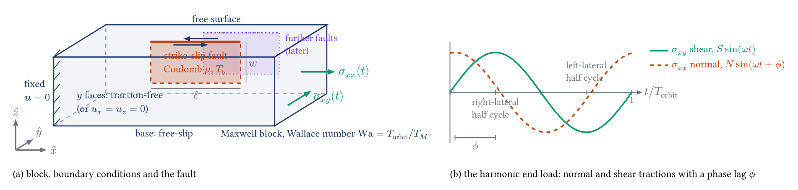

```{note}
Migrated from the wiki page [Box-fault-cyclic-loading](https://github.com/underworldcode/underworld3/wiki/Box-fault-cyclic-loading) on 2026-10-27 as this campaign page's starting text (written 2026-10-17 to 2026-10-18). The dated entries at the foot are the record; this text is trimmed as its content moves into guides, subsystem pages and entries.
```


*Work in progress. Louis Moresi with Mark Simons; computation on hyperion, branch `feature/tidal-shell` (to be renamed), scripts in `scripts/sessions/box_fault_cyclic/`. Each section is revised in place as the work moves; the page is meant to read as a draft paper, not a log.*



*Figure 1. (a) A viscoelastic block with a vertical strike-slip fault that breaks the free surface; one end face is fixed, the other carries a harmonic traction; the sides are traction-free (or held at $u_x = u_z = 0$ if the open box proves too soft); the base is free-slip. Further faults are added later. (b) The end load: a normal traction and a horizontal shear traction, both harmonic at the orbital period, with a phase lag between them.*

## Problem statement

Berne et al. (2024) proposed that the tiger-stripe faults of Enceladus accumulate a net strike-slip offset over each tidal cycle because the fault is clamped differently in the two halves of the cycle, and that this could leave a far-field deformation signature. The thin-shell study ([Tidal faulted shell](Tidal-faulted-shell)) showed the mechanism operates on a sphere: the asymmetry in slip follows the phase of the clamping stress relative to the shear, and a Maxwell shell walks by an amount per orbit that falls as the Maxwell time grows. That model carried the full tidal geometry and the thin-sheet approximation, and the mesh resolved each stripe by eight cells.

The box model isolates the mechanism. A finite, vertical strike-slip fault that reaches the surface (blind under a damage zone in the first build, see Implementation) with Coulomb friction sits in a three-dimensional Maxwell block. One end of the block is held fixed; the other is driven by a traction with a normal component $N\sin(\omega t + \phi)$ and a horizontal shear component $S\sin(\omega t)$, the two-component periodic load that the tide applied at the stripes in the shell. The side faces are left unconstrained (traction-free); if that leaves too much of the box open, they are held at $u_x = u_z = 0$ instead, so material may leave through them but not slide along them. There is no history to transport across them. The base is free-slip; the top is a free surface.

The questions, in order:

1. For an elastic block, how does the net slip per cycle depend on the phase lag $\phi$, the ratio $N/S$, the friction $\mu$ and the overburden $T_b$? Is there a net slip at all, or only a difference in rate between the two half cycles?
2. For a Maxwell block, how does the net slip and the far-field displacement depend on the Wallace number $\mathrm{Wa} = T_\mathrm{orbit}/T_M$, the ratio of the forcing period to the relaxation time (a generalised Deborah number; the clustering control parameter of DiCaprio et al. 2008)?
3. With a second fault added (dotted in Figure 1), does the stress shadow of one modify the net slip of the other?

The geometry follows DiCaprio et al. (2008), who used a block with a single strike-slip fault and a viscoelastic rheology to study the clustering of earthquakes under post-seismic reloading, with the Wallace number as the control parameter.

## Implementation

*This section describes the model as built. It is revised, not appended to, when the implementation changes.*

**Status (2026-10-17, midday): the driver runs in parallel with geometric multigrid, a silent integrator bug found on the way is fixed, the stress-history flavour is settled; no science runs yet.** Branch `feature/tidal-shell` (pushed), scripts `scripts/sessions/box_fault_cyclic/box_fault_cyclic.py` (driver) and `box_fault_plot.py` (figures).

- **Mesh and fault.** A gmsh box with the fault as a conforming interior patch (`BoxInternalPatch`), graded from the fault cell size (0.05) to the far field (0.15), the patch top two fault cells below the surface; the patch is split into coincident node pairs (`split_fault`). The box carries no multigrid tail of its own, so two plain boxes at twice and four times the far-field size are registered as the coarse tail (`set_custom_fmg`, non-nested, barycentric transfers) and the rotated solve takes the custom-P geometric multigrid velocity block. Measured on 8 ranks, 16k cells: 32 velocity and 10 pressure iterations per linear solve, zero normal leak on the fault. A GAMG velocity block is refused by the driver, and the library now warns whenever it falls back to GAMG: the fallback is a symptom of a mesh without its tail, not a configuration.
- **The alternative, adapt-on-top, and why it is not the default.** The designed pipeline (box with one refinement level, adapt toward the fault column, sheet placed by carving a cavity, split) carries its tail automatically, but the cavity reaches about two cell diameters above the sheet top, so a blind fault needs a setback of at least five fine cells (0.20 refused, 0.25 passed at cell size 0.05), and in parallel the placement's gathered region under-reached the grown cavity on this geometry (serial passes). The defect is marked in `place_surface.py`; the route stays an option.
- **Damage band.** A low-viscosity region (ratio 0.01 by default) one fault cell wide either side of the trace, from the fault top to the free surface. The shear modulus is not reduced there.
- **Rheology.** Maxwell (`ViscoElasticPlasticFlowModel`, ETD integrator, no objective rate), shear modulus 1, viscosity De in periods, so the Wallace number is 1/De. De = 0 gives a viscous block. *Bug found and fixed here:* the ETD coefficients took the viscosity as a float, and a viscosity that varies in space (the damage band) made that fail and fall silently to the viscous limit, so the whole block lost its elastic response (first-step end velocity 0.007, the viscous value, against 0.061 with a constant viscosity). The coefficients are now formed symbolically when the Maxwell time is an expression; `tests/test_1093` holds the regression (a uniform-valued expression must match the constant; a weak band must not make the block viscous). Every box run before the fix was effectively viscous.
- **Stress history.** The solver's default history is semi-Lagrangian. On a uniform block all flavours reproduce the exact Maxwell creep benchmark (`tests/test_1094`: ETD-1's first step is the creep rate over $1 - e^{-x}$, then the creep rate, all within 3 %). On the faulted box the semi-Lagrangian and Eulerian flavours disagree by a quarter on the second step's slip rate: the trace-back queries a field that is double-valued across the split, and a point query sees one side only. The displacement per step here is far below a cell, so the history is kept on the grid with no transport at all (`stress_transport = "none"`, added to `Stokes` for this), which is also the cheapest: the semi-Lagrangian history cost about 45 s of the 95 s step.
- **Boundary conditions.** The x = 0 face fixed; on x = Lx the traction (N sin(ωt + φ), S sin(ωt), 0) through two uniform P1 fields updated each step, so the residual is compiled once. The natural-condition value in Underworld3 pushes into the domain when positive (measured: a positive normal value compressed the box), so the traction vector enters negated; N > 0 is tension and the loaded end moves outward. The y faces are traction-free (option: u_x = u_z = 0; there is no periodic box yet); the base has u_z = 0; the top is free.
- **Fault laws.** Regularised Coulomb from the no-opening reaction with a constant overburden (`add_coulomb_fault_bc(mu, sigma_n="reaction", V0, background=T_b)`), or a viscous or frictionless interface. The 3-D normal traction is recovered pointwise (see the ported fixes).
- **Diagnostics (all collective).** Signed strike slip at every pair each step (`fault_pair_jumps`, all-gathered), accumulated per cycle and in total; the fault normal traction; the surface velocity on a fixed grid integrated to a net displacement per cycle; `cycle_NNNN.npz` per cycle and `records.json` of step scalars. A pure normal load on the x-parallel fault gives no strike slip, as it must.
- **Library fixes brought in from `feature/mohr-triaxial`** (one commit, all tests passing here): the 3-D fault normal traction recovered pointwise (the P2-triangle load against P1 lumped masses read zero at vertices and 4/3 at midpoints), keyed on facet topology so the surface-mesh edge fault is unchanged; the sheet-cavity closure for three shapes that defeated it on adapted meshes; a single `split_fault` keeps the mesh's multigrid tail. Tests in `test_0848` and the new `test_0867`.
- **Parallel multigrid defect, found and fixed here.** The velocity multigrid on the split mesh needed 4 iterations in serial but 22, 37 and 55 on 2, 4 and 8 ranks, while a plain or free-slip box held at 3 to 4 on any rank count. The split moves the fault's cell star onto one rank, so the finest partition is no longer the coarse one, and the custom-P transfer into the finest level went wrong in two ways: the cross-partition builder ran a serial orphan repair on each rank's slice of the all-gathered coarse cloud and overwrote thousands of fine rows with injections onto far-away coarse nodes (20,272 of 27,785 rows wrong on 8 ranks), and the co-partitioned builder snapped nodes outside the rank's local coarse hull to the nearest local node, with the automatic choice between the two made on empty columns alone, which preferred the broken one. The parallel builders no longer repair orphans (genuine ones are dropped at install) and a level is rebuilt across partitions whenever a fine node falls outside its local hull. The finest transfer now reproduces the coordinate field to 1e-14 on 2 and 8 ranks; `tests/parallel/test_1095` holds the check. After the fix the velocity solve takes 5, 5 and 6 iterations on 2, 4 and 8 ranks against 4 in serial, and the wall time scales (70, 39, 29 s for the probe's single solve). On the box itself (29k cells, Coulomb, 8 ranks) a Newton iteration now costs about 90 s with 11 to 12 velocity and 20 to 25 pressure iterations; what remains is the per-iteration assembly and the rotated and Galerkin matrix products on P2 tetrahedra, and the Coulomb step takes two to five Newton iterations.
- **Cost before the fix.** About 100 s per step on 8 ranks at 16k cells, almost all of it in the Schur loop at those iteration counts; the semi-Lagrangian history added about 45 s, the 100:1 damage band and the solver tolerance were not the drivers.

## Results

*2026-10-18: one box, one load, μ = 0.4, overburden 0.01, S = N = 0.01, φ = 80°, 20k cells on 16 ranks, 16 steps per cycle, six cycles per run. Every run in the tables has finished except the 45° fault, whose steady value is already clear.*

**A fault parallel to the loaded face's normal is not clamped by the load.** With the fault strike along x and free y faces, the end load's normal component σxx acts along the fault: the fault-averaged normal stress varies by ±1.6 × 10⁻⁴ over a cycle against a normal load of 10⁻², and the Coulomb strength is constant to 3 %. The net slip per cycle then decays to zero at every Maxwell time tried, as the elastic limit requires: the first cycle's offset is the friction hysteresis locked in from the unstressed start, and the back-stress of any further net slip stops it.

| fault parallel to x | cycle 1 | cycle 2 | cycle 3 | cycle 4 |
|---|---|---|---|---|
| elastic (De 100) | −1.5 × 10⁻³ | −6.8 × 10⁻⁵ | −2.4 × 10⁻⁵ | −1.3 × 10⁻⁵ |
| De 10 | −1.4 × 10⁻³ | −7.6 × 10⁻⁵ | −3.3 × 10⁻⁵ | |
| De 1 | −1.4 × 10⁻³ | −5.3 × 10⁻⁵ | −1.5 × 10⁻⁵ | −1.2 × 10⁻⁵ |

Maxwell relaxation alone does not make a fault walk: it removes the back-stress that would stop a walk, but there must be an asymmetry to accumulate.

**A fault at 30° to x walks.** Rotated in plan, the fault takes clamping σnn = σxx sin²θ − 2σxy sinθ cosθ from the same load, so the strength now varies through the cycle: at 30° the clamping follows the shear, the fault is clamped while the shear drives it right-laterally and unclamped (frictionless at the extreme) while it drives it left-laterally. At De 1 the slip is one-sided and the net slip per cycle settles to a steady walk within two cycles:

| strike 30°, De 1 | net slip per cycle | fraction of the cycle's slip | surface net displacement, max |
|---|---|---|---|
| cycle 1 | −2.3 × 10⁻³ | 0.58 | 9.3 × 10⁻³ (start-up) |
| cycle 2 | −1.17 × 10⁻³ | 0.25 | 3.4 × 10⁻⁴ |
| cycle 3 | −1.12 × 10⁻³ | 0.24 | 3.1 × 10⁻⁴ |


*Figure 2. The 30° fault at De 1. Top left: the load (shear green, normal dashed), the range of the fault normal traction (grey, tension positive) and the mean slip rate along strike (blue). Top right: net slip over the last cycle on the fault plane. Bottom left: cumulative slip. Bottom right: the surface net displacement over the last cycle, with the fault trace.*

The surface carries the walk's far-field signature: a four-lobed pattern around the fault, as for a left-lateral offset, and a broad drift on the loaded side reaching the edge of the box, 1 to 3 × 10⁻⁴ per cycle, steady from the second cycle on.

**The walk scales with the Wallace number, more weakly than 1/De.** The steady net slip per cycle (from the third cycle on) for the 30° fault:

| De | Wa = 1/De | net slip per cycle | surface net displacement per cycle |
|---|---|---|---|
| 0.3 | 3.3 | −2.79 × 10⁻³ | 7.8 × 10⁻⁴ |
| 1 | 1 | −1.12 × 10⁻³ | 3.0 × 10⁻⁴ |
| 3 | 0.33 | −4.7 × 10⁻⁴ | 1.4 × 10⁻⁴ |
| 10 | 0.1 | −1.9 × 10⁻⁴ | 6.2 × 10⁻⁵ |
| 100 | 0.01 | −6.6 × 10⁻⁵ (still falling, about 12 % a cycle) | 3.3 × 10⁻⁵ |

From De 0.3 to 10 the walk falls as about De^−0.77 (0.76 between 0.3 and 1, 0.78 between 1 and 10), with De 3 on the line; the elastic-limit run is decaying toward the floor the same law predicts (about 3 × 10⁻⁵). A truly elastic body cannot sustain a walk: the back-stress of each increment has nowhere to go. The walk needs the Maxwell relaxation to remove it, and the relaxation per cycle sets the rate.

**The walk needs the clamping in phase with the shear.** Rotating the fault changes how the end load divides between clamping and shear on it, and so the phase of the clamping relative to the shear. At De 1, steady values from the third cycle on (slip reported right-lateral positive; every oblique fault walks left-lateral):

| strike | far-field clamping phase relative to the shear | in-phase part of the clamping (cos(phase) × amplitude) | net slip per cycle | ratio to 30° | surface net displacement per cycle |
|---|---|---|---|---|---|
| 30° | −152° | 7.5 × 10⁻³ | −1.12 × 10⁻³ | 1 | 3.0 × 10⁻⁴ |
| 45° | −108° | 3.2 × 10⁻³ | −4.4 × 10⁻⁴ | 0.39 | 1.0 × 10⁻⁴ |
| 60° | −82° (near quadrature) | ≈ 1.4 × 10⁻³, changing sign | −5.2 × 10⁻⁵ | 0.05 | 2.6 × 10⁻⁵ |

The walk follows the part of the clamping in phase (here anti-phase) with the shear, the component that makes one half-cycle stronger than the other: the far-field estimate gives 0.43 at 45° against 0.39 measured. Near quadrature (60°) the slip still reverses twice a cycle at similar peak rates; the clamping shifts when the fault slides, not how far, and the walk almost vanishes. This is the box form of the shell's site sweep. (The splitter labels the fault's sides by a coordinate-order rule that swaps as the fault rotates, between 30° and 45° on this geometry, so the raw jump changes sense with the angle; the driver now orients it from the geometry.)

**Summary so far.** The Berne et al. mechanism needs three things at once: clamping that varies with the load, in phase with the shear; a relaxation time comparable to the period or shorter; and a fault free to slip. Given all three, the asymmetry accumulates into a steady walk and a steady far-field displacement, both scaling as roughly Wa^0.8. Gravity, absent here, would oppose the topography the walk builds and stop it at an amplitude of order the asymmetric driving stress over ρg.

## References

- Berne, A., Simons, M., Keane, J. T., Leonard, E. J., Park, R. S. (2024). Jet activity on Enceladus linked to tidally driven strike-slip motion along tiger stripes. *Nature Geoscience* 17, 385–391. doi:10.1038/s41561-024-01418-0
- DiCaprio, C. J., Simons, M., Kenner, S. J., Williams, C. A. (2008). Post-seismic reloading and temporal clustering on a single fault. *Geophysical Journal International* 172, 581–592. doi:10.1111/j.1365-246X.2007.03622.x

<!-- BEGIN ENTRIES (generated by scripts/build_index.py; do not edit) -->

## Entries

- 2026-10-18 · [Box fault: walk scaling with the Wallace number and the clamping-phase result](../entries/2026-10-18-box-fault-walk-scaling-with-the-wallace-number-and-the-clamping.md) · measurement
- 2026-10-18 · [Box fault: orientation series (30, 45, 60 degrees) against the in-phase clamping](../entries/2026-10-18-box-fault-orientation-series-30-45-60-degrees-against-the-in.md) · finding
- 2026-10-18 · [Box fault: De 0.3 steady walk](../entries/2026-10-18-box-fault-de-0-3-steady-walk.md) · finding
- 2026-10-18 · [Box fault: 60 degree walk is left-lateral (slip sense corrected)](../entries/2026-10-18-box-fault-60-degree-walk-is-left-lateral-slip-sense-corrected.md) · finding
- 2026-10-17 · [Box fault: the parallel multigrid defect and its fix](../entries/2026-10-17-box-fault-the-parallel-multigrid-defect-and-its-fix.md) · finding
- 2026-10-17 · [Box fault: side walls traction-free, blind fault under a damage band](../entries/2026-10-17-box-fault-side-walls-traction-free-blind-fault-under-a-damage.md) · finding
- 2026-10-17 · [Box fault: post-fix step cost; first run in progress](../entries/2026-10-17-box-fault-post-fix-step-cost-first-run-in-progress.md) · measurement
- 2026-10-17 · [Box fault: multigrid iteration counts after the fix](../entries/2026-10-17-box-fault-multigrid-iteration-counts-after-the-fix.md) · measurement
- 2026-10-17 · [Box fault: implementation status (mesher, damage band, ported fixes)](../entries/2026-10-17-box-fault-implementation-status-mesher-damage-band-ported-fixes.md) · finding
- 2026-10-17 · [Box fault: implementation as built (gmsh patch + registered coarse tail, sign, cost)](../entries/2026-10-17-box-fault-implementation-as-built-gmsh-patch-registered-coarse.md) · measurement
- 2026-10-17 · [Box fault: first results - the x-parallel null and the oblique walk](../entries/2026-10-17-box-fault-first-results-the-x-parallel-null-and-the-oblique-walk.md) · finding
- 2026-10-17 · [Box fault: ETD expression-viscosity bug, stress-history flavour, cost](../entries/2026-10-17-box-fault-etd-expression-viscosity-bug-stress-history-flavour.md) · measurement
- 2026-10-17 · [Box fault cyclic loading: set-up figure, problem statement, implementation status](../entries/2026-10-17-box-fault-cyclic-loading-set-up-figure-problem-statement.md) · finding

<!-- END ENTRIES -->
