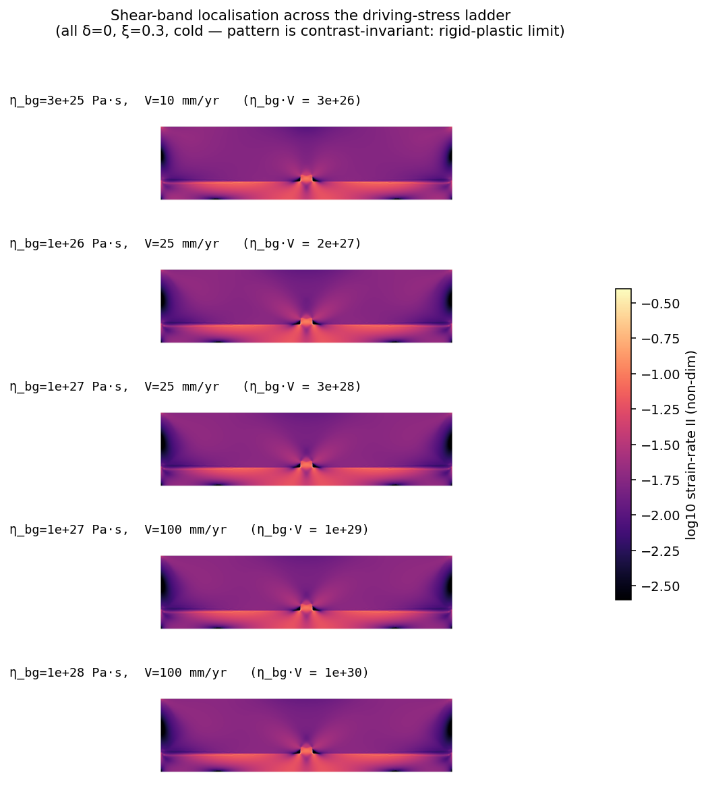
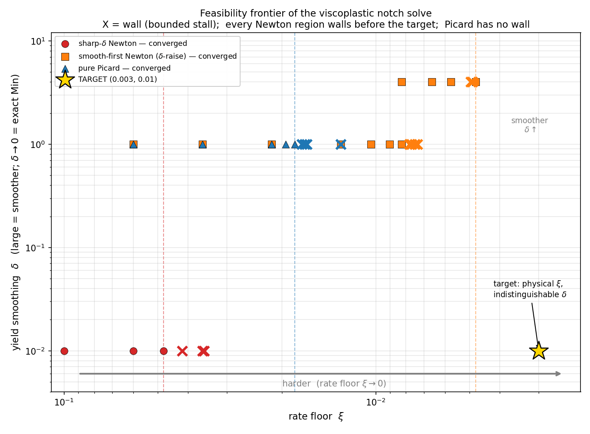
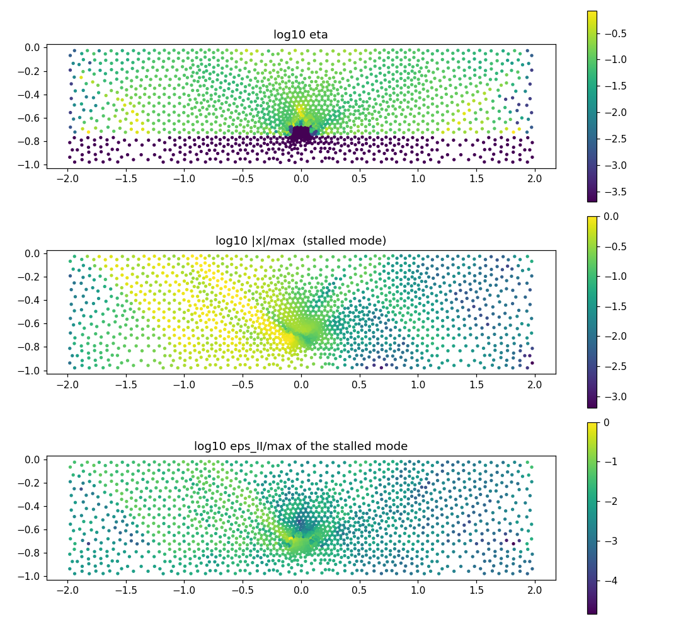

```{note}
Migrated from the wiki page [Spiegelman-notch-campaign-2026](https://github.com/underworldcode/underworld3/wiki/Spiegelman-notch-campaign-2026) on 2026-10-27 as this campaign page's starting text (written 2026-10-05 to 2026-10-05). The dated entries at the foot are the record; this text is trimmed as its content moves into guides, subsystem pages and entries.
```


The notch-localisation benchmark of Spiegelman, May and Wilson (2016; also the ASPECT Newton benchmark set and Fraters et al. 2018): a 120 × 30 km strong viscous layer (η_bg) over a weak layer (η_b = 1e21 Pa·s), a notch cut in the strong layer, convergence V imposed at the sides, Drucker–Prager yielding with C = 1e8 Pa and φ = 30°, gravity on, free top. Their finding is the one we set out to reproduce and then get past: the consistent Newton tangent has a small basin of attraction, and from the viscous guess it stalls or diverges at higher friction, higher resolution and larger η_bg·V. Everything the campaign learned about solving it is on [Solvers and multigrid](../topics/solvers-and-multigrid.md); this page says what we ran and what came out.

Scripts, logs and the written record (`DELTA_SMOOTHING_PRICE.md`, 46 sections, and `REGULARISATION_SURVEY_2026-07-31.md`) are the git repository `~/+Simulations/spiegelman_hardcase` on the campaign machine (114 drivers, 148 logs, meshes, checkpoints); moving it next to `ve_cylinder_demo` in `uw3-campaigns` is a roadmap item. The solver changes are on `bugfix/picard-warmup-791` (PR #794).

## The problem as we ran it

Non-dimensionally the notch has two groups, both going as 1/(η_bg·V): the buoyancy number ρgL²/(η_bg V) and the cohesion number C L/(η_bg V). η_bg alone sets only the weak-layer contrast, which is a local perturbation (a 40× change in contrast at fixed product moves the yielded fraction by 0.4%). So the Spiegelman (η_bg, V) plane is one-dimensional in difficulty, and the dial is η_bg·V:

| η_bg·V (Pa·s·mm/yr) | 5e22 | 1e23 | 2.5e23 | 5e23 | 1e24 | 2.5e24 | 1e25 |
|---|---|---|---|---|---|---|---|
| strong layer yielded at the viscous seed | 9% | 18% | 44% | 80% | 92% | 94% | 95% |

Our hard cases sit at the right: η_bg = 1e24 with V = 2.5 mm/yr ("1e24") and η_bg = 5e24 ("5e24"), where 97% of the layer is above the yield surface in the viscous solution, plus a power-law variant (n = 3, ε = 1e-3) with the same yield law ("n3+yield"). Mesh: a gmsh base of 492 triangles refined once (ref 1, 9895 dofs: P2 velocity, P0 pressure) or twice (ref 2); the velocity multigrid is Galerkin on that hierarchy.



*Strain-rate invariant at the viscous-seed start across the ladder (δ = 0, ξ = 0.3): the band pattern is contrast-invariant — the rigid-plastic limit — which is the measurement that collapsed the plane to one axis.*

Formulation rules that were fixed by ruling during the campaign and hold for every number below: a smooth yield law (no exact Min or Max anywhere — a floor at exactly zero gives a zero-viscosity cell and a singular operator), a positive residual strength (0.02 C) under the tension floor, a viscosity floor at 1e-3 η_bg in the strong layer, no pressure nullspace (the free top fixes the gauge; a projection would feed a gauge-fixed pressure to the yield law), and Krylov iteration counts rather than wall clock as the currency.

## What we ran, in order

1. **Soft-min homotopies in δ** (July). The δ-continuation (sqrt family, descending δ) rescues Picard; under the consistent tangent it adds nothing, because Newton already solves what the smoothing exists to smooth. The sqrt family is a solve aid and not a regulariser; the power mean is neither. A difficulty "wall" was reported and then withdrawn: everything measured was a stall, and stalls are information.
2. **The feasibility frontier in the (ξ, δ) plane** (July, figure below): where sharp-δ Newton, smooth-first Newton and Picard each converge or wall as the rate floor ξ is lowered toward the physical value. Read it as history — it predates the warm-start fix, the restart finding and the smooth-law ruling, all of which move the frontier.
3. **The pivot** (Louis, 2026-07-31): the pure problem is ill-posed (stalls are fixed points, the trapped defect is sub-coarse-scale and corner-locked, the neighbourhood is non-unique) — regularise the problem, state the regularisation, move on. Phase 2 (a problem with an inherent length) was specified but not started; the roadmap carries it.
4. **The Picard → Newton recipe** (September): a residual-keyed blend J_p + α(J_n − J_p) inside one SNES solve, keyed on ‖F(u=0)‖ so a warm start enters where it should, with back-off and restarts; built into the solver as `consistent_jacobian="continuation"`. Converges the matrix of cases that pure Newton and two-stage continuation did not; warm starts cost ~10 iterations.
5. **The linear-solve diagnosis** (October 3), after every nonlinear remedy had been tried against a solve that failed at Newton's second iteration: two independent failure modes and a third, mechanical one — the Schur complement goes indefinite under the yield–pressure coupling; the Newton velocity block carries a mechanism mode in an over-yielded layer; and FGMRES at PETSc's default restart of 30 stalls completely on that mode. Each measured with the actual Newton right-hand side; see the topic page.
6. **Approach from above** (October 3–4): ladders in V, in the rate-weakening cohesion homotopy α, in plain cohesion scale from the *onset* (found from the viscous stresses), and in the rate-strengthening ξ; full Newton on every rung where it holds, the blend where it does not.
7. **SNES-FAS** on the notch (October 4) with coarse auxiliary vectors supplied: runs; equals Newton give or take.
8. **Defaults** (October 5): the exact Min is no longer the model default; the consistent tangent is the solver default with one automatic Picard step on a cold start.



*The July feasibility frontier in (ξ, δ): crosses are bounded stalls. Every Newton region walled before the target; Picard had no wall. Superseded by the October diagnosis, kept because it is the map the later work was measured against.*

## What came out

Velocity-multigrid cycles are the cost; the cold blend at 5e24 (91 nonlinear its, 20k cycles) is the reference.

| route, 5e24 | result | cost |
|---|---|---|
| pure Newton from cold, any tangent, any Krylov cap | fails at iteration 2 | — |
| cold blend (`"continuation"`) | converges | 91 its, 20.1k cycles |
| plain cohesion ladder from the onset (s* = 180), full Newton every rung | converges, 8 rungs | 235 its, 103k cycles |
| ξ ladder 1 → 0, blend every rung | converges | 65k cycles (16k to ξ = 0.003, the rest in the last two rungs) |
| ξ ladder, Newton with blend-on-failure | converges | 246k cycles |
| V ladder 0.25 → 2.5 | converges | 100k cycles; full Newton fails one doubling away |
| α (rate-weakening) homotopy 8 → 0 | converges | 604k cycles; the velocity tangent is indefinite at large α |
| nested iteration (ref 0 → ref 1) | fine Newton fails from the interpolated state; fine blend 38 its | coarse solution is far in residual (F₀ 0.32 vs 0.42 cold) |
| FAS, warm, V-cycles, production fieldsplit on the fine level | 2 cycles | 189 outer Krylov its vs Newton's 152 — parity |

| route, n3+yield (1e24, n = 3) | result |
|---|---|
| blend, either tangent, exact or FMG velocity solves | stalls at α 0.2–0.5, ‖F‖ 2.7e-3 |
| cohesion ladder from the onset (s* = 33.6), full Newton | two rungs converge (71, 74 its), third fails; the slow rungs are the power law's curvature (tangent verified by h-sweep), not the solver |
| ξ ladder from 100 | Newton to ξ = 3; blend each rung below; **converged at ξ = 1e-3** (‖F‖ 2.4e-7), the first converged state on this case; ξ = 0 fails from there by either method |

The notch at ξ = 0 and n = 3 is where the discretisation may hold no solution; a floor-scale ξ (1e-3, the order of the viscosity floor) would be a consistent regularisation. That is a physics decision, on the roadmap.



*The mode the velocity multigrid cannot solve at a cold Newton state (partial tangent, η_bg 5e24): the whole strong layer is yielded (top), and the mode is a near-rigid translation of its left half about the notch (middle), with strain rate two to three decades below the notch value (bottom). Its Rayleigh quotient is 1.8e-7 against a smallest diagonal of 4.7e-4.*

## Results to discount

- Every ξ verdict before 2026-10-04 ("ξ cannot help"): taken under the broken warm start, FGMRES(30) and the exact-Max floor.
- Every "unregularised DP baseline" before 2026-09-24: the notch model silently ran the harmonic mean (#782).
- Every comparison against the two-stage continuation before 2026-09-29: its Picard stage was invisible in the report, so that arm was undercounted.
- The July δ-ladder and feasibility-frontier numbers as absolute costs: they were measured on a two-level hierarchy with a quarter of the problem direct-solved, and before the restart finding.
- The "ξ cannot reach 0 at sharp δ" claim as a statement about ξ: at that time ξ = 0 with δ = 0 was the exact Min.
- Nested-iteration cycle counts on ref 0: no hierarchy, GAMG fallback, not comparable.

## Lessons recorded elsewhere

The two linear failure modes, the restart, the gauge, the ladders, the h-sweep tangent test and the FAS verdict ([Solvers and multigrid](../topics/solvers-and-multigrid.md)); the benchmark page ([Spiegelman notch benchmark](../benchmarks/spiegelman-notch-benchmark.md)).

## Next

Phase 2 as ruled: a well-posed regularised problem with a stated length scale, starting with the width-versus-h scan of ξ that has never been run. Landing the branch (PR #794 plus the defaults). The remaining default decisions: a viscosity-floor and residual-strength default tied to the model's scales, restart 100, the pressure-coupling switch.

## History

- 2026-10-05 — created from the campaign record at the close of the solver diagnosis; figures: regime bands (July 28), feasibility frontier (July 18), stalled mode (October 3).

<!-- BEGIN ENTRIES (generated by scripts/build_index.py; do not edit) -->

## Entries

- 2026-10-05 · [Spiegelman notch campaign: campaign page, solver lessons, benchmark row, figures](../entries/2026-10-05-spiegelman-notch-campaign-campaign-page-solver-lessons.md) · finding

<!-- END ENTRIES -->
