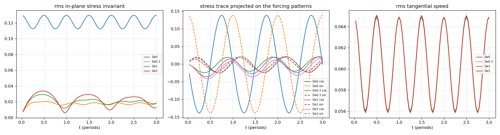
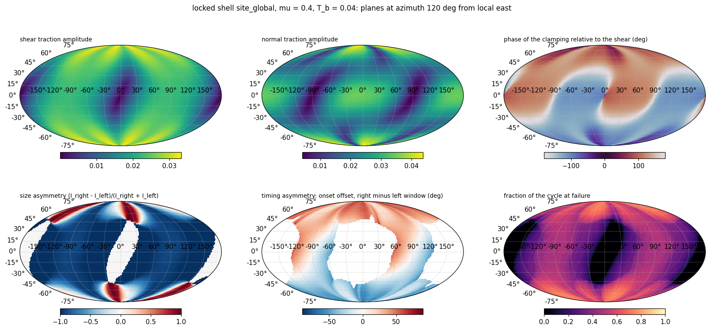
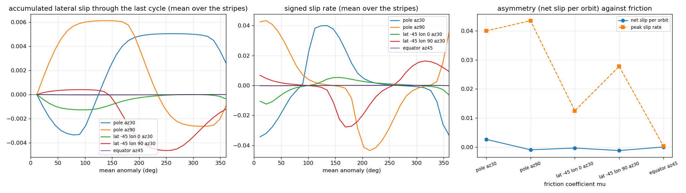
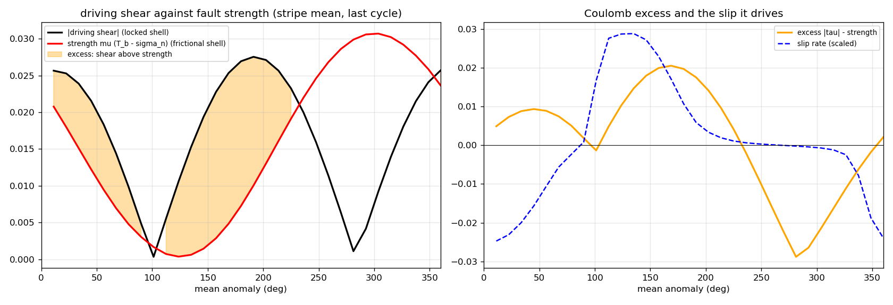
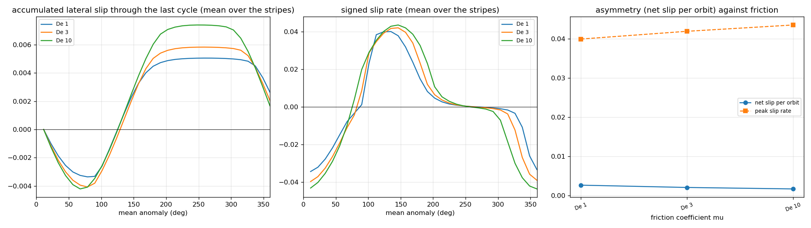
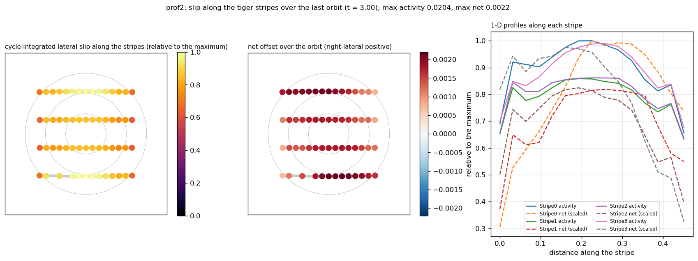
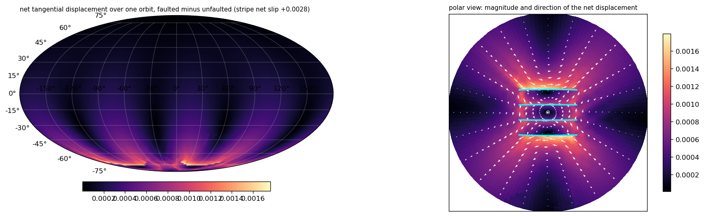

```{note}
Migrated from the wiki page [Tidal-faulted-shell](https://github.com/underworldcode/underworld3/wiki/Tidal-faulted-shell) on 2026-10-27 as this campaign page's starting text (written 2026-10-15 to 2026-10-17). The dated entries at the foot are the record; this text is trimmed as its content moves into guides, subsystem pages and entries.
```


> Continued (2026-10-17) as a 3-D box toy model of the same mechanism: [Box fault cyclic loading](Box-fault-cyclic-loading).

A thin viscoelastic shell on a sphere, flexed by the degree-2 eccentricity tide, with tiger-stripe faults: what the faults do to the shell and what the tide does to the faults. Branch `feature/tidal-shell` (from `feature/fault-split-multigrid`); driver and post-processing in `scripts/sessions/tidal_shell/`; runs under `~/+Simulations/tidal_shell/` on hyperion. Thin-skin only, by ruling (2026-10-15), until it is clear what a thick shell would add.

## Implementation

- **Sheet**: `ThinSheet` on `SphericalManifold` (R = 1), plane-stress membrane closure, thickness L = 0.08, no basal drag (ocean). Viscous or Maxwell (`ViscoElasticPlasticFlowModel`, ETD integrator, no objective rate), Eulerian SUPG stress history.
- **Tide**: the shell's radial velocity is prescribed, `ThinSheet.normal_velocity = w(x, t)`, as the datum of the rotated tangency constraint at every node; the strain rate picks up the curvature term $(w/R)\mathbf P$ through the nodal normals. Forcing $W = A[-\tfrac32 P_{20}\cos nt + \tfrac34(3(x^2-y^2)\cos nt + 8xy\sin nt)]$, $A = 0.01$, period 1, shear modulus 1, Maxwell time $De$ in periods.
- **Faults**: `sphere.add_fault` with great-circle polylines (four stripes, length 0.52, spacing 0.14 rad, near the south pole, rotated 30° from the sub-planet direction as in Berne et al. 2024); `add_fault_bc(0, name)` frictionless or `add_coulomb_fault_bc(mu, name, sigma_n="reaction", background=L*T_b)`: regularised Coulomb friction with the strength from the no-opening reaction plus a constant effective overburden $T_b$. A pair node takes the tidal datum on its mean-normal row.
- **Diagnostics** (all collective): membrane closed form each step; stress trace projected on the forcing patterns (amplitude and phase); per stripe the signed slip rate, cumulative slip and normal traction; polar stress fields saved for Coulomb-stress maps (`tidal_cff.py`: stripe-parallel receivers or the weakest plane, against a reference run).
- **Library changes on the way** (all with tests in `tests/test_1092`): the cold-start lift of a datum-only solve returned converged in zero iterations; the rigid-rotation gauge is now projected out of the rotated residual norm (the Maxwell history left a Killing-mode component and the Newton loop floored at $10^{-4}$); the fault trace mass on a surface mesh took the triangle's weights and read the normal traction 5 to 8 times too high; the maps are drawn from nodal stress components because an expression with velocity gradients cannot cross ranks in the collective evaluator.

## Mesh


`SphericalManifold(cellSize=0.08)`: a uniform gmsh triangulation of the unit sphere, 4932 triangles, median edge 0.078, with no local refinement. `add_fault` snaps existing mesh nodes onto each requested great-circle arc and duplicates the interior ones (27 added nodes), so a stripe of length 0.52 is 8 mesh edges of 0.065 (7 on Stripe1, one of them doubled) and the stripe spacing of 0.14 rad is 1.8 cells. The stripe-averaged slip, the clamping-phase mechanics and the far field (wavelengths of order the sphere) are well above this scale; the tip stress concentrations, the shape of the along-strike slip profile and the stress shadow between stripes are resolved at the cell size only. The benchmark sweep used h = 0.3, 0.2, 0.15 on the unfaulted sheet; the faulted runs have not been repeated at a second resolution. Figure: `tidal_mesh_fig.py`.

Local refinement is feasible but not yet used: `SphericalManifold(cellSize=0.16, refinement=1).adapt(metric, max_levels=2)` with a distance metric to the arcs runs on the manifold (4968 to 5698 cells for h = 0.03 on the stripes) and `add_fault` cuts the child (24 to 35 facets per stripe), but the bisected nodes sit on chords (|x| - 1 up to 2.4e-3) and would need projecting back to the sphere, and the sheet solver, fault contact and multigrid tail have not been exercised on an adapted manifold.

## Benchmarks

Unit sphere, uniform membrane, no drag: breathing $w = W$ gives no tangential flow and stress $6\eta W\mathbf P$ (exact); a degree-2 radial pattern gives tangential velocity $\tfrac{3}{11}W\nabla_s Y_2$ for any rheology or thickness (7.2, 3.4, 2.5 % at h = 0.3, 0.2, 0.15). Maxwell transfer function, $\omega\tau = 2\pi De$: trace amplitude on the cos pattern $\tfrac{24}{11}\mu A\,\omega\tau/\sqrt{1+\omega^2\tau^2}$, lag behind the displacement $\arctan(1/\omega\tau)$.

| De | amplitude measured / predicted | lag measured / predicted (°) | steps per period |
|---|---|---|---|
| viscous (η = 1) | 0.139 / 0.137 | 90 / 90 | 32 |
| 0.3 | 0.0195 / 0.0193 | 32 / 28 | 128 |
| 1 | 0.0218 / 0.0215 | 14 / 9 | 128 |
| 3 | 0.023 / 0.0218 | 22 / 3 | 32 |

The velocity response is rheology-independent; the stress saturates at the elastic value above $De \approx 0.3$; the lag excess is first order in the step (43° and 27° at 32 steps per period for De 0.3 and 1).



## Four frictionless stripes against the unfaulted shell (h = 0.08, two periods)

| last period | viscous | Maxwell, De = 1 |
|---|---|---|
| rms tangential speed | +1.1 % | +1.7 % |
| peak speed at the slipping phases | +2.3 % | +3.3 % |
| rms in-plane stress invariant | −2.3 % | −2.6 % |
| slip amplitude | 0.035 to 0.070 | 0.05 to 0.08 |

East–west stripes at the pole slip at the cos-pattern extremes and lock at the quarter phases (viscous); with elastic memory they never lock. The faults' imprint is confined to their own neighbourhood: tip concentrations about four times the regional stress, a stress shadow over the block between the stripes.


**Coulomb failure stress** (μ = 0.4, tension positive), at the slipping phase. Faulted minus unfaulted on the weakest plane at each point: the block between the stripes is unloaded by up to the ambient value, the tips loaded; the weakest plane's normal sits about 20° from the stripe normal.


The Maxwell shell shows the same geometry at a tenth of the amplitude:


Maxwell against viscous on the unfaulted shell, each normalised by its own rms shear: the difference is the phase lag drawn in space, the elastic shell up to 0.7 rms-shear units further from failure on one side of the cap at the same orbital time.


## Frictional stripes under cyclic loading (Berne et al. 2024 analogue)

Maxwell shell (De = 1), stripes at 30° azimuth, μ = 0.4, overburden $T_b = 0.04$ against stripe-plane tractions of ±0.03 shear and ±0.04 normal (the paper's 50 kPa against ±30 and ±25 kPa), four periods. Driving tractions on the locked shell, the Coulomb traction $|\tau| - \mu(T_b - \sigma_n)$ and the frictional shell's accumulated slip, last cycle:


Shear peaks at 190°, tension at 110° (the paper: 195°, 120°); failure windows 10–100° and 110–225° (the paper: 30–80°, 180–225°). Cycle by cycle, per stripe:


Cycle 1 is the spin-up; cycles 2 to 4 coincide ($\Xi = 0.015$). Within the cycle: left-lateral slip from 320° to 60°, stick through the clamped crossing, an abrupt right-lateral onset at 90° as the tension unclamps the stripe, peak rate near 130°, locked from 220° to 320°. The two episodes differ in size and shape: the paper's double-peaked, asymmetric slip history.

**Against friction** (μ = 0, 0.2, 0.4, 0.6, stripe mean, last cycle):


| μ | net slip per orbit | peak slip rate |
|---|---|---|
| 0 | 0.0009 | 0.046 |
| 0.2 | 0.0021 | 0.043 |
| 0.4 | 0.0026 | 0.040 |
| 0.6 | 0.0022 | 0.038 |

Friction delays the right-lateral onset (60°, 90°, 100°) and shrinks the left-lateral episode faster than the right-lateral one. The cycle does not close: each orbit leaves a right-lateral offset of about half the left-lateral episode, saturating with μ. This is where the Maxwell shell departs from the paper's elastic one, whose cycles close: the stress that loads the locked fault relaxes instead of reversing, and the stripes walk. It must vanish at long Maxwell times (to run: De = 10).

## Where the asymmetry comes from (site and orientation sweep)

On a stripe plane the shear and normal tractions are sinusoids in mean anomaly; the clamping's phase relative to the shear sets the kind of asymmetry. In phase or antiphase, one shear extreme meets full clamping and the other full tension: one episode is suppressed (one-sided slip). In quadrature, both extremes meet the same clamping: equal episodes, shifted onsets. The south-polar stripes at 30° sit between (clamping 80° behind the shear) and show both. Maps from the locked shell's global stress (`tidal_site_analysis.py`: traction amplitudes, clamping phase, a size index from the Coulomb windows, a timing index from the onset offsets), planes at the paper's orientation:



Frictional runs at five sites confirm the maps: pole 30° double-peaked and lopsided; pole 90° two equal rounded episodes with a shifted onset; latitude −45° on the sub-planet meridian one-sided left-lateral; latitude −45° at longitude 90° one-sided the other way; the sub-planet point no slip at all.



## Strength against driving shear

Stripe mean, last cycle, μ = 0.4: the tidal shear peaks at 0.0275 while the strength μ(T_b − σ_n) swings from 0.0004 to 0.031, so the shear exceeds the strength over 62 % of the orbit. The right-lateral window (112–225°) opens because the tension drives the strength to nearly zero while the shear is still rising: the excess reaches three times the strength and the fault slides freely (slip 0.007). The left-lateral window (320–100°) runs against a strength 0.02 to 0.03 with an excess under 10 % of it: creep against a matched strength, the sensitive episode (the onset moves 60°, 90°, 100° for μ = 0.2, 0.4, 0.6).



## Slip totals: the walking and its mechanism

Per orbit the two episodes last the same fraction of the cycle (0.34 each at μ = 0.4); their peak rates differ by 15 to 25 % and their totals by 10 to 33 %, growing with friction (right/left 0.99, 1.10, 1.23, 1.33 at μ = 0, 0.2, 0.4, 0.6). In an elastic shell the totals must cancel every orbit; here their difference is the net slip per orbit. Against the Maxwell time it falls close to 1/De: fitted asymptotes 0.0015, 0.0006, 0.0002 per orbit (stripe mean) at De = 1, 3, 10, so it vanishes in the elastic limit and the mechanism is the relaxation of the shear stored while the stripes are locked. The first orbit's net slip (0.008 to 0.009) is the cold-start transient at every De.



Along the stripes (the paper's Fig. 4a): activity peaks at 0.4 to 0.6 of the length and stays at 66 to 76 % of its maximum one spacing from the tips; the outer stripes are 15 % more active than the inner pair, which they shield; the net offset peaks mid-stripe and halves at the ends.



## Far-field deformation (first result)

Net tangential displacement over one orbit, faulted minus unfaulted (De = 1, μ = 0.4, overburden 0.04, stripe-mean net slip 0.0016):



| region | rms net displacement per orbit |
|---|---|
| within 15° of the stripe set | 0.0008 |
| beyond 15° | 0.0003 |
| beyond 90° | 0.00013 |
| unfaulted shell's own residual (noise floor) | 0.00006 |

The walking is not confined to the stripe block: it loads the shell as a four-lobed field, contraction across the stripes and extension along them, at about half the stripe offset in the near field and 8 % in the far hemisphere, with lobes reaching mid-latitudes along several meridians.

The strain of that net displacement (finite differences on the polar grid; inside the stripe block it is the stripes' own offsets over the grid spacing and is not a far-field quantity):


| band from the stripe set | rms maximum shear strain per orbit | rms dilatation |
|---|---|---|
| 20–29° | 1.4e-3 (0.14 A) | 1.2e-3 |
| 29–40° | 8.3e-4 (0.08 A) | 5.8e-4 |
| 40–52° | 5.6e-4 (0.06 A) | 3.9e-4 |

A rotated quadrupole, extension along one diagonal and contraction along the other: the far field of a right-lateral step across the set. The strain numbers are indicative only: the same bands read the same at De = 10 while the displacement there is three to six times smaller, so at 20–40° they are dominated by the stripe-tip near field and grid-scale structure rather than the far field (the finite-difference noise floor from the unfaulted residual is small, 1–3e-5). The displacement is the quantity to quote; a harmonic projection of it would give the clean low-degree far field.

**At De = 10** (sixteen orbits, against its own locked twin): per-stripe net slip 0.0001 to 0.0002 per orbit and still drifting slowly at orbit 16 (the Maxwell tail), far-field displacement rms 0.00018 within 15° and 0.00005 beyond, against a floor of 0.00003: the far field is barely resolved at an ice-like Maxwell time, consistent with the 1/De scaling of the walking.


A cut defect found on the way: a stripe built as a chain of great-circle arcs between exponential-map points (kinks at every vertex) lost part of its cut silently (11 of 16 facets at 9 points, fragments at 13); stripes are now single great-circle arcs. The library should refuse rather than truncate such a chain (open).

## Open

- Resolution: the faulted runs are at one cell size (h = 0.08, stripes 8 edges long, 1.8 cells apart); a refined-stripe run (adapt-on-top on the manifold, with the nodes projected back to the sphere) would test the tip concentrations and the slip-profile shape.

- A harmonic projection of the net displacement for the low-degree far field; De 10 beyond sixteen orbits if its tail matters.
- Opening on the stripes; stripes of the real geometry; the Jaumann rate on a drag-free sphere (fails in the linear solve; not needed for the tide).
- The cut's silent truncation of a kinked polyline.

<!-- BEGIN ENTRIES (generated by scripts/build_index.py; do not edit) -->

## Entries

- 2026-10-17 · [Tidal faulted shell: mesh figure and resolution notes](../entries/2026-10-17-tidal-faulted-shell-mesh-figure-and-resolution-notes.md) · measurement
- 2026-10-16 · [Tidal faulted shell: site sweep, strength balance, the walking and its Maxwell-time scaling, slip profiles, the first far-field result](../entries/2026-10-16-tidal-faulted-shell-site-sweep-strength-balance-the-walking-and.md) · measurement
- 2026-10-16 · [Tidal faulted shell: implementation and results (benchmarks, Coulomb maps, the Berne analogue, friction sweep)](../entries/2026-10-16-tidal-faulted-shell-implementation-and-results-benchmarks.md) · measurement
- 2026-10-16 · [Tidal faulted shell: far-field strain per orbit](../entries/2026-10-16-tidal-faulted-shell-far-field-strain-per-orbit.md) · finding
- 2026-10-16 · [Tidal faulted shell: De 10 far field, corrected stripe net slip, the strain measure hedged](../entries/2026-10-16-tidal-faulted-shell-de-10-far-field-corrected-stripe-net-slip.md) · finding
- 2026-10-15 · [Tidal faulted shell: the formulation, the Maxwell sweep, four tiger stripes against the unfaulted shell, polar views, solver findings](../entries/2026-10-15-tidal-faulted-shell-the-formulation-the-maxwell-sweep-four.md) · measurement

<!-- END ENTRIES -->
