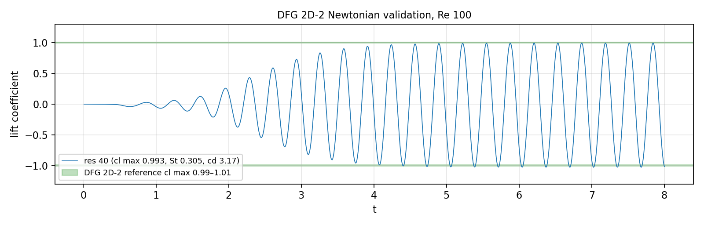
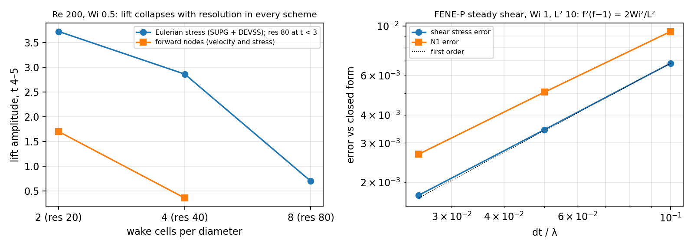
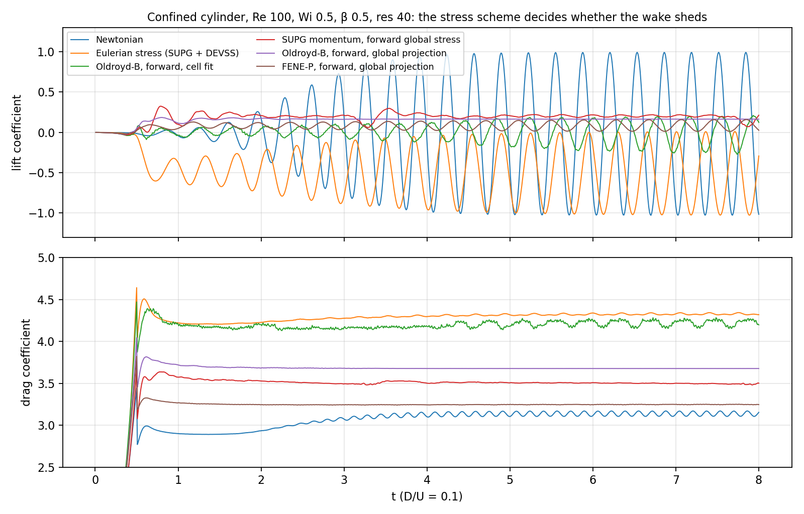
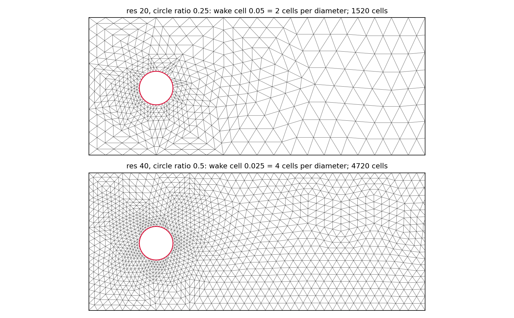
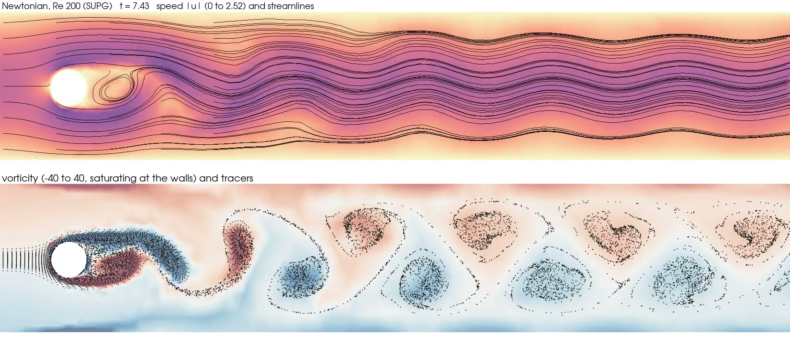
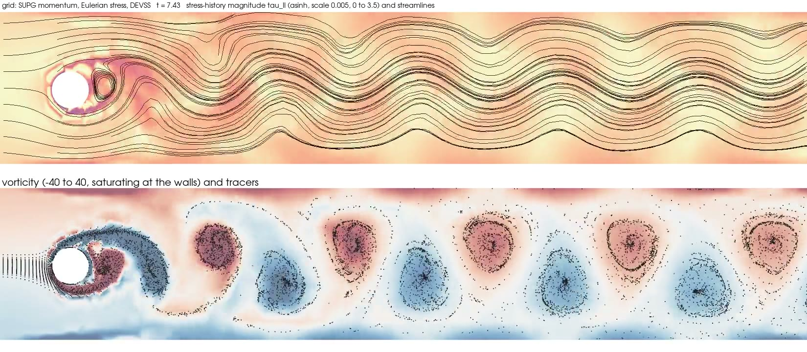
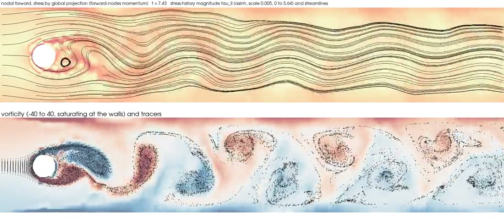
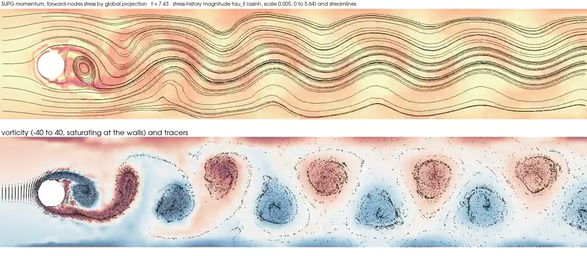
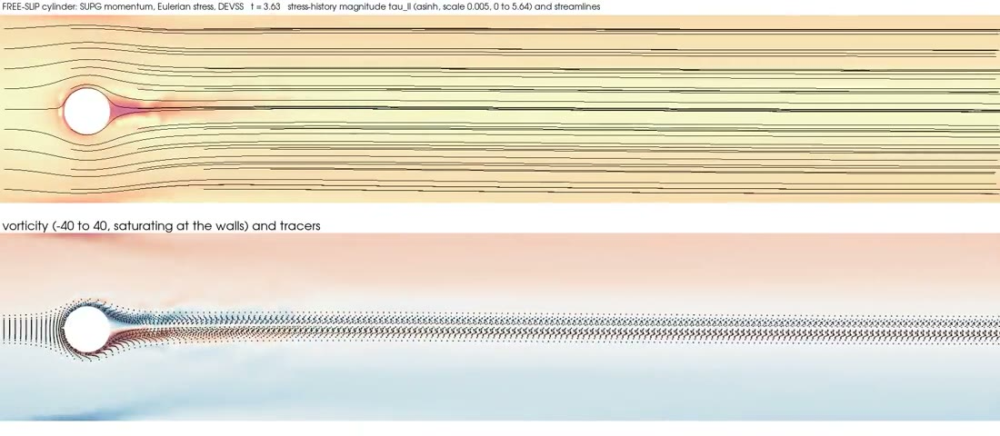
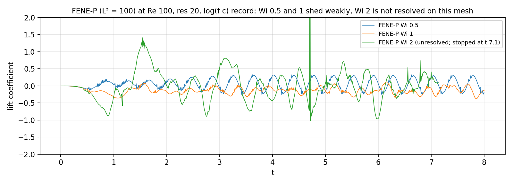

Wiki commit [`301c3899`](https://github.com/underworldcode/underworld3/wiki/Benchmarks/301c3899746b60e3b8bfe92cb5fc453a1daf6f15) by lmoresi, 2026-10-05: **Equations for each VE model and the step; figures: meshes, frames, force traces, validation, convergence**

The text this commit added, as written that day (the integrated version is on the topic page):

### Added to Benchmarks

## Figures

*The Newtonian cylinder at Re 100 on the res-40 mesh: the lift saturates at 0.993 against the reference band 0.99 to 1.01, St 0.305, cd 3.17 against 3.22 to 3.24.*

*Left: at Re 200, Wi 0.5 the settled lift amplitude falls with resolution in every scheme, so coarse "nice vortices" are an artefact. Right: FENE-P steady shear against the cubic $f^2(f-1) = 2\mathrm{Wi}^2/L^2$, first order in $\Delta t/\lambda$.*

*The open VE cylinder case: lift and drag at Re 100, Wi 0.5, res 40 for every stress scheme. The global projection runs go steady; the cell fit and the Eulerian stress keep shedding. The Eulerian run's lift sits about a mean of −0.5, an asymmetry we have not explained and should not forget. Newtonian for reference.*

### Added to Cylinder campaign 2026

## The meshes

*The gmsh base is built two refinement levels coarser and refined back with the new vertices snapped to the circle, so the velocity block has a multigrid hierarchy. Res 20 puts two cells across a diameter in the wake; res 40 four. dt is set by Courant one at the cylinder, so the wake runs at Courant 0.25 (res 20) or 0.5 (res 40).*
## What it looks like
Each movie has two panels: the stress-history magnitude (asinh scale) with streamlines above, vorticity (−40 to 40) with tracers from two off-centre smoke sources below. Frames near t 7.5, Re 200, Wi 0.5, res 20, all with the stress by global projection unless marked.

*Newtonian: the Kármán street at Re 200.*

*Eulerian momentum and stress (SUPG + DEVSS): the "nicest" vortices at this resolution, which the resolution study says is an artefact.*

*Forward-nodes momentum and stress, global projection: coherent street, St 0.26.*

*SUPG momentum with the forward global stress: St 0.30 follows the velocity history.*

*Free-slip cylinder: no shedding, one steady birefringent strand.*

*Re 100, Wi 0.5, res 40: lift and drag for every stress scheme (see [Benchmarks](../benchmarks/benchmarks.md)).*

*FENE-P at res 20 on the log(f c) record: Wi 0.5 and 1 shed weakly; Wi 2 is not resolved on this mesh.*

### Added to Viscoelastic Constitutive models

## The equations
Notation: $\mathbf{L} = \nabla \mathbf{u}$ the velocity gradient, $\mathbf{D} = \tfrac12(\mathbf{L} + \mathbf{L}^T)$ the strain rate, $\boldsymbol{\sigma}$ the total deviatoric stress, $\boldsymbol{\tau}$ the elastic (memory) part of it, $\eta_s$ the solvent viscosity, $\eta_p$ the viscosity of the elastic branch, $\lambda$ its relaxation time, $G = \eta_p/\lambda$ its modulus, $\mathbf{c}$ the conformation (the ensemble-average dyad of the dumbbell end-to-end vector, $\mathbf{I}$ at rest), $d$ the dimension. The upper-convected derivative is
$$\overset{\nabla}{\mathbf{A}} = \frac{D\mathbf{A}}{Dt} - \mathbf{L}\mathbf{A} - \mathbf{A}\mathbf{L}^T .$$
The dimensionless groups of the cylinder work are $\mathrm{Re} = \rho U D/(\eta_s + \eta_p)$, $\mathrm{Wi} = \lambda U/D$ and $\beta = \eta_s/(\eta_s + \eta_p)$.
**Maxwell element, linear spring (UCM).** No solvent branch; the whole stress relaxes:
$$\boldsymbol{\sigma} = \boldsymbol{\tau}, \qquad \boldsymbol{\tau} + \lambda\,\overset{\nabla}{\boldsymbol{\tau}} = 2\eta_p \mathbf{D}.$$
**Jeffreys element, linear spring (Oldroyd-B).** A solvent dashpot in parallel:
$$\boldsymbol{\sigma} = 2\eta_s \mathbf{D} + \boldsymbol{\tau}, \qquad \boldsymbol{\tau} + \lambda\,\overset{\nabla}{\boldsymbol{\tau}} = 2\eta_p \mathbf{D}.$$
In conformation form, which is what the code integrates, $\boldsymbol{\tau} = G(\mathbf{c} - \mathbf{I})$ and
$$\frac{D\mathbf{c}}{Dt} = \mathbf{L}\mathbf{c} + \mathbf{c}\mathbf{L}^T - \frac{1}{\lambda}(\mathbf{c} - \mathbf{I}).$$
The spring is Hookean, so in a steady extension with $\lambda\dot\epsilon > 1/2$ the conformation grows without bound. On the cylinder wake that happens between Wi 1 and 2: the stress fills the wake with structure at the mesh scale on every mesh, and it is the model rather than the scheme.
**Jeffreys element, FENE-P spring.** The spring stiffens as the dumbbell approaches its maximum extension $L$ (Peterlin's closure replaces $\langle f(\mathbf{Q})\mathbf{Q}\mathbf{Q}\rangle$ by $f(\langle\mathbf{Q}\mathbf{Q}\rangle)\langle\mathbf{Q}\mathbf{Q}\rangle$):
$$f(\mathbf{c}) = \frac{L^2 - d}{L^2 - \mathrm{tr}\,\mathbf{c}}, \qquad \boldsymbol{\tau} = G\,(f\mathbf{c} - \mathbf{I}), \qquad \frac{D\mathbf{c}}{Dt} = \mathbf{L}\mathbf{c} + \mathbf{c}\mathbf{L}^T - \frac{1}{\lambda}(f\mathbf{c} - \mathbf{I}).$$
The relaxation rate is $f/\lambda$ and the relaxation target is $\mathbf{I}/f$; $\mathrm{tr}\,\mathbf{c} < L^2$ always, so the stress saturates. With $L^2 \to \infty$, $f \to 1$ and the model is Oldroyd-B. The parameter is `Parameters.extensibility` $= L^2$ (dimensionless; 100 on the cylinder, 10 in the tests). The trace of $f\mathbf{c} = \boldsymbol{\tau}/G + \mathbf{I}$ gives $f$ from the stress in closed form,
$$f = 1 + \frac{\mathrm{tr}\,\boldsymbol{\tau}}{G L^2},$$
which is what the log(f c) record below relies on.
**Steady simple shear** ($\dot\gamma$, $\mathrm{Wi} = \lambda\dot\gamma$), the closed forms the tests use. Oldroyd-B: $\tau_{xy} = \eta_p\dot\gamma$, $N_1 = 2\eta_p\lambda\dot\gamma^2 = 2G\,\mathrm{Wi}^2$. FENE-P in two dimensions: $c_{yy} = 1/f$, $c_{xy} = \mathrm{Wi}/f^2$, $c_{xx} = (1 + 2\mathrm{Wi}^2/f^2)/f$, and the closure gives one cubic for $f$,
$$f^2 (f - 1) = \frac{2\,\mathrm{Wi}^2}{L^2}, \qquad \tau_{xy} = \frac{\eta_p\dot\gamma}{f}, \qquad N_1 = \frac{2G\,\mathrm{Wi}^2}{f^2}.$$
At Wi 1, $L^2 = 10$: $f = 1.1510$, $\tau_{xy} = 0.8688\,\eta_p\dot\gamma$, $N_1 = 1.5097\,G$.
**What the code stores and steps.** The history carries $\boldsymbol{\psi} = \log(\boldsymbol{\tau}/G + \mathbf{I})$, which is $\log\mathbf{c}$ for a linear spring and $\log(f\mathbf{c})$ for FENE-P; the exponential of a symmetric record is positive definite, which is what makes the log store survive large Wi. One step of length $\Delta t$ with the exponential integrator at first order, written for the stress with $x = \Delta t\,f^*/\lambda$ and $\alpha = e^{-x}$ ($f^* = 1$ for a linear spring, the lagged factor of the carried record for FENE-P):
$$\boldsymbol{\tau}^{n+1} = \alpha\,\boldsymbol{\tau}^* + (1-\alpha)\,2\eta_p\mathbf{D}^{n+1} + \alpha\,\Delta t\,f^*\,\mathcal{S}\!\left(G(\mathbf{c}^* - \mathbf{I})\right) + \frac{b^2}{(1-\alpha) f^*}\,\frac{G}{\lambda}\,\mathbf{L}\mathbf{L}^T, \qquad \mathcal{S}(\mathbf{A}) = \mathbf{L}\mathbf{A} + \mathbf{A}\mathbf{L}^T, \quad b = \lambda\left(1 - (1+x)e^{-x}\right).$$
Here $\boldsymbol{\tau}^*$ and $\mathbf{c}^*$ are the carried (transported) record decoded at the new time level, $\mathcal{S}$ is the stretching source of the objective rate, taken explicitly with the current gradient on the carried strain $G(\mathbf{c}^* - \mathbf{I})$ rather than on the stress (the two differ for FENE-P), and the last term is the positive-definite correction: without it the stretched relaxation target is $(1-\alpha)\mathbf{I} + b\,\mathcal{S}(\mathbf{I})$, which is not a product of two factors; with it the target is $(\sqrt{1-\alpha}\,\mathbf{I} + b\mathbf{L}/\sqrt{1-\alpha})(\cdot)^T$ and stays positive semi-definite. That term is what let the cross-slot bifurcation appear. The $f^*$ on the relaxation rate cancels the $f^*$ on the stress $G f^* \mathbf{c}$ for every source, which is why the source keeps its Oldroyd-B weight $\alpha\,\Delta t$ (times $f^*$) and not $\alpha\,\Delta t/f^*$; the first form of the step had one $1/f$ too many on the stretching source and sat 3% and 13% off the closed form at every $\Delta t$.

*Right: the FENE-P shear box against the cubic, first order in $\Delta t/\lambda$. Left belongs to [Transport histories](../topics/transport-histories.md).*
