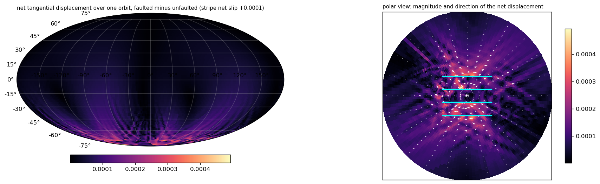

Wiki commit [`523d0181`](https://github.com/underworldcode/underworld3/wiki/Tidal-faulted-shell/523d0181429ea5d86c5ac13967d7bad844729c69) by Louis Moresi, 2026-10-16: **Tidal faulted shell: De 10 far field, corrected stripe net slip, the strain measure hedged**

The text this commit added, as written that day (the integrated version is on the topic page):

### Added to Tidal faulted shell

Net tangential displacement over one orbit, faulted minus unfaulted (De = 1, μ = 0.4, overburden 0.04, stripe-mean net slip 0.0016):
The walking is not confined to the stripe block: it loads the shell as a four-lobed field, contraction across the stripes and extension along them, at about half the stripe offset in the near field and 8 % in the far hemisphere, with lobes reaching mid-latitudes along several meridians.
A rotated quadrupole, extension along one diagonal and contraction along the other: the far field of a right-lateral step across the set. The strain numbers are indicative only: the same bands read the same at De = 10 while the displacement there is three to six times smaller, so at 20–40° they are dominated by the stripe-tip near field and grid-scale structure rather than the far field (the finite-difference noise floor from the unfaulted residual is small, 1–3e-5). The displacement is the quantity to quote; a harmonic projection of it would give the clean low-degree far field.
**At De = 10** (sixteen orbits, against its own locked twin): per-stripe net slip 0.0001 to 0.0002 per orbit and still drifting slowly at orbit 16 (the Maxwell tail), far-field displacement rms 0.00018 within 15° and 0.00005 beyond, against a floor of 0.00003: the far field is barely resolved at an ice-like Maxwell time, consistent with the 1/De scaling of the walking.

- A harmonic projection of the net displacement for the low-degree far field; De 10 beyond sixteen orbits if its tail matters.
