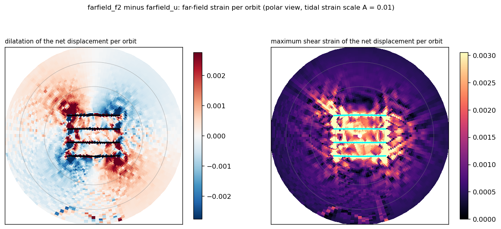

Wiki commit [`6f04382e`](https://github.com/underworldcode/underworld3/wiki/Tidal-faulted-shell/6f04382e44673d0e9db4189709c28c102a8cd36d) by Louis Moresi, 2026-10-16: **Tidal faulted shell: far-field strain per orbit**

The text this commit added, as written that day (the integrated version is on the topic page):

### Added to Tidal faulted shell

The strain of that net displacement (finite differences on the polar grid; inside the stripe block it is the stripes' own offsets over the grid spacing and is not a far-field quantity):

| band from the stripe set | rms maximum shear strain per orbit | rms dilatation |
|---|---|---|
| 20–29° | 1.4e-3 (0.14 A) | 1.2e-3 |
| 29–40° | 8.3e-4 (0.08 A) | 5.8e-4 |
| 40–52° | 5.6e-4 (0.06 A) | 3.9e-4 |
A rotated quadrupole, extension along one diagonal and contraction along the other: the far field of a right-lateral step across the set. The tidal in-plane strain amplitude is about 1.6 A, so beyond 30° the permanent strain per orbit is about 5 % of the diurnal strain amplitude at De = 1, and by the 1/De scaling about 1 % at De = 10. The map is element-noisy (a P2 velocity integrated on a grid and differenced); a smoother estimate would project the net displacement onto low-degree harmonics.
