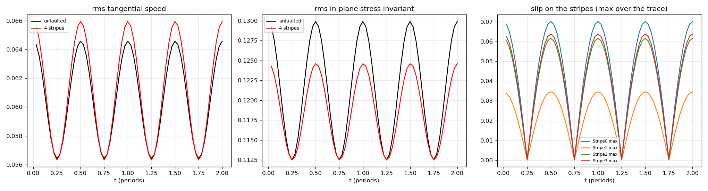
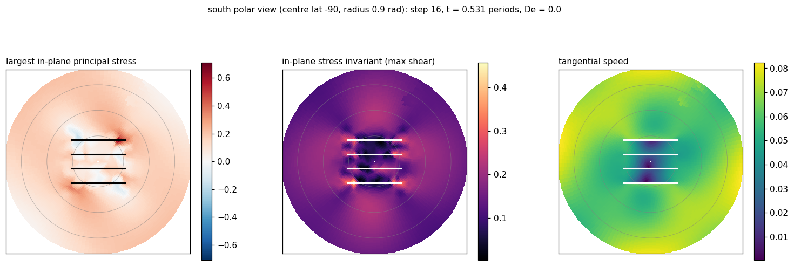
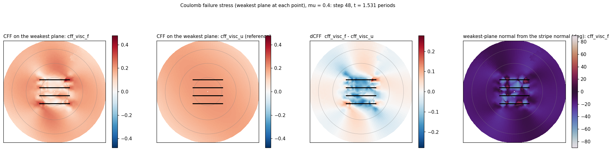
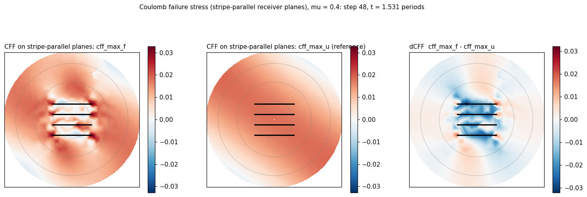
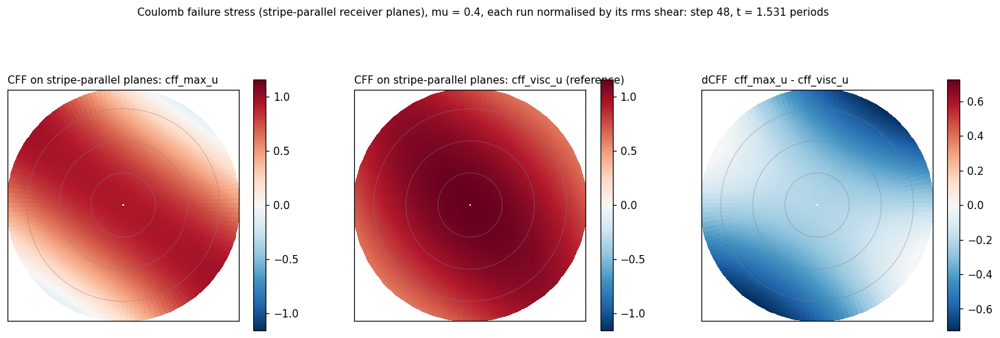
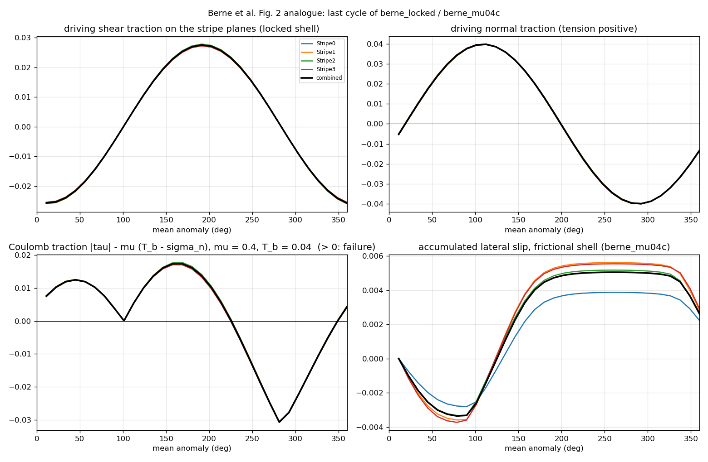
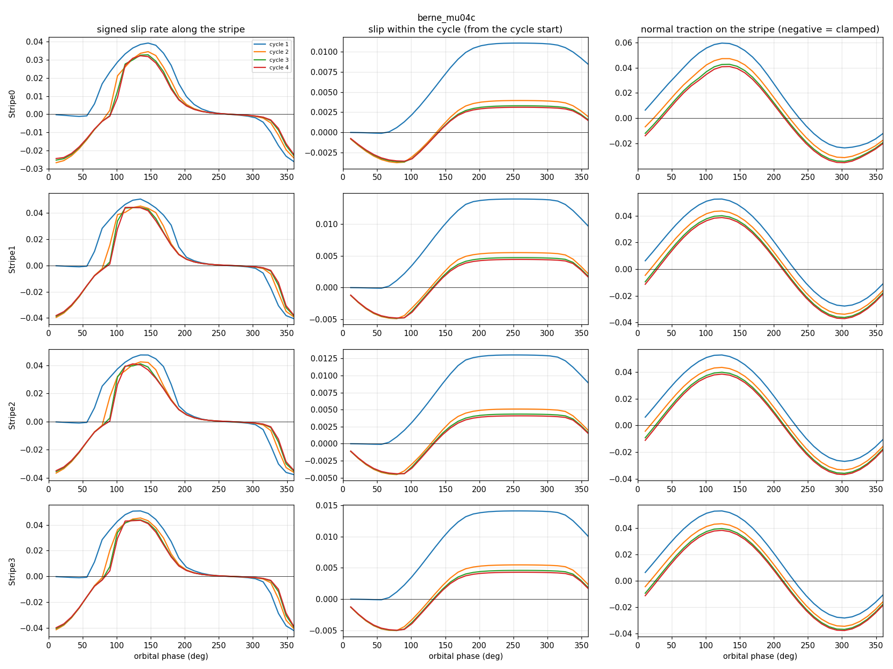
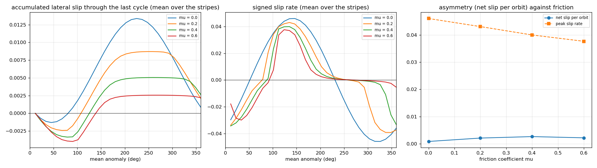

Wiki commit [`4e4224d9`](https://github.com/underworldcode/underworld3/wiki/Tidal-faulted-shell/4e4224d9dd09c73a7eb0b4f15c5a045c154692b6) by Louis Moresi, 2026-10-16: **Tidal faulted shell: implementation and results (benchmarks, Coulomb maps, the Berne analogue, friction sweep)**

The text this commit added, as written that day (the integrated version is on the topic page):

### Added to Tidal faulted shell

# Tidal response of a faulted thin shell
A thin viscoelastic shell on a sphere, flexed by the degree-2 eccentricity tide, with tiger-stripe faults: what the faults do to the shell and what the tide does to the faults. Branch `feature/tidal-shell` (from `feature/fault-split-multigrid`); driver and post-processing in `scripts/sessions/tidal_shell/`; runs under `~/+Simulations/tidal_shell/` on hyperion. Thin-skin only, by ruling (2026-10-15), until it is clear what a thick shell would add.
## Implementation
- **Sheet**: `ThinSheet` on `SphericalManifold` (R = 1), plane-stress membrane closure, thickness L = 0.08, no basal drag (ocean). Viscous or Maxwell (`ViscoElasticPlasticFlowModel`, ETD integrator, no objective rate), Eulerian SUPG stress history.
- **Tide**: the shell's radial velocity is prescribed, `ThinSheet.normal_velocity = w(x, t)`, as the datum of the rotated tangency constraint at every node; the strain rate picks up the curvature term $(w/R)\mathbf P$ through the nodal normals. Forcing $W = A[-\tfrac32 P_{20}\cos nt + \tfrac34(3(x^2-y^2)\cos nt + 8xy\sin nt)]$, $A = 0.01$, period 1, shear modulus 1, Maxwell time $De$ in periods.
- **Faults**: `sphere.add_fault` with great-circle polylines (four stripes, length 0.52, spacing 0.14 rad, near the south pole, rotated 30° from the sub-planet direction as in Berne et al. 2024); `add_fault_bc(0, name)` frictionless or `add_coulomb_fault_bc(mu, name, sigma_n="reaction", background=L*T_b)`: regularised Coulomb friction with the strength from the no-opening reaction plus a constant effective overburden $T_b$. A pair node takes the tidal datum on its mean-normal row.
- **Diagnostics** (all collective): membrane closed form each step; stress trace projected on the forcing patterns (amplitude and phase); per stripe the signed slip rate, cumulative slip and normal traction; polar stress fields saved for Coulomb-stress maps (`tidal_cff.py`: stripe-parallel receivers or the weakest plane, against a reference run).
- **Library changes on the way** (all with tests in `tests/test_1092`): the cold-start lift of a datum-only solve returned converged in zero iterations; the rigid-rotation gauge is now projected out of the rotated residual norm (the Maxwell history left a Killing-mode component and the Newton loop floored at $10^{-4}$); the fault trace mass on a surface mesh took the triangle's weights and read the normal traction 5 to 8 times too high; the maps are drawn from nodal stress components because an expression with velocity gradients cannot cross ranks in the collective evaluator.
## Benchmarks
Unit sphere, uniform membrane, no drag: breathing $w = W$ gives no tangential flow and stress $6\eta W\mathbf P$ (exact); a degree-2 radial pattern gives tangential velocity $\tfrac{3}{11}W\nabla_s Y_2$ for any rheology or thickness (7.2, 3.4, 2.5 % at h = 0.3, 0.2, 0.15). Maxwell transfer function, $\omega\tau = 2\pi De$: trace amplitude on the cos pattern $\tfrac{24}{11}\mu A\,\omega\tau/\sqrt{1+\omega^2\tau^2}$, lag behind the displacement $\arctan(1/\omega\tau)$.
| De | amplitude measured / predicted | lag measured / predicted (°) | steps per period |
|---|---|---|---|
| viscous (η = 1) | 0.139 / 0.137 | 90 / 90 | 32 |
| 0.3 | 0.0195 / 0.0193 | 32 / 28 | 128 |
| 1 | 0.0218 / 0.0215 | 14 / 9 | 128 |
| 3 | 0.023 / 0.0218 | 22 / 3 | 32 |
The velocity response is rheology-independent; the stress saturates at the elastic value above $De \approx 0.3$; the lag excess is first order in the step (43° and 27° at 32 steps per period for De 0.3 and 1).
## Four frictionless stripes against the unfaulted shell (h = 0.08, two periods)
| last period | viscous | Maxwell, De = 1 |
| rms tangential speed | +1.1 % | +1.7 % |
| peak speed at the slipping phases | +2.3 % | +3.3 % |
| rms in-plane stress invariant | −2.3 % | −2.6 % |
| slip amplitude | 0.035 to 0.070 | 0.05 to 0.08 |
East–west stripes at the pole slip at the cos-pattern extremes and lock at the quarter phases (viscous); with elastic memory they never lock. The faults' imprint is confined to their own neighbourhood: tip concentrations about four times the regional stress, a stress shadow over the block between the stripes.

**Coulomb failure stress** (μ = 0.4, tension positive), at the slipping phase. Faulted minus unfaulted on the weakest plane at each point: the block between the stripes is unloaded by up to the ambient value, the tips loaded; the weakest plane's normal sits about 20° from the stripe normal.

The Maxwell shell shows the same geometry at a tenth of the amplitude:

Maxwell against viscous on the unfaulted shell, each normalised by its own rms shear: the difference is the phase lag drawn in space, the elastic shell up to 0.7 rms-shear units further from failure on one side of the cap at the same orbital time.

## Frictional stripes under cyclic loading (Berne et al. 2024 analogue)
Maxwell shell (De = 1), stripes at 30° azimuth, μ = 0.4, overburden $T_b = 0.04$ against stripe-plane tractions of ±0.03 shear and ±0.04 normal (the paper's 50 kPa against ±30 and ±25 kPa), four periods. Driving tractions on the locked shell, the Coulomb traction $|\tau| - \mu(T_b - \sigma_n)$ and the frictional shell's accumulated slip, last cycle:

Shear peaks at 190°, tension at 110° (the paper: 195°, 120°); failure windows 10–100° and 110–225° (the paper: 30–80°, 180–225°). Cycle by cycle, per stripe:

Cycle 1 is the spin-up; cycles 2 to 4 coincide ($\Xi = 0.015$). Within the cycle: left-lateral slip from 320° to 60°, stick through the clamped crossing, an abrupt right-lateral onset at 90° as the tension unclamps the stripe, peak rate near 130°, locked from 220° to 320°. The two episodes differ in size and shape: the paper's double-peaked, asymmetric slip history.
**Against friction** (μ = 0, 0.2, 0.4, 0.6, stripe mean, last cycle):

| μ | net slip per orbit | peak slip rate |
|---|---|---|
| 0 | 0.0009 | 0.046 |
| 0.2 | 0.0021 | 0.043 |
| 0.4 | 0.0026 | 0.040 |
| 0.6 | 0.0022 | 0.038 |
Friction delays the right-lateral onset (60°, 90°, 100°) and shrinks the left-lateral episode faster than the right-lateral one. The cycle does not close: each orbit leaves a right-lateral offset of about half the left-lateral episode, saturating with μ. This is where the Maxwell shell departs from the paper's elastic one, whose cycles close: the stress that loads the locked fault relaxes instead of reversing, and the stripes walk. It must vanish at long Maxwell times (to run: De = 10).
- The walking against the Maxwell time (De = 3, 10), and the elastic limit of the slip cycle.
- The Jaumann rate on a drag-free sphere fails in the linear solve (its tangent surrogate breaks the rotation null space); not needed for the tide.
- Opening on the stripes; stripes of the real geometry; a single effective-Love-number measure of the faults' global effect.
