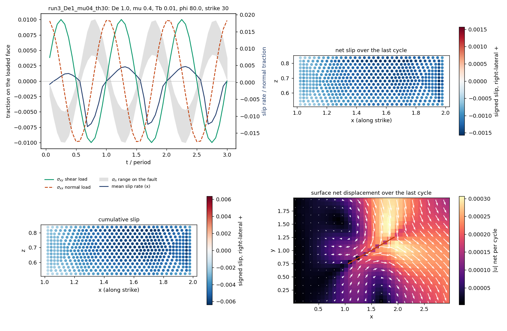

Wiki commit [`660c3e35`](https://github.com/underworldcode/underworld3/wiki/Box-fault-cyclic-loading/660c3e351d1ae5c4f83576d937158541a474445a) by Louis Moresi, 2026-10-17: **Box fault: first results - the x-parallel null and the oblique walk**

The text this commit added, as written that day (the integrated version is on the topic page):

### Added to Box fault cyclic loading

*Provisional (2026-10-18): one geometry, one load, μ = 0.4, overburden 0.01, S = N = 0.01, φ = 80°, 20k cells on 16 ranks, 16 steps per cycle. The De 10 and elastic runs of the oblique fault are in progress; this section is revised as they land.*
**A fault parallel to the loaded face's normal is not clamped by the load.** With the fault strike along x and free y faces, the end load's normal component σxx acts along the fault: the fault-averaged normal stress varies by ±1.6 × 10⁻⁴ over a cycle against a normal load of 10⁻², and the Coulomb strength is constant to 3 %. The net slip per cycle then decays to zero at every Maxwell time tried, as the elastic limit requires: the first cycle's offset is the friction hysteresis locked in from the unstressed start, and the back-stress of any further net slip stops it.
| fault parallel to x | cycle 1 | cycle 2 | cycle 3 | cycle 4 |
|---|---|---|---|---|
| elastic (De 100) | −1.5 × 10⁻³ | −6.8 × 10⁻⁵ | −2.4 × 10⁻⁵ | −1.3 × 10⁻⁵ |
| De 10 | −1.4 × 10⁻³ | −7.6 × 10⁻⁵ | −3.3 × 10⁻⁵ | |
| De 1 | −1.4 × 10⁻³ | −5.3 × 10⁻⁵ | −1.5 × 10⁻⁵ | −1.2 × 10⁻⁵ |
Maxwell relaxation alone does not make a fault walk: it removes the back-stress that would stop a walk, but there must be an asymmetry to accumulate.
**A fault at 30° to x walks.** Rotated in plan, the fault takes clamping σnn = σxx sin²θ − 2σxy sinθ cosθ from the same load, so the strength now varies through the cycle: at 30° the clamping follows the shear, the fault is clamped while the shear drives it right-laterally and unclamped (frictionless at the extreme) while it drives it left-laterally. At De 1 the slip is one-sided and the net slip per cycle settles to a steady walk within two cycles:
| strike 30°, De 1 | net slip per cycle | fraction of the cycle's slip | surface net displacement, max |
|---|---|---|---|
| cycle 1 | −2.3 × 10⁻³ | 0.58 | 9.3 × 10⁻³ (start-up) |
| cycle 2 | −1.17 × 10⁻³ | 0.25 | 3.4 × 10⁻⁴ |
| cycle 3 | −1.12 × 10⁻³ | 0.24 | 3.1 × 10⁻⁴ |

*Figure 2. The 30° fault at De 1. Top left: the load (shear green, normal dashed), the range of the fault normal traction (grey, tension positive) and the mean slip rate along strike (blue). Top right: net slip over the last cycle on the fault plane. Bottom left: cumulative slip. Bottom right: the surface net displacement over the last cycle, with the fault trace.*
The surface carries the walk's far-field signature: a four-lobed pattern around the fault, as for a left-lateral offset, and a broad drift on the loaded side reaching the edge of the box, 1 to 3 × 10⁻⁴ per cycle, steady from the second cycle on. This is the box form of the Berne et al. hypothesis: load-modulated clamping makes the slip asymmetric, Maxwell relaxation removes the back-stress that would cap it, and the asymmetry accumulates into net deformation. Gravity, absent here, would oppose the topography the walk builds and eventually stop it at an amplitude of order the asymmetric driving stress over ρg.
