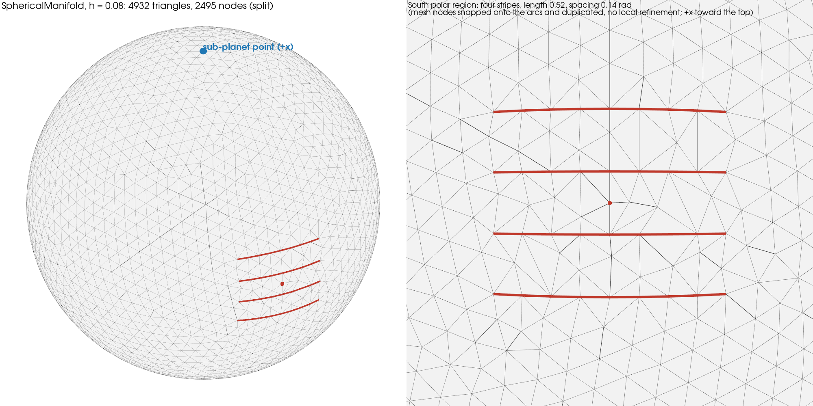

Wiki commit [`c0944c82`](https://github.com/underworldcode/underworld3/wiki/Tidal-faulted-shell/c0944c824554804014d9609cf42dc05ff51a33a2) by Louis Moresi, 2026-10-17: **Tidal faulted shell: mesh figure and resolution notes**

The text this commit added, as written that day (the integrated version is on the topic page):

### Added to Tidal faulted shell

## Mesh

`SphericalManifold(cellSize=0.08)`: a uniform gmsh triangulation of the unit sphere, 4932 triangles, median edge 0.078, with no local refinement. `add_fault` snaps existing mesh nodes onto each requested great-circle arc and duplicates the interior ones (27 added nodes), so a stripe of length 0.52 is 8 mesh edges of 0.065 (7 on Stripe1, one of them doubled) and the stripe spacing of 0.14 rad is 1.8 cells. The stripe-averaged slip, the clamping-phase mechanics and the far field (wavelengths of order the sphere) are well above this scale; the tip stress concentrations, the shape of the along-strike slip profile and the stress shadow between stripes are resolved at the cell size only. The benchmark sweep used h = 0.3, 0.2, 0.15 on the unfaulted sheet; the faulted runs have not been repeated at a second resolution. Figure: `tidal_mesh_fig.py`.
Local refinement is feasible but not yet used: `SphericalManifold(cellSize=0.16, refinement=1).adapt(metric, max_levels=2)` with a distance metric to the arcs runs on the manifold (4968 to 5698 cells for h = 0.03 on the stripes) and `add_fault` cuts the child (24 to 35 facets per stripe), but the bisected nodes sit on chords (|x| - 1 up to 2.4e-3) and would need projecting back to the sphere, and the sheet solver, fault contact and multigrid tail have not been exercised on an adapted manifold.
- Resolution: the faulted runs are at one cell size (h = 0.08, stripes 8 edges long, 1.8 cells apart); a refined-stripe run (adapt-on-top on the manifold, with the nodes projected back to the sphere) would test the tip concentrations and the slip-profile shape.
