```{note}
Migrated from the wiki page [Fault-multigrid](https://github.com/underworldcode/underworld3/wiki/Fault-multigrid) on 2026-10-27 as this topic page's starting text (written 2026-10-13 to 2026-10-15). The dated entries at the foot are the record; this text is trimmed as its content moves into guides, subsystem pages and entries.
```

## Current understanding (2026-10-30)

Four things are settled since the wiki text below was written, each with its entry in
the list at the foot:

- **Construction in practice is the placed ladder, not bisection.** Every production
  driver places the fault as a structured ladder band into a copy of the base's finest
  level (`place_fault_ribbon_2d(..., mesher="ladder", split=True)`, rung spacing $S$,
  band $2S$) and builds the split chain by hand; adapt-and-cut is the automated library
  route and the one the hierarchy strategies were compared on (entry 2026-10-28).
- **The chain's hosts.** The $2S$ ladder is placed on the base's finest level beside the
  $S$ ladder, and the $4S$ ladder one level down; the chain replaces the base's top two
  levels and the hierarchy has as many levels as the welded one (entry 2026-10-30; the
  wiki text and two earlier entries say "one and two steps below the finest", which the
  code and the guide's cell counts contradict).
- **Why the chain.** A yielding lid caps the welded tail's velocity solve at 200
  iterations once Newton starts; the lean chain does not cap (entry 2026-10-29). The
  rig's "ratio-12" table is confounded with the rig band's cell aspect (three nodes
  across a fixed width) and does not set a production limit (entry 2026-10-30).
- **Nesting.** Production widens the band with the level, so the chain nests along the
  spine only; vertex nesting of rails and rungs holds only at the rig's constant width
  (entry 2026-10-30). The transfer is the cell-located, side-aware one either way.

What we understand about geometric multigrid for faults on adapt-on-top meshes: the rulings that fix the shape of the hierarchy, the hierarchies we tried and the one we settled on (C: every add-on level carries the fault, the background never cut), the ladder as that hierarchy with a realisation switch, the pieces that make a split level work, how it behaves as the fault is refined, and what it does and does not do in parallel. The library is `utilities/fault_mg.py` with hooks in `custom_mg`, `rotated_bc`, `Mesh.add_fault` and `meshing/extrude.py` (branch `feature/fault-split-multigrid`, 2026-10-14); the governing document in the repository is `docs/developer/subsystems/fault-split-multigrid.md`, the exploration record `docs/developer/design/FAULT_MULTIGRID_HIERARCHIES.md`. The parallel fault-network machinery this builds on is PR #672 (`docs/developer/design/fault-parallel-placement-2026-09.md`). Figures are generated by `scripts/sessions/fault_mg/fig_*.py` on that branch.

## The rulings

Three things are settled and keep being re-derived; they are written in the technical notes (`fault-parallel-placement-2026-09.md`, `fault-patch-multigrid-2026-08.md`, `FAULT_MULTIGRID_HIERARCHIES.md`) and they fix everything below.

1. **The base mesh is never cut and never rebalanced.** The base and its coarse levels are the persistent, distributed object that holds the fields. Everything the fault needs is built on top of it: the add-on levels are ephemeral, rebuilt whenever the fault moves, and may be partitioned any way, because every transfer to them is partition-agnostic. A load fix is applied to the add-on levels, never to the base.
2. **One hierarchy for both fault representations.** The nested levels carry the fault *as the model has it*: a split spine on every level (the split-node model, strategy C below) or a weak transversely isotropic band at each level's own resolution (the TI model). The background stays welded either way. Not the cut on some meshes and a placement on others.
3. **No bespoke meshes per case.** The placed ladder band, sub-sampled 2:1 so that every coarser spine vertex is a finer one, is the one add-on hierarchy that serves either realisation.

Where the library stands against those: C is implemented for the cut (`add_fault` replays the cut on every add-on level, 2-D, 3-D and parallel, below). The ladder hierarchy has been assembled by hand and measured for both realisations (`ladder_c.py`, the section after next); the automatic replay of a placed band onto the add-on levels is the next piece of library work.

## The setting

A fault is a split-node discontinuity: the mesh is cut so the trace is a chain of facets, the chain is duplicated into `Plus` and `Minus` sides with coincident nodes, and the solver imposes the contact condition in a per-pair rotated frame. With $\mathbf v^\pm$ the two velocities at a pair, the rotation $Q$ takes $(\mathbf v^+, \mathbf v^-)$ to mean and jump components in the fault frame $(\hat{\mathbf n}, \hat{\mathbf t})$:

$$
Q\begin{pmatrix}\mathbf v^+\\ \mathbf v^-\end{pmatrix} = \frac{1}{\sqrt 2}\begin{pmatrix}\mathbf v^+ + \mathbf v^-\\ \mathbf v^+ - \mathbf v^-\end{pmatrix}\quad\text{in the frame }(\hat{\mathbf n},\hat{\mathbf t}),
$$

and the no-opening row $[\mathbf v]\cdot\hat{\mathbf n} = 0$ is constrained out; the slip row $[\mathbf v]\cdot\hat{\mathbf t}$ stays free (frictionless), or carries the interface law. The rotated operator is $\hat A = Q A Q^{T}$ with the constrained rows removed, solved by FGMRES on a fieldsplit with the velocity block preconditioned by full multigrid (F-cycle) on a custom prolongation list and Galerkin coarse operators $A_{l} = P_l^{T} A_{l+1} P_l$.

The mesh is the adapt-on-top kind: a static background hierarchy (the base mesh and its coarse levels, never modified) and *add-on* levels built on it toward the fault, one multigrid level per halving of the near-fault cell size. The question this page answers is what the fault looks like on the add-on levels.

## The four hierarchies, on the cut

The exploration was done on the cut embedding (adapt grades the mesh toward the trace by newest-vertex bisection, the trace is cut into the edges and split). Four hierarchies:

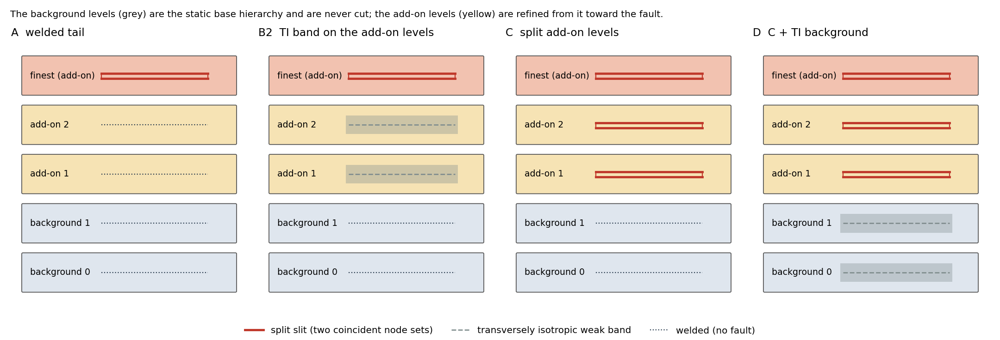
*Each column is one multigrid hierarchy, coarsest at the bottom. The background (grey) is never cut. A: the fault only on the finest level, welded Galerkin levels below. B2: a transversely isotropic weak band rediscretised on the add-on levels. C: every add-on level cut and split like the finest. D: C with a TI band on the background too.*

| | finest | add-on levels | background levels |
|---|---|---|---|
| A | split | welded, Galerkin | welded, Galerkin |
| B2 | split | welded, TI weak band, rediscretised | Galerkin from the TI levels |
| C | split | split, Galerkin | welded, Galerkin |
| D | split | split, Galerkin | broad TI weak zone, rediscretised |

The TI band is a Gaussian in the distance to the trace with half-width equal to the level's near-fault cell size, director along the fault normal, $\eta_1 = \eta^{1-f}\eta_w^{f}$ with $\eta_w = 0.1\,\eta$ for a frictionless fault and $\eta_w = \eta_f w$ for a viscous one.

Test problem: unit box in simple shear ($\mathbf v = (y - \tfrac12, 0)$ on the walls), incompressible Stokes with $\eta = 1$, a straight fault from $(0.30, 0.45)$ to $(0.70, 0.55)$, background `UnstructuredSimplexBox(cellSize=0.1, refinement=1)`, $k$ add-on levels with the finest at $h = 0.05/2^k$. The measure is velocity-block iterations per solve.

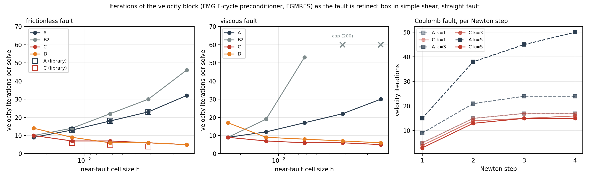
*Left and middle: iterations per solve as the near-fault cell size halves, frictionless and viscous faults (prototype drivers; the open squares are the library path, which reproduces the prototype). A and B2 grow with refinement, C and D fall. B2 stalls on the viscous fault. Right: a Coulomb fault, iterations per Newton step; C stays near 15 where A reaches 50.*

The peak slip agrees to five figures across all four at every $k$: only the solver path changes.

**Why B2 fails and C works.** A smeared band on a coarse level is a continuous steep shear. The split fine operator has a genuine discontinuity, and a coarse correction that cannot represent it is rejected: the coarse space has to contain the discontinuity itself. One TI level directly under the split finest is worse than A at every band strength (27 iterations for A against 29, 46 and 73 for bands at $\eta_w/\eta = 0.1, 0.03, 0.01$ at $k = 4$). With the add-on levels split, the hierarchy is a proper nested-space hierarchy for the faulted problem and the iteration count becomes mesh-independent, in fact falling slightly with depth. D adds nothing at depth and costs a rediscretised background operator per step and two band parameters per problem. The general rule, which the ladder section uses from the other side: *the coarse levels must carry the fault the way the fine operator does*. Split under split; smeared under smeared.

## The ladder as the hierarchy

A fault reaches the mesh by one of two routes:

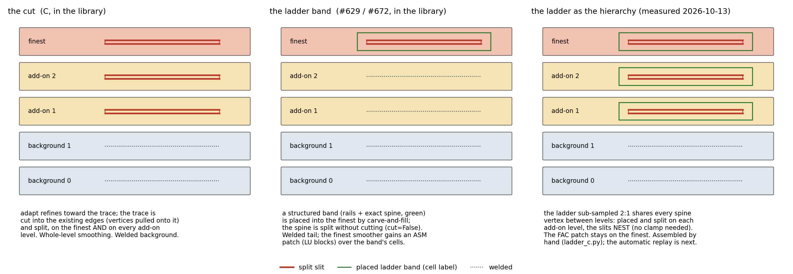
*Left: the cut, where C was built and measured. Middle: the placed ladder band as the fault-network work builds it today (finest only, welded tail, finest-level patch). Right: the ladder sub-sampled 2:1 as the add-on hierarchy, the ruling's shape.*

- **The cut** (`FaultNetwork.build(width=None)`, `mesh.add_fault` with `cut=True`): adapt grades the mesh toward the trace, the trace's control points are pulled onto vertices, every edge the trace crosses is split at the crossing, and the chain is split. The fault's resolution is whatever adapt gave the band. The level replay is literally the same cut on each add-on level.
- **The ladder band** (`FaultNetwork.build(width=w)`, `place_fault_ribbon_2d`, `mesher="ladder"`): a structured band of width $w$ (rails plus the exact spine, transfinite) is placed into the mesh by carve-and-fill, the fault is the band's spine, and the split consumes the spine's own vertices (`cut=False`, nothing snaps). The band is a modelling object (a damage zone, a yielding or TI layer) or, for a split-node model, pure resolution. Its multigrid today is the fault-patch design (#629): the welded base levels as the tail, and the finest level's smoother gains an ASM patch of LU blocks keyed on the band's cell label.

The ruling picks the second route as the hierarchy, because a ladder at spacing $2S$ shares every spine vertex with the ladder at $S$: placed on each add-on level, the levels nest, the slits coincide exactly, the band's cells are structured on every level, and each level can carry the fault either way.

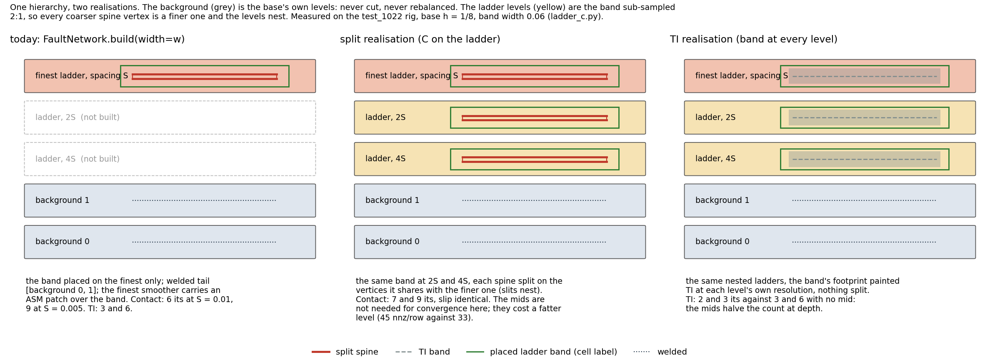
*Left: what `FaultNetwork.build(width=w)` gives today. Middle: the split realisation, the same band at 2S and 4S with the spine split on the vertices it shares with the finer level. Right: the TI realisation, the band's footprint painted TI at each level's own resolution, nothing split. Iteration counts from the measurements below.*

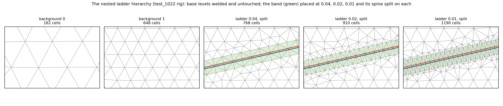
*The hierarchy as built on the `test_1022` rig, zoomed to the band: the two background levels, welded and untouched, and the ribbon placed at spacing 0.04, 0.02 and 0.01 with its spine split on each (Plus red, Minus blue, drawn 0.003 apart). The band cells are shaded.*

**Measured (2026-10-13, `ladder_c.py`).** Base $h = 1/8$ with one refinement; a transfinite ribbon of width 0.06 along the trace $(0.15, 0.42)$ to $(0.85, 0.58)$ at spacing 0.04, 0.02, 0.01, 0.005; the spine cut at the ribbon's own vertices (tips 0.04 inside) and split; the mids are the same ribbon at 2:1 and 4:1, welded or split on the same spine vertices; the tail is the two base levels. Velocity iterations per solve, frictionless contact:

| finest spacing | no mid | welded mid(s) | split mid(s) |
|---|---|---|---|
| 0.01 (one mid, 0.02) | 6 | 7 | 7 |
| 0.005 (two mids, 0.02 and 0.01) | 9 | 9 | 9 |

The slip is identical in every arm (0.2182 and 0.2177) and the opening is at machine precision. The TI realisation on the same ladders (contrast $10^{-3}$, director the band normal, the band's footprint on every level):

| finest spacing | no mid | welded TI mid(s) |
|---|---|---|
| 0.01 | 3 | 2 |
| 0.005 | 6 | 3 |

**The finest ladder is the constraint; the tail is the choice (2026-10-14).** The ladder exists so that stress, and everything read from it (topography, the stress inside against outside the influence zone), is resolved on elements that lie wholly inside or wholly outside the band: the margins are element boundaries. That is a property of the finest level only; the coarse levels are a preconditioner and never see a stress. So the finest is fixed as the base's finest with the ladder placed into it, the fault entering it by the realisation (spine split for an interface law, TI band for a damage zone, both on the same band), and everything below it is free. The base is never cut: the finest is a separate mesh built from it. The question is then how far the welded base carries a single finest ladder, and what to put under it when it does not:

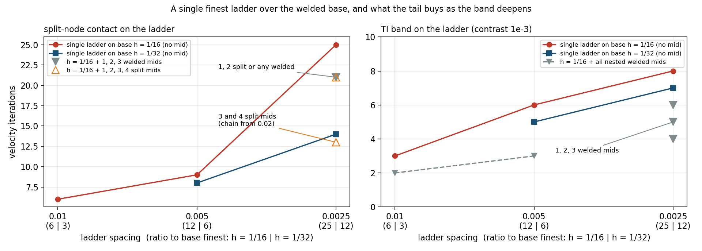
*Velocity iterations as the ladder deepens, on the base with finest cell 1/16 (red) and on a twice-refined base, finest cell 1/32 (blue), with no mid level; the markers at 0.0025 are the tails tried under the 1/16 base. Left, split-node contact; right, the TI band.*

| finest spacing (ratio to base 1/16) | contact, no mid | contact, 1 / 2 / 3 welded mids | contact, 1 / 2 / 3 / 4 split mids | TI, no mid | TI, 1 / 2 / 3 welded mids |
|---|---|---|---|---|---|
| 0.01 (6) | 6 | 7 | 7 | 3 | 2 |
| 0.005 (12) | 9 | 9 | 9 | 6 | 3 |
| 0.0025 (25) | 25 | 21 / 21 / 21 | 21 / 21 / 13 / 13 | 8 | 6 / 5 / 4 |

On the twice-refined base, no mid: contact 8 and 14 at 0.005 and 0.0025 (ratio 6 and 12), TI 5 and 7.

- **A single ladder over the welded base is enough up to a ratio of about 12** for both realisations (contact 9, TI 6). Past that the contact count climbs steeply (25 at ratio 25); the TI count hardly moves (8).
- **For the TI realisation the nested welded mids are a clean, monotone gain** (8, 6, 5, 4 with zero to three mids at ratio 25), and optional.
- **For the split realisation the welded mids do nothing** (21 for one, two or three), which is the B2 result again: a welded coarse space under a split fine operator. One or two split mids near the finest do nothing either (21). The *chain* of split ladders from near the base's spacing (0.02, 0.01, 0.005 under 0.0025; adding 0.04 changes nothing) brings it to 13, which is C on the ladder and is what the split-level machinery is for. A twice-refined base with no mid gives the same count (14): the split chain does the job of base refinement under the band. The chain's levels are fat (57 to 66 nonzeros per row on the mid levels against 27) and cost 40 s against 26 s for the finer base at this size.
- **The count still rises with the band's absolute resolution** on either route (9 at 0.005 to 13 or 14 at 0.0025), unlike C on the cut, which fell with depth. The two have different tails (the cut's levels are 2:1 bisections of the base down to the fault; the ladder's chain starts with a 3:1 welded-to-split jump).

So, under the constraint: keep the band within a ratio of about 12 of the base's finest cell near the fault and the add-on is one level, both realisations, no mids. A base graded toward the fault corridor at construction (`refine_lines`) is the balanced way to get that ratio, since the base is partitioned once for what it holds. Where the base cannot be graded, the TI realisation takes welded nested mids and the split realisation takes the split chain, which needs the ribbon replay.

**What is built and what is not.** The ladder levels in the table were placed and split by hand (one `place_thin_volume` call per spacing, `add_fault(..., split_levels=False)` on each) and handed to `set_custom_fmg` as the tail. The library's replay of a fault onto the add-on levels knows the cut (`("line", ...)`) and the 3-D sheet (`("sheet", ...)`), not yet the ribbon (`("ribbon", traces, width, size)`), so `FaultNetwork.build(width=w)` still gets the finest band only. Writing that recipe, with the realisation as its switch, is the next piece.

## The pieces that make a split level work

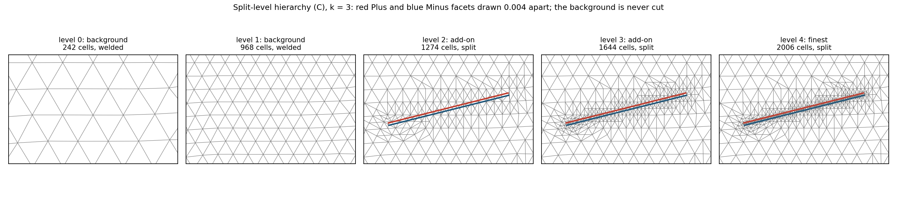
*The cut hierarchy at $k = 3$, zoomed to the fault: two background levels, welded; two add-on levels and the finest, each cut on the same trace and split (Plus red, Minus blue, drawn 0.004 apart).*

**A side-aware transfer.** The transfer between a split coarse level and a split fine level cannot come from the node-cloud builders (barycentric or RBF over the coarse nodes): a slit has coincident coarse nodes and the triangulation of the cloud degenerates. Instead, for each fine node one fine cell containing it is taken, and that cell's centroid is located in the coarse mesh. A centroid is never on the fault, so the located coarse cell is on the node's own side; a node on the slit interpolates from its own side only. The coarse cell's Lagrange interpolant is then evaluated at the node by the dual-basis identity

$$
W = B\,M^{-1}, \qquad M_{im} = \mu_m(\mathbf x_i)\ \text{over the cell's own nodes},\quad B_{tm} = \mu_m(\mathbf x_t)\ \text{at the fine nodes},
$$

with the monomials $\mu_m$ taken in the cell's reference coordinates, so the conditioning depends only on degree and dimension. On the cut the levels are conforming but not nested near the trace, because each cut pulls vertices onto it: a fine node can lie slightly outside its located coarse cell, and the evaluation point is clamped into the cell (barycentric coordinates clipped to $[0,1]$ and renormalised). Without the clamp, extrapolated weights reached 5.4 near a tip and the Galerkin coarse operator had a near-zero diagonal that made SOR return NaN. Off the trace a quadratic is reproduced to $10^{-14}$; within two coarse cells of the trace the clamp costs exactness ($3\times10^{-4}$ at 0.03 from the trace, 0.018 at worst). On the ladder the levels nest and the clamp never fires.

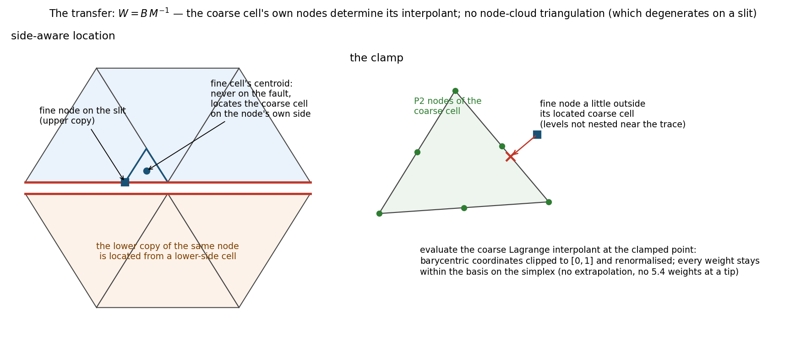
*Left: the fine node on the slit (square) is located through its own cell's centroid (dot), which lies on the node's side. Right: a node outside its located coarse cell is clamped to the nearest point of the cell before the interpolant is evaluated.*

**A per-level pair frame.** Each split level carries its own pair rotation $Q_l$, built from the level's own pairing and facet normals by the same rule as the finest, on the solver's discretisation copied onto the level DM, with no throwaway solver. The rotated prolongation is

$$
\hat P_l = Q_{l+1}\,P_l\,Q_l^{T},
$$

restricted to the admissible unknowns: the finest's opening rows are zeroed (its size is the operator's) and each coarse level's opening rows (and on a surface mesh the jump and mean along the surface normal) are removed. Leaving the opening mode in a coarse space the fine operator constrains out is what split levels without their own frames got wrong.

**Unreached coarse unknowns are dropped, on every hierarchy.** A coarse unknown no fine unknown reaches (a few near the tips; on a welded-to-split transfer a few more) is a null mode of the Galerkin coarse operator. It is removed from the level, fine to coarse. It used to be repaired by nearest-node injection, and that was wrong in serial as well as in parallel: on the ladder's two-mid welded chain four orphans were injected onto fine rows that already carried a weight-1 entry, giving duplicate columns, a singular coarse operator and NaN. The repair is gone (branch commit `03d2d4eb`).

## Optimisations in place

- **One adapt call.** On the cut the add-on levels are the bisection generations of a single `base.adapt(metric, max_levels=k)`, subsampled to one level per halving of the near-fault size (a level that coarsens by less than 1.8 is dropped).
- **Levels by replay.** `add_fault` records the fault recipe (the trace, or the sheet and its placement options) and replays it on each add-on level, finest down; a level the faults cannot be carried onto (a network whose one-cell junction ligament closes at the coarser spacing; a sheet the placement refuses) stays welded with every level beneath it, with a warning.
- **Batched transfer.** Cell location by a kd-tree over the coarse centroids with the best of 16 candidates by minimum barycentric coordinate; the per-cell inverse nodal Vandermonde batched over cells; the weights in chunks of 65536 nodes. No per-cell Python loop in the weight evaluation.
- **No throwaway solvers.** Level frames and reduced layouts come from the solver's fields and discrete system copied onto a clone of the level DM.
- **Transfers reused across Newton steps.** The rotated solve keeps the composed prolongations for the Newton loop; only the operator is re-assembled.
- **Co-located fault stars in parallel.** Each level's fault star is moved onto the rank holding the finest level's star after the split (the pairing rides as labels), so the transfers locate the fault band rank-locally; see below.

## FMG behaviour on the cut

Library path, serial, frictionless fault:

| add-on levels $k$ | near-fault $h$ | C | A |
|---|---|---|---|
| 2 | 0.0125 | 6 | 13 |
| 3 | 0.00625 | 5 | 18 |
| 4 | 0.0031 | 4 | 23 |

Viscous fault at $k = 3$: 5 against 17. The peak slip agrees to six figures. Coulomb (four Newton steps): per-step iterations 3, 13, 15, 15 at $k = 5$ against 15, 38, 45, 50.

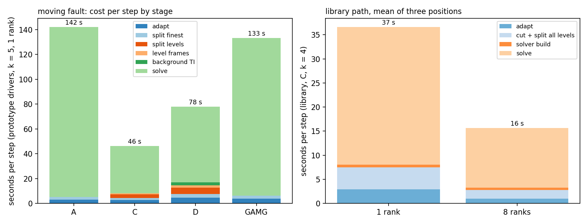
*A fault translated across the box, the add-on part rebuilt and re-split at every position. Left: seconds per step by stage at $k = 5$ in the exploration (seven levels), where C's extra surgery costs about 5 s against a solve three times cheaper than A's. Right: the library path at $k = 4$, three positions, 1 and 8 ranks (a 3000-cell problem; the solve is dominated by set-up, not by Krylov work).*

With the moving fault, C takes 4 to 5 iterations at every position in serial and 7 at 8 ranks; the slip is identical to six figures.

**The thick twin.** `mesh.extrude(L, layers)` builds the thick 3-D twin of a faulted sheet; its tail extrudes the split sheet (through-thickness halvings) and the split add-on levels, so the layer's hierarchy is the sheet's one dimension up. The faulted plate of `test_1083` (two layers, 6024 tetrahedra, 261 pairs): 11 velocity iterations serial, 13 at 2 ranks, slip 0.19356 on both; with one add-on level in the sheet (7524 tetrahedra, 681 pairs): 16 and 20. The thin-layer iteration count still grows with refinement: the through-thickness coupling and the pressure Schur complement on a thin layer are their own question, outside this hierarchy.

## Parallel

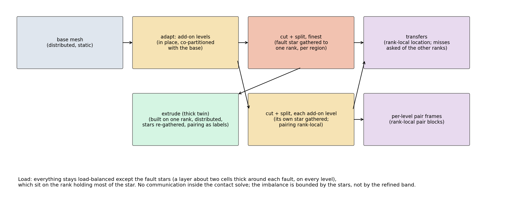
*The pipeline in parallel. The base and its levels are distributed and untouched; the add-on levels are built co-partitioned with the base; the split gathers each fault's cell star onto one rank (two layers of cells, so every pair is born on one rank and the contact solve needs no communication); the levels follow the finest's star; the transfers locate rank-locally and ask the other ranks for what they cannot; the thick twin is built on one rank, distributed, and its stars re-gathered with the pairing carried as labels.*

**Mechanism.** The split's rule (PR #672) is that a fault's cell star is rank-interior: the star is redistributed onto the rank already holding most of it, per region, and every pair block of the rotated operator is then local. The split-level hierarchy keeps that rule on every level. The transfer locates each owned fine node in the local coarse mesh (owned plus ghost cells); the nodes whose coarse cell lives elsewhere are all-gathered as query points, every rank answers the ones it holds, and the asker keeps the best answer. The levels therefore need not be co-partitioned for correctness. The pairing rides every redistribution as a pair of DM labels, one value per pair on its Minus and Plus points, because the migration star forest PETSc returns for an initial distribution does not index the stratified point numbering.

**Is the imbalance in the base mesh? No.** The base and its coarse levels are balanced at every rank count, and nothing here touches them. The imbalance is in the add-on levels, and it has two parts, in this order of size:

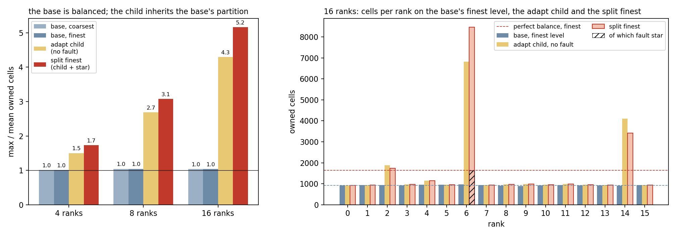
*The box with a base cell of 0.025 and three add-on levels (26230 cells on the finest). Left: the largest rank's share of the mean, for the base's coarsest and finest levels, the add-on child before any fault exists, and the split finest. Right: cells per rank at 16 ranks on the base's finest level, on the add-on child, and on the split finest with the fault star hatched. The band's refinement fell on two of the sixteen ranks.*

| ranks | base levels | add-on child, no fault | split finest (child + star) |
|---|---|---|---|
| 4 | 1.0 | 1.5 | 1.7 |
| 8 | 1.0 | 2.7 | 3.1 |
| 16 | 1.0 | 4.3 | 5.2 |

1. **The add-on child inherits the base's partition.** The base is partitioned for the base, and that is right. The adapt child is built in place, co-partitioned with its parent: every refined cell stays on the rank that owned the cell it came from. The refinement is concentrated in the band, so the ranks whose base cells lie under the band collect most of the new cells. At 16 ranks the base's finest level has about 930 cells per rank and the child puts 6822 on one rank and 4000 on another. This is the larger part of the imbalance and it exists before any fault is split. It is not a property of the base and the base is not the fix: the child is ephemeral and may be partitioned for itself, star-weighted, with every transfer to it already partition-agnostic.
2. **The fault star is gathered onto one rank.** That is the contact design's accepted trade: extra load on the rank that owns a fault in exchange for no communication inside the contact solve. It adds the star (about two cells thick around the fault on each level, 1624 cells here) to a rank that, by the inheritance above, already holds the band. A network's faults go to different ranks region by region (#672), so with many faults the cost is a few stars per rank rather than all on one.

A third thing was a choice and is fixed: each level's star used to go to its own rank, which cost nothing in convergence but made up to half of the finest nodes transfer misses answered remotely. Co-locating every level's star with the finest's (`fault_mg.colocate_split_level`) brings the misses to the band's rim: 2 to 6 % on the split-to-split transfers, 10 to 17 % from the welded background to the first split level, 1 to 4 % throughout the larger case.

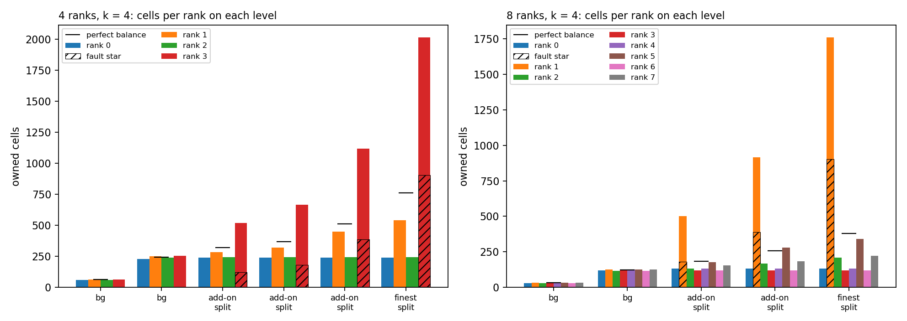
*The same picture per level on the small test box ($k = 4$, 3034 cells on the finest) at 4 and 8 ranks: owned cells per rank on every level, the hatched part of a bar the fault star, the dash the perfect balance. The background levels are balanced; the add-on levels are not, and every level's star sits on the same rank.*

**Iterations and times.** C converges at every rank count tried: $k = 3$ takes 5, 6, 6, 8 iterations at 1, 2, 4, 8 ranks and $k = 4$ 4, 5, 5, 7. The count creeps up with ranks for two reasons: `adapt` keeps one intermediate level fewer at 8 ranks than in serial (its level subsampling is partition-dependent; 4 levels against 5), and the smoother is block-Jacobi across ranks. On the larger case:

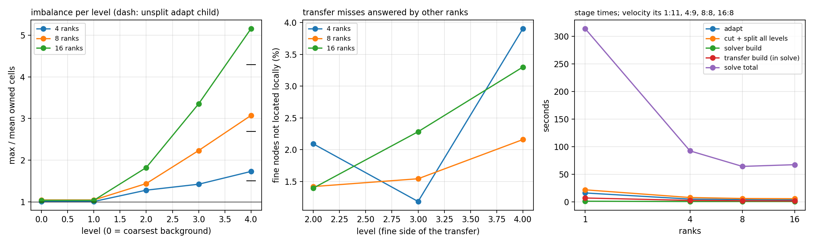
*The 26230-cell case at 1, 4, 8 and 16 ranks: imbalance per level, transfer misses, and stage times.*

| ranks | velocity its | finest max/mean cells | adapt | cut + split all levels | transfers | solve |
|---|---|---|---|---|---|---|
| 1 | 11 | 1.0 | 16.0 s | 21.7 s | 6.8 s | 314 s |
| 4 | 9 | 1.7 | 4.8 s | 7.7 s | 2.4 s | 92 s |
| 8 | 8 | 3.1 | 3.9 s | 5.9 s | 1.8 s | 64 s |
| 16 | 8 | 5.2 | 3.3 s | 5.5 s | 1.5 s | 67 s |

The iteration count holds, the set-up stages scale, and the solve stops scaling at 8 ranks because every smoother sweep and residual waits for the rank that holds the band. In a plate-scale model the band is a small fraction of the mesh and the cap sits correspondingly higher, but it is a cap, and it is set by the add-on levels' inherited partition, not by the base.

**Compromises, in one list.** Rank-interior stars on every level (load on the owning rank; no communication in the contact solve). Add-on levels that inherit the base's partition until they are partitioned for themselves. Levels co-located with the finest by moving their stars (one more redistribution per level per step; the pairing carried as labels). The thick twin built on one rank and then distributed (memory bounded by one rank). Transfer misses resolved by an all-gather of the missed nodes (cheap now that they are the rim). The parallel adapt keeps a different intermediate level than serial.

## An annulus example: the Zhong & Gurnis (1995) analogue

The target model is mantle convection with a plate and a mobile, faulted margin (Zhong & Gurnis, Science 267, 838, 1995): a temperature-dependent lid, a dipping fault at the trench that moves with the overriding plate, surface velocity and dynamic topography read from the solution. The driver is `scripts/sessions/fault_mg/zg95_annulus.py` (branch `feature/fault-split-multigrid`), the probe `zg95_probe.py`, the profile `zg95_profile.py`.

**The construction.** The base annulus ($r_i = 0.55$, coarsest cell 0.16 halved three times to 0.02) carries the temperature and the semi-Lagrangian advection-diffusion, and is never cut or rebalanced. The add-on finest is a copy of the base's finest with the trench placed as the structured ladder: spacing 0.005, one element either side of the spine, dipping 45 degrees from above the surface through the lid to a depth of 0.15, outcropping through the ladder's cap. The spine is split on its rung vertices from three spacings below the surface down (no pair node ever sits on the wall, so the wall and pair frames never cross); the cap and the last rungs are painted transversely isotropic (contrast $10^{-3}$) to bridge the split to the surface. Stokes on the add-on: viscosity $\eta = \exp(\ln 10^{3}\,(1 - T))$, $Ra = 10^{6}$, rotated free-slip on both walls with the exact radial normal, frictionless contact on the spine, custom FMG on the base's own four levels. The velocity goes back to the base by evaluation for the advection step, and the trench is advected with the surface velocity just on the overriding side; the add-on is rebuilt when it has moved by a rung.

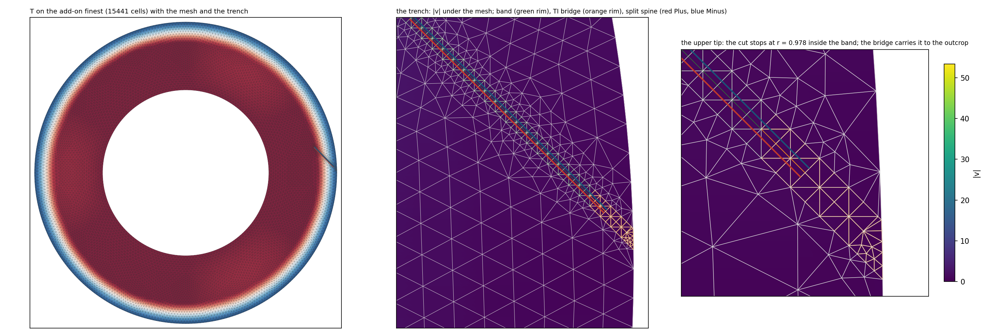
*The add-on finest at the trench: regular rungs with one element either side are the ladder, the orange cells at the surface the cap; the split spine (red Plus, blue Minus) stops three spacings below the surface and the bridge carries it to the outcrop. Velocity magnitude under the mesh.*

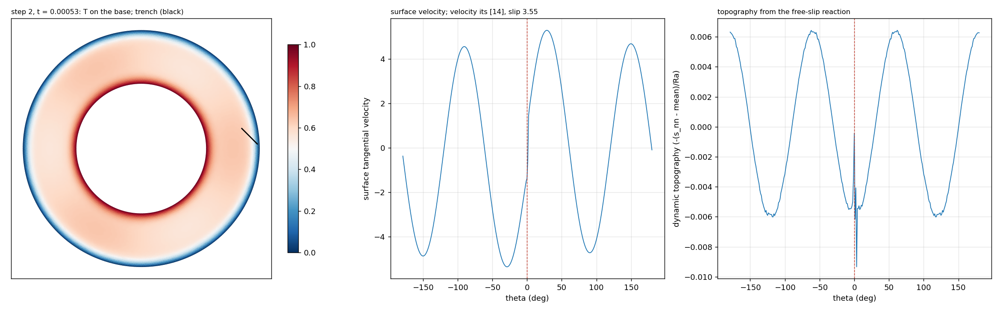
*The driver's first fault step: temperature on the base with the trench, the surface velocity with its step at the fault, the topography with the trench's low and high on top of the convective pattern.*

**What it cost to get there**, each a defect in machinery that had only ever run on boxes:

| defect | symptom | fix |
|---|---|---|
| the placer's domain tool took the annulus loops in whatever winding the walk returned | at cell sizes 0.04 and 0.08 the hole was added as area and the band met nothing | every loop counter-clockwise |
| the 2-D outcrop frame read each chord of the faceted wall as its own wall | a dipping band's clearance cavity refused as contact away from the outcrop; once allowed, the splice chorded across the curve's vertices and lost the sagitta | chords grouped into smooth walls (the 3-D rule); the splice keeps the surviving wall vertices |
| the structured ladder could not outcrop at all | neither realisation could reach the surface; the fallback was an unstructured band with a cut through it | the ladder runs to one rung short of the wall and a clipped cap closes it |
| the orphan rule dropped only exactly unreached coarse unknowns, before the finest's constrained rows were zeroed | wall unknowns with Galerkin diagonals of $10^{-20}$ | relative reach, after the zeroing |
| Cartesian coarse levels under a rotated finest | a coarse wall node's normal component is reached only through fine tangential rows weighted by a vanishing sine; the inode SOR's nodal block inversion hit a zero pivot and the velocity solve failed before its first iteration | every coarse level takes the wall rotation on its own nodes and loses its normal rows |
| the free-slip gauge mode | rejected with facet-averaged normals on an irregular polygon, so the coarse LU met a singular operator | the exact radial normal; and the SVD coarse solve that follows needs a small coarsest level (14k unknowns took over 30 minutes, 900 is instant) |

**Measured.** The probe solve: 10 velocity iterations, slip 1.80; the same case on GAMG 119 iterations. The driver's first fault steps: 14, 12, 14 velocity iterations, slip 3.5, the trench creeping with the overriding plate. One rank against two on the identical two-step case: slip 3.6995 against 3.7005, trench velocity 1.590 against 1.591, topography the same to $10^{-4}$, the solve 60 s against 35 s.

**Meshing against the solve.** Per step on one rank at 15k cells: the base and its levels 2 s once; placement, cap and split 5 s, recurring when the trench has moved a rung (about every twenty steps here); the temperature transfer 1.5 s; the solve 56 to 62 s, of which the hierarchy set-up is the 6 s difference between the first solve and a repeat with the temperature changed. The remaining 50 s is Krylov work, nearly all of it inside the pressure Schur complement, which applies the velocity multigrid at each of its 17 iterations. So the meshing is under a tenth of a rebuilding step and under one percent amortised; the step is the solve, and the solve is the Schur iteration count and the smoother, which is tuning, not meshing.

**A convection run where the fault matters (2026-10-14/15).** The purely viscous state above has no bendable plate and no ridge, so the fault cannot organise plate motion. The campaign was re-anchored on Moresi & Solomatov (GJI 133, 669, 1998): non-dimensionalised on the basal viscosity, $Ra_0 = 10^{7}$, contrast $3\times10^{4}$, Byerlee yield $\tau = 10^{5} + 10^{7} z$ (their mobile-lid reference; the depth gradient at $\tau_1/Ra_0 = 1$ keeps the interior strong, where a tenth of that let the interior yield and run away), internal heating 7 with the base held at $T = 1$, the interior started at 0.8. Implicit SUPG transport, steps capped at $10^{-3}$, eight ranks, 27 to 35 s per step on the base.

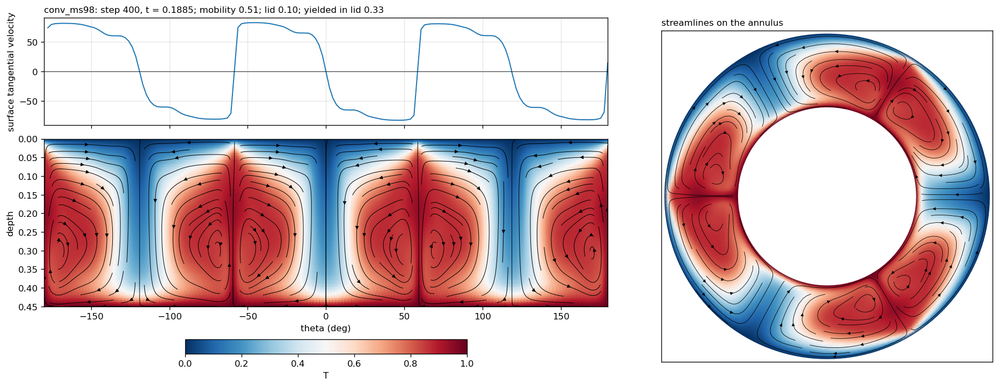
*The control (`conv_ms98`) at step 400: a steady six-cell mobile lid from step 100 on, plateau surface speeds near 80 with sharp reversals over narrow slabs, lid 0.105, a third of it yielding, mid-depth temperature 0.70. Restarting it at equilibrium with the contrast raised to $10^{5}$ and the cohesion to $2\times10^{5}$ gave the sluggish distributed-deformation regime (lid 0.15, mobility 0.2 to 0.4, one broad plate stretching uniformly) with no overturn in 600 steps.*

The fault phase restarts from the control's step-150 checkpoint with the same rheology on the add-on, the trench dipping under the plate on the positive-theta side above the seeded downwelling. Two runs of 300 steps:

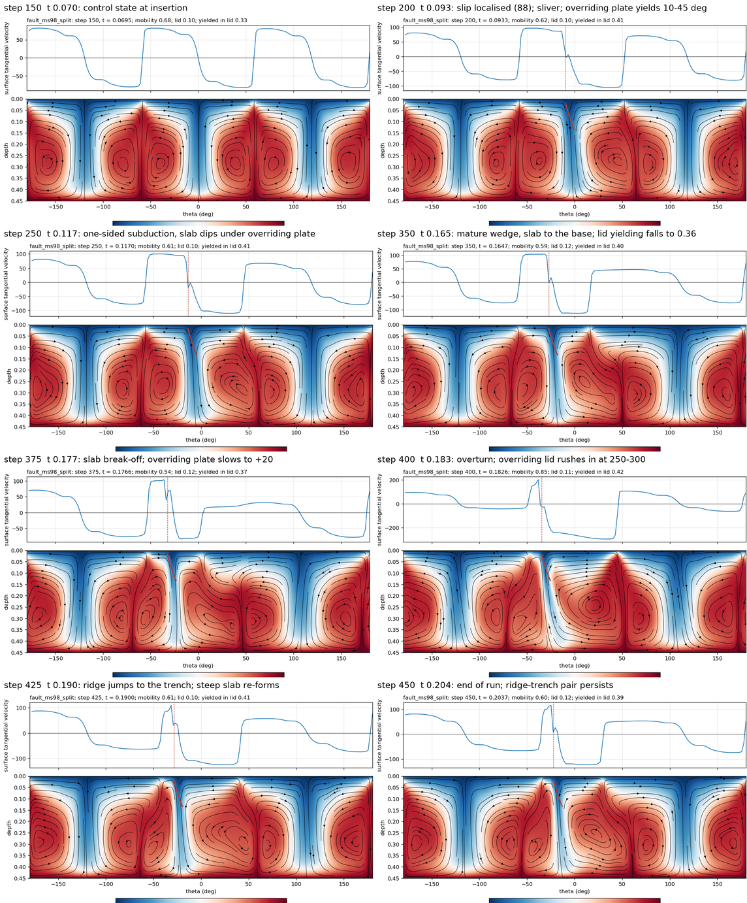
*`fault_ms98_split`, trench velocity sampled 1.7 degrees into the hanging wall, which goes stationary once the fault takes the slip, so the fault stood still. In order: the fault localises the plate boundary (slip 70 to 90) and leaves a stationary sliver, the overriding plate yielding over 35 degrees; the downwelling becomes one-sided, a slab dipping under the overriding plate, the deformation zone narrowing to 10 degrees and the slip rising to 120; the slab breaks off; the sinking fragment pulls the overriding lid in at 250 to 300, an overturn in the Moresi & Solomatov sense triggered locally by the fault; a ridge opens behind the trench and a steep slab re-forms. The five cells away from the fault never changed. Lid yielding averaged 0.40 against the control's 0.33: the fault added yielding on the overriding side, and only approached the control's value while the subduction wedge was mature.*

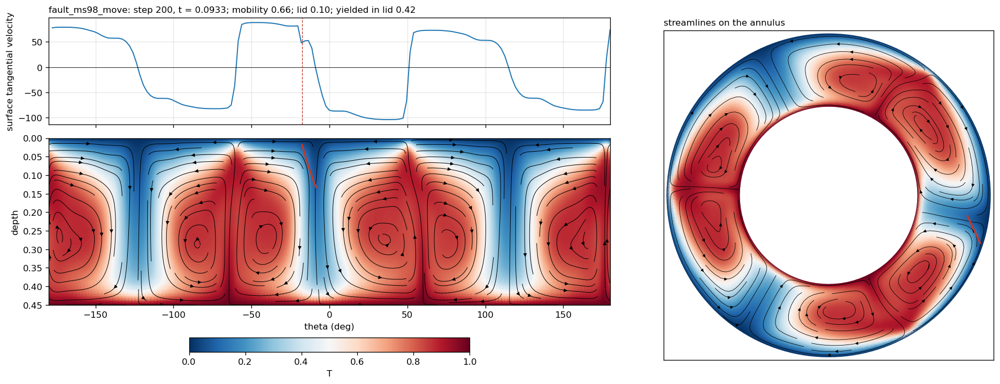
*`fault_ms98_move` (running): the trench follows the overriding plate proper (median surface velocity over a window 0.1 to 0.3 rad beyond the fault), advancing over the subducting plate at 85 to 95. The slab follows the fault at a lag of about 12 degrees and, at this stage, stays vertical and symmetric.*

**What the fault phase cost, and the solver item it exposed.** A cold first step on the faulted add-on took 742 s: 24 nonlinear iterations, and in every Newton-phase solve the pressure (Schur) iteration hit its cap of 200 (42 to 54 in the Picard phase). Picard-only at the same tolerance capped too, from iteration 14, so the cap is not the Newton tangent: it sets in once the nonlinear residual has dropped about a hundredfold, and the base mesh never shows it. Each pressure iteration nests a full velocity multigrid solve, so a capped solve is about 3400 cycles. The working hypotheses are the nested Schur stalling on the inner-solve noise floor once the outer residual is small, or the yielded viscosity on the faulted add-on defeating the $1/\eta$ Schur preconditioner; the probe is one step at two ranks from the checkpoint with the pressure KSP monitored per outer iteration. The runs above use a relative tolerance of $10^{-2}$, Picard-only, which Picard reaches before the cap, and a warm start across the add-on rebuilds (the previous velocity and pressure evaluated onto the new add-on), which halves the step: 25 to 300 s depending on whether the trench moved a rung.

Three parallel-safety defects in the driver came out of the same runs and are the reason the first 8-rank fault run "stuck": a rank-local test deciding whether to write the yield indicator onto the base variable (a collective flush) hung seven ranks in a reduction; a cross-mesh evaluation of the effective-viscosity expression, which holds velocity gradients, cannot be lambdified (evaluate on the owning mesh into a P1 variable and transfer that); the figure's temperature panel was drawn only in serial. The ruling that followed: build parallel-safe infrastructure and then use it, in drivers and examples as much as in the library, since a rank-local shortcut in a script is what users and AI tools copy.

The hand-over note for this campaign is `scripts/sessions/fault_mg/CAMPAIGN.md` on the branch.

## What did not work, and why

- **TI bands on coarse levels under a split finest (B1, B2).** Worse than A at every strength, stalling for a viscous fault: a smeared band is a continuous shear the split fine operator rejects. The coarse space must carry the fault the way the fine operator does.
- **Node-cloud transfers to a split coarse level.** Coincident coarse nodes degenerate the Delaunay triangulation of the cloud; the faulted thick layer's multigrid returned NaN on its first cycle for this reason, which was first misread as a failure of geometric multigrid on the rotated 3-D operator.
- **Extrapolated weights.** Non-nested levels near a pulled tip gave weights up to 5.4 and weakly reached coarse unknowns; a 5 % column-norm pruning heuristic worked but the clamp removes the need for it.
- **Nearest-node injection for orphan columns.** Not correct in serial either: on the ladder's two-mid chain four orphans injected onto fine rows that already carried a weight-1 entry gave duplicate columns, a singular coarse operator and NaN, split and unsplit finest alike; in parallel 512 of 618 orphans duplicated. Dropping the unknowns is the rule on every hierarchy now; the repair is gone.
- **The migration star forest for the pairing.** Fine for a redistribution, wrong for an initial distribution (`DMPlexDistribute` of a one-rank mesh): labels instead.
- **Rebalancing the base after adapt.** Proposed once more in this work and ruled out again: the base holds the fields and is the persistent object; the add-on levels are what gets partitioned.
- **The sheet placement on a bisection-refined 3-D child.** Its volume guard refuses the two-level child at every clearance and sheet size tried (volume change $4\times10^{-6}$ to $5\times10^{-5}$ against a guard of $10^{-9}$); at one add-on level `clearance=0.9` works. General 3-D fault patches on add-on meshes wait on the placement.

## The add-on formulation: where balance lives

The add-on has two goals, an accurate representation of the fault and rapid set-up and tear-down, and the balance of the whole system is a property of the add-on formulation alone: every cell outside the band is a copy of the base and inherits the base's balance. The two levers are fewer band cells and moved band cells; nothing else changes the ratio.

- **Minimal add-on degrees of freedom, no rebalance.** A split-node fault is an exact discontinuity at any resolution, so the leanest add-on is the cut (or the ladder at the base's spacing) on a clone of the base's finest level: the new unknowns are the duplicated spine nodes and the crossing vertices, and the only imbalance is the gathered star, two cell layers along the trace. For a plate-scale model that is a few percent on one rank. A TI band cannot be that lean, since it needs about two elements across its width, so the width sets the refinement. With a band of area fraction $f$ refined $k$ halvings on $P$ ranks, a fault of length $L$ in a domain of width $D$ loads the busiest rank by roughly $f\,4^{k}\sqrt{P}\,D/L$ above the mean: it grows with $\sqrt P$, so the cap moves out but never disappears, and it is dominated by $4^{k}$, which is the case for keeping the band at the base's resolution or one halving below it. The large case on this page refines three halvings across most of the box; those are a toy's proportions.
- **Non-conforming (composite) multigrid.** The fault-patch design already in the library for the finest level, extended to the ladder levels: the band is the only add-on, with no copy of the base, and the levels at $S, 2S, 4S$ live on the band and couple to the base at its rim. It removes the duplicated base from set-up and tear-down and from memory. It does not change the balance, because the band's cells are still on the band's ranks.
- **Partition the add-on levels for themselves.** The transfers are partition-agnostic and the co-location step already pays one redistribution per level per rebuild; a geometric partition of each add-on level weighted by its star costs the same and lifts the cap. The prize on the large case is the 16-rank solve going from about 67 s toward 25 to 30 s. Segmenting one fault's star across ranks is the expensive version, since it puts a pair on a rank seam and breaks the communication-free contact block; not now.

Position (2026-10-14): keep the band lean by realisation; never touch the base; the composite grid is the proper form of the add-on and the ladder its patch; the one cheap partitioning step on the add-on levels is tried and measured against the no-move case before it is kept. The ribbon replay is the prerequisite for all three.

## Open

- **The ribbon replay recipe**, so `FaultNetwork.build(width=w)` gets its nested 2:1 ladder levels on every add-on level automatically, with the realisation (split spine or TI band) as the switch. The hierarchy is measured; the library plumbing is not written.
- **Partitioning the add-on levels for themselves**, star-weighted, the base untouched: the larger part of the measured imbalance and the 8-rank cap.
- The thin layer's own multigrid: iterations grow with refinement on the extruded twin.
- Networks through the levels where the ligament survives the coarsening; faults near a boundary.
- A rank-local extrusion instead of the one-rank build.
- Scaling on a plate-scale problem (the figures here are a toy).
- The pressure-cap solver item of the fault phase (above); the dynamic topography sign convention (peaks over the downwellings in the step figures); the trench rule once the moving-fault run has finished.

## History

- 2026-10-13 — Exploration of A, B2, C, D on the box (prototype drivers), C chosen; library implementation in 2-D, 3-D (extruded layer, sheet patches at one add-on level) and parallel; merged with development's fault-network work (#672); co-location of the level stars; the ladder measured for both realisations; the orphan injection retired.
- 2026-10-14 — The annulus example: the outcropping ladder, the per-level wall rotation, the placer on curved walls; profile of meshing against solve. The depth measurements: a single ladder carries to ratio ~12; TI takes welded mids, contact needs the split chain or a graded base. The add-on formulation section (where balance lives; lean band, composite grid, partition the add-on). Page restructured around the rulings (base never rebalanced; one nested ladder hierarchy with a realisation switch); the parallel imbalance decomposed into base (balanced), inherited child partition and gathered star.

<!-- BEGIN ENTRIES (generated by scripts/build_index.py; do not edit) -->

## Entries

- 2026-10-30 · [The production chain puts the 2S ladder on the base's finest level, beside the S ladder, and the 4S ladder one level down; the rig's band-ratio table is confounded with cell aspect](../entries/2026-10-30-the-production-chain-puts-2s-on-the-finest-base-level-and-4s-one-level-down.md) · finding
- 2026-10-30 · [Ladder levels nest along the spine, not by vertices, when the band widens with the level as production does](../entries/2026-10-30-ladder-levels-nest-along-the-spine-not-by-vertices-when-the-band-widens.md) · finding
- 2026-10-29 · [Which multigrid tail goes under the finest ladder: the lean split chain in production; a single ladder over the welded base only on a linear rig up to a band ratio of about 12](../entries/2026-10-29-which-tail-under-the-finest-ladder-the-lean-split-chain-in-production.md) · decision
- 2026-10-29 · [A per-level wall rotation cuts a rotated free-slip custom-FMG solve on an adapted annulus from 18 serial and 197 parallel velocity iterations to 3 and 4](../entries/2026-10-29-per-level-wall-rotation-cuts-rotated-freeslip-fmg-iterations-on-an-adapted-annulus.md) · measurement
- 2026-10-28 · [Which fault-mesh construction is used in practice: the placed ladder with a hand-built split chain; adapt-and-cut is the automated route the hierarchy was measured on](../entries/2026-10-28-which-fault-mesh-construction-is-used-in-practice.md) · finding
- 2026-10-28 · [The fault-split integration head reproduces UWTN 2026-022's numbers; the suites pass but for two failures that predate it](../entries/2026-10-28-fault-split-integration-head-reproduces-uwtn-2026-022.md) · measurement
- 2026-10-28 · [Coarse solve on the rotated path: handle the null space, leave the coarse level to PETSc's defaults; MUMPS is not the default](../entries/2026-10-28-coarse-solve-null-space-first-petsc-defaults-not-mumps.md) · decision
- 2026-10-15 · [Fault multigrid: the Moresi-Solomatov convection campaign, the fault sequence, the solver item and the hand-over](../entries/2026-10-15-fault-multigrid-the-moresi-solomatov-convection-campaign-the.md) · finding
- 2026-10-14 · [Fault multigrid: the rulings up front; the ladder as the one hierarchy (split or TI); the parallel imbalance decomposed (base balanced, child inherits, star gathers)](../entries/2026-10-14-fault-multigrid-the-rulings-up-front-the-ladder-as-the-one.md) · decision
- 2026-10-14 · [Fault multigrid: the finest ladder is the constraint; how far the welded base carries it, and what each realisation needs under it](../entries/2026-10-14-fault-multigrid-the-finest-ladder-is-the-constraint-how-far-the.md) · finding
- 2026-10-14 · [Fault multigrid: the convection campaign toward a fault that matters (in progress); the inode rule](../entries/2026-10-14-fault-multigrid-the-convection-campaign-toward-a-fault-that.md) · decision
- 2026-10-14 · [Fault multigrid: the annulus example (Zhong & Gurnis analogue), the outcropping ladder, the coarse-level wall rotation, meshing against solve](../entries/2026-10-14-fault-multigrid-the-annulus-example-zhong-gurnis-analogue-the.md) · finding
- 2026-10-14 · [Fault multigrid: the add-on formulation, where balance lives](../entries/2026-10-14-fault-multigrid-the-add-on-formulation-where-balance-lives.md) · finding
- 2026-10-14 · [Dead end: TI bands on coarse levels under a split finest (B1, B2)](../entries/2026-10-14-dead-end-ti-bands-on-coarse-levels-under-a-split-finest.md) · dead-end
- 2026-10-14 · [Dead end: Rebalancing the base after adapt](../entries/2026-10-14-dead-end-rebalancing-the-base-after-adapt.md) · dead-end
- 2026-10-13 · [Fault multigrid: the two embeddings (cut and ladder), the larger-case scaling and where the imbalance comes from](../entries/2026-10-13-fault-multigrid-the-two-embeddings-cut-and-ladder-the-larger.md) · measurement
- 2026-10-13 · [Fault multigrid: the ladder measured (split, welded and no mid; TI); orphan injection retired](../entries/2026-10-13-fault-multigrid-the-ladder-measured-split-welded-and-no-mid-ti.md) · dead-end
- 2026-10-13 · [Fault multigrid: the hierarchies, the split-level design, FMG behaviour and the parallel load](../entries/2026-10-13-fault-multigrid-the-hierarchies-the-split-level-design-fmg.md) · finding
- 2026-10-13 · [Fault multigrid: the base is never rebalanced; partition the add-on child; one ladder hierarchy for split and TI](../entries/2026-10-13-fault-multigrid-the-base-is-never-rebalanced-partition-the-add.md) · finding
- 2026-10-13 · [Dead end: The sheet placement on a bisection-refined 3-D child](../entries/2026-10-13-dead-end-the-sheet-placement-on-a-bisection-refined-3-d.md) · dead-end
- 2026-10-13 · [Dead end: The migration star forest for the pairing](../entries/2026-10-13-dead-end-the-migration-star-forest-for-the-pairing.md) · dead-end
- 2026-10-13 · [Dead end: Node-cloud transfers to a split coarse level](../entries/2026-10-13-dead-end-node-cloud-transfers-to-a-split-coarse-level.md) · dead-end
- 2026-10-13 · [Dead end: Nearest-node injection for orphan columns](../entries/2026-10-13-dead-end-nearest-node-injection-for-orphan-columns.md) · dead-end
- 2026-10-13 · [Dead end: Extrapolated weights](../entries/2026-10-13-dead-end-extrapolated-weights.md) · dead-end

<!-- END ENTRIES -->
