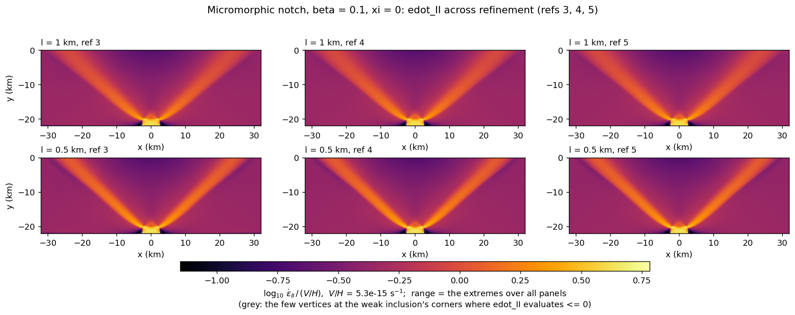
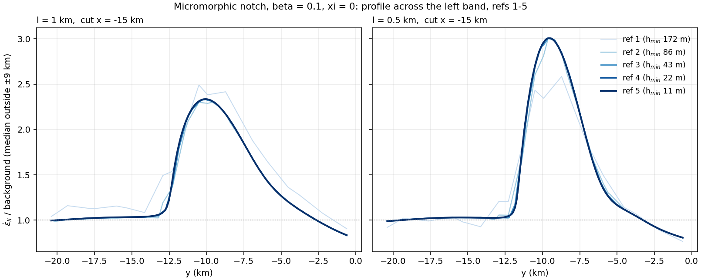
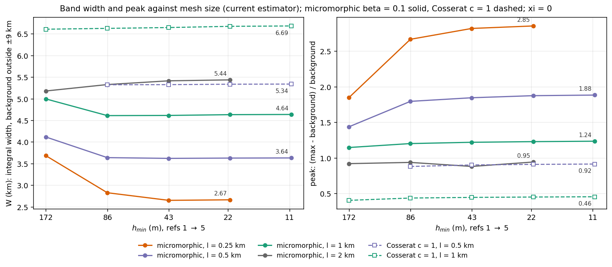
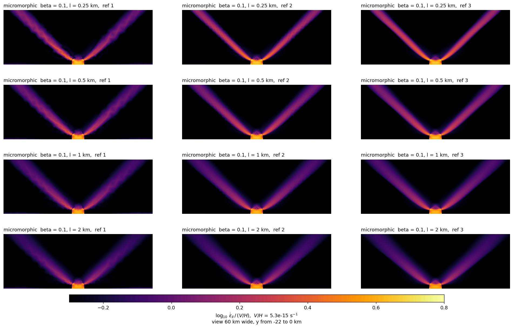
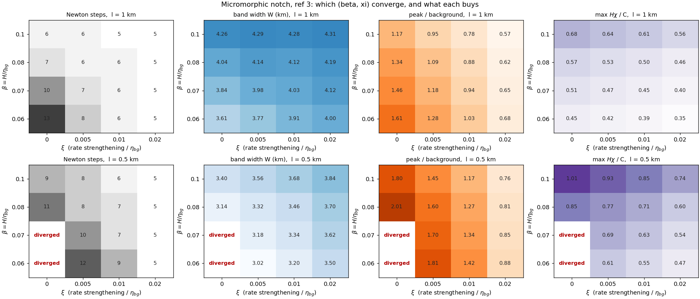
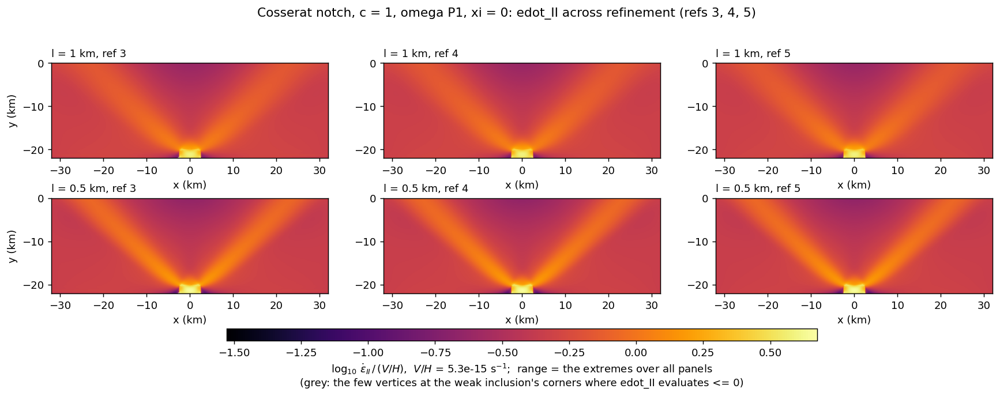
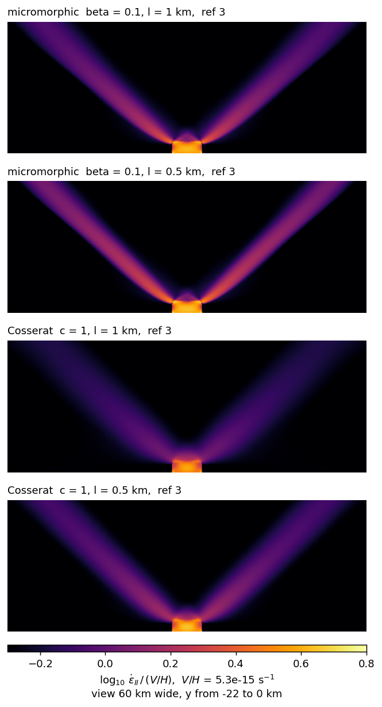

```{note}
Migrated from the wiki page [Shear-band-length-scales](https://github.com/underworldcode/underworld3/wiki/Shear-band-length-scales) on 2026-10-27 as this topic page's starting text (written 2026-10-09 to 2026-10-13). The dated entries at the foot are the record; this text is trimmed as its content moves into guides, subsystem pages and entries.
```


Drucker–Prager plasticity has no length scale, so on the [Spiegelman notch benchmark](../benchmarks/spiegelman-notch-benchmark.md) the shear bands narrow with every mesh refinement and Newton eventually fails. We give the band a length of its own by adding a field to the continuum, solved in the same Newton system as the flow. Two formulations are implemented:
- the **micromorphic** (gradient-plasticity) model, which we use as the default;
- a **2-D Cosserat** continuum.

On the notch both converge at every refinement with no rate strengthening. The micromorphic band width is unchanged from refinement 3 to refinement 5 ($h_{\min}$ = 11 m).

Code: branch `feature/shear-band-length-scale`. Drivers, raw numbers and the full run log: `notch_length_scale/` in [uw3-campaigns](https://github.com/lmoresi/uw3-campaigns) (`REPORT.md`).

## Formulations

### Coupled fields in the Stokes solver

`stokes.add_coupled_field(field, F0, F1=None, momentum_flux=None)` adds a scalar or vector `MeshVariable` $c$ to the Stokes system as an extra DM field, with its own weak form

$$
\int_\Omega \left( F_0\,\psi + \mathbf{F}_1 \cdot \nabla\psi \right) \mathrm{d}\Omega = 0 \qquad \forall \psi .
$$

$F_0$ and $\mathbf F_1$ may depend on $\mathbf u$, $p$, $c$ and their gradients. `momentum_flux` is a stress added to the momentum flux. `add_coupled_dirichlet_bc(value, boundary, field)` fixes $c$ on a boundary; without it, $c$ has the natural condition $\mathbf F_1\cdot\mathbf n = 0$.

Every Jacobian block between $c$ and $(\mathbf u, p)$ is derived symbolically, so Newton sees the full coupling. Ordinary Stokes solves are unaffected; their generated C is byte-identical. Tests: `tests/test_1070_stokes_coupled_fields.py`.

### Micromorphic plasticity (the default)

A scalar field $\chi$, with the units of a strain rate, is tied to the strain-rate invariant $e = \dot\varepsilon_{II}$ by two terms added to the dissipation:

$$
\Psi_\chi = \frac{H}{2}\,(e - \chi)^2 + \frac{A}{2}\,|\nabla\chi|^2, \qquad A = H\,\ell^2 .
$$

Stationarity in $\chi$ makes $\chi$ the strain rate smoothed over the length $\ell$:

$$
H\,(\chi - m\,e) - \nabla\cdot(A\,\nabla\chi) = 0
\quad\Longleftrightarrow\quad
\chi - \ell^2\nabla^2\chi = m\,e ,
$$

where $m$ masks the plastic layer, so a viscous inclusion does not drive $\chi$. Stationarity in $\mathbf u$ shifts the yield stress by $H(e - \chi) = -A\nabla^2\chi$:

$$
\sigma_y = \mathrm{smoothmax}\!\left( C + p\sin\phi + m\,H\,(e - \chi),\; s_{\min} \right).
$$

Where deformation is concentrated more sharply than $\ell$, $e > \chi$ and the material is stronger; on the flanks of a band it is weaker. Strain spreads until it varies over about $\ell$, and where it already does, $\chi \approx e$ and the law is plain Drucker–Prager. For a perturbation of wavenumber $k$ the shift is

$$
\hat s = H\,\frac{\ell^2k^2}{1 + \ell^2k^2}\;\hat e ,
$$

a rate strengthening of modulus $H$ that acts only on modes shorter than $\ell$. Rate strengthening $\xi$ acts at every wavelength and so sets no length.

Parameters:
- $\ell$, the length;
- $H = \beta\,\eta_{bg}$, the modulus. It must be comparable to the yielded viscosity $\tau_y/\dot\varepsilon_{\mathrm{band}}$: on the notch $\beta \ge 0.06$–0.08.

```python
chi = uw.discretisation.MeshVariable("chi", mesh, 1, degree=1, units="1/s")
H = uw.expression(r"H_{\chi}", uw.quantity(0.1 * eta_bg, "Pa*s"), "micromorphic modulus")
ell = uw.expression(r"\ell", uw.quantity(1.0, "km"), "micromorphic length")
e = stokes.Unknowns.Einv2           # strain-rate invariant
m = material.sym[0]                 # 1 in the plastic layer, 0 elsewhere

stokes.add_coupled_field(
    chi,
    F0=H * (chi.sym[0] - m * e),
    F1=H * ell**2 * chi.sym.jacobian(mesh.CoordinateSystem.N),
)

s_min = 0.02 * C
stokes.constitutive_model.Parameters.yield_stress = uw.maths.smooth_max(
    C + sin_phi * p.sym[0] + m * H * (e - chi.sym[0]), s_min, s_min)
```

### 2-D Cosserat continuum

A micro-rotation rate $\omega$ (a scalar in 2-D) relative to the continuum spin $W = \tfrac12(\partial_x u_y - \partial_y u_x)$ adds a skew stress to the momentum balance and has its own moment balance:

$$
\boldsymbol\sigma \to \boldsymbol\sigma + 2\eta_c\,(W - \omega)\,\mathbf E,
\qquad \mathbf E = \begin{pmatrix}0&-1\\1&0\end{pmatrix},
$$

$$
-\nabla\cdot\mathbf{m} + 4\eta_c\,(\omega - W) = 0,
\qquad \mathbf{m} = 2\,\eta_{\mathrm{eff}}\,\ell^2\,\nabla\omega .
$$

The yield law sees the generalised invariant $e_{\mathrm{gen}}^2 = \dot\varepsilon_{II}^2 + \tfrac12\ell^2|\nabla\omega|^2$. So $\eta_{\mathrm{eff}} = \tau_y/(2e_{\mathrm{gen}})$ scales both the deviatoric and the couple stress, and a band narrower than $\ell$ pays for its rotation gradient. The Cosserat viscosity $\eta_c = c\,\eta_{\mathrm{lin}}$ does not yield.

Parameters: $\ell$ and $c$.

```python
omega = uw.discretisation.MeshVariable("omega", mesh, 1, degree=1, units="1/s")
spin = stokes.Unknowns.W[1, 0]
grad_omega = omega.sym.jacobian(mesh.CoordinateSystem.N)
eta_c = c * eta_lin

cm = stokes.constitutive_model      # generalised invariant in the yield law
edot_II = cm._strainrate_inv_II.sym
cm._strainrate_inv_II.sym = sympy.sqrt(edot_II**2 + ell**2 * (grad_omega * grad_omega.T)[0, 0] / 2)

stokes.add_coupled_field(
    omega,
    F0=4 * eta_c * (omega.sym[0] - spin),
    F1=2 * cm.viscosity * ell**2 * grad_omega,
    momentum_flux=2 * eta_c * (spin - omega.sym[0]) * sympy.Matrix([[0, -1], [1, 0]]),
)
```

## Example: the Cosserat shear layer

A linear Cosserat layer $0 < y < 1$, sheared by $u_x(1) = U$ with $\omega = 0$ on both walls, has a closed form. Take $\eta = \eta_c = 1$ and couple modulus $B = 2\eta\ell^2 = 0.02$. The shear stress $\sigma_{xy} = T$ is constant, and

$$
\omega = -\frac{T}{2\eta}\left[1 - \frac{\cosh k(y - \tfrac12)}{\cosh(k/2)}\right],
\qquad k^2 = \frac{4\eta_c\,\eta}{B\,(\eta + \eta_c)},
\qquad (\eta + \eta_c)\,u_x' + 2\eta_c\,\omega = T .
$$

P2 $\omega$ and P2 $\mathbf u$ converge at third order:

| $h$ | $\lVert\omega - \omega_{\mathrm{exact}}\rVert_2$ | $\lVert u_x - u_{\mathrm{exact}}\rVert_2$ |
|---|---|---|
| 1/8 | 1.09e-3 | 1.16e-4 |
| 1/16 | 1.50e-4 | 1.53e-5 |
| 1/32 | 1.93e-5 | 1.94e-6 |

The two coarser levels are a regression test in `test_1070`.

## Example: the Spiegelman notch

The notch of the [Spiegelman notch benchmark](../benchmarks/spiegelman-notch-benchmark.md):
- $\eta_{bg} = 10^{23}$ Pa s, convergence 5 mm/yr, $\phi = 30°$, $C = 10^8$ Pa, residual strength $0.02\,C$;
- the smooth (sqrt soft-min) yield law, no rate strengthening ($\xi = 0$) unless stated;
- refinements 1–5 of `notch_mesh1`, with $h_{\min}$ = 172, 86, 43, 21 and 11 m at the notch tip. The elements crossing the band are 530, 265 and 132 m at refinements 3, 4 and 5.

**Solving it:**
- consistent Newton from the viscous seed, with $\chi = 0$;
- exact LU of the Jacobian as the reference;
- in production, the default fieldsplit, with velocity and $\chi$ together under geometric FMG and pressure in the Schur split;
- every linear solve tight ($10^{-8}$), because Eisenstat–Walker makes Newton crawl here;
- refinements 4 and 5 grid-sequenced from the level below;
- refinement 5 ran on 16 ranks.

### Micromorphic: the width does not change with refinement



*$\log_{10}\dot\varepsilon_{II}$ at refinements 3, 4 and 5 (columns), $\ell$ = 1 and 0.5 km (rows), β = 0.1, one colour scale for every panel.*


*The left band at x = −15 km with the mesh: 9, 18 and 35 elements across the band at refinements 3, 4 and 5 for $\ell$ = 1 km.*



*$\dot\varepsilon_{II}$ over the far-field background across the left band. Refinements 2–5 lie on one curve.*



*Band width and peak strain rate against $h_{\min}$: micromorphic (β = 0.1) solid, for every $\ell$; Cosserat (c = 1) dashed.*

Band width $W$ (km), β = 0.1. $W$ is the area of $\dot\varepsilon_{II}$ above the far-field background on a vertical cut through one limb, divided by the peak height and taken normal to the band, as the median of 8 cuts. The background is the median outside ±9 km of the peak.

| $\ell$ (km) | ref 3 | ref 4 | ref 5 | Newton steps, ref 4 / 5 |
|---|---|---|---|---|
| 0.25 | 2.66 | 2.67 | | 13 (inexact Newton) |
| 0.5 | 3.63 | 3.63 | 3.64 | 5 / 5 |
| 1 | 4.62 | 4.64 | 4.64 | 5 / 5 |
| 2 | 5.42 | 5.44 | | 5 |

- The peak strain rate changes by under 1% between refinements 4 and 5.
- The yield-stress floor is never reached.

### Multigrid cost: flat where the length is resolved

Krylov iterations per Newton step (median / max), with every linear solve tight to $10^{-8}$:
- $h$ is the element crossing the band at x = −15 km: 2.1, 1.1, 0.53, 0.27 and 0.13 km at refinements 1–5;
- refinements 1–3 start cold from the viscous seed;
- refinements 4–5 are grid-sequenced, so their steps are fewer and easier.

| model | ref 1 | ref 2 | ref 3 | ref 4 | ref 5 |
|---|---|---|---|---|---|
| micromorphic $\ell$ = 2 km | 34/36 | 36/37 | 34/38 | 27/37 | |
| micromorphic $\ell$ = 1 km | 36/37 | 36/44 | 36/43 | 27/39 | 32/38 |
| micromorphic $\ell$ = 0.5 km | 39/43 | 49/64 | 54/88 | 33/51 | 37/47 |
| micromorphic $\ell$ = 0.25 km | 43/52 | 63/188 | stagnates | inexact Newton only | |
| Cosserat $\ell$ = 1 km | 36/36 | 34/36 | 34/35 | 32/39 | 47/49 |
| Cosserat $\ell$ = 0.5 km | 35/37 | 36/37 | 35/36 | 32/38 | 27/38 |
| no length scale, $\xi$ = 0.03 | 35/38 | 47/50 | linear solve fails | | |

Where the band is resolved on the coarse multigrid levels, the cost per Newton step does not change with refinement. That holds for micromorphic $\ell \ge$ 1 km and for Cosserat. The one exception is a single point: Cosserat at $\ell$ = 1 km rises to 47 at refinement 5, on 16 ranks. It grows as the band approaches the coarse-level element size (micromorphic $\ell$ = 0.5 and 0.25 km). Without a length scale, the band shrinks with $h$ and the linear solve fails at refinement 3: 36, then 226, then 500 iterations, ending in `DIVERGED_LINEAR_SOLVE`.

### Inexact Newton: loose linear solves are enough

Once the band has a length scale, the linear solves need not be tight. Micromorphic, β = 0.1, $\ell$ = 1 km, starting from the viscous solution, on 4 ranks:

| linear solves | ref 2: Newton / total Krylov | ref 3: Newton / total Krylov | $W$ at ref 3 (km) |
|---|---|---|---|
| every solve to $10^{-8}$ | 6 / 231 | 6 / 227 | 4.617305 |
| fixed rtol $10^{-4}$ | 6 / 97 | 6 / 91 | 4.617304 |
| Eisenstat–Walker capped at $10^{-3}$ | 6 / 69 | 7 / 68 | 4.617305 |
| Eisenstat–Walker capped at $10^{-2}$ | 7 / 54 | 7 / 43 | 4.617272 |

- Capping the Eisenstat–Walker forcing at $10^{-2}$ cuts the Krylov work 4–5 times for at most one extra Newton step, and the width agrees to $10^{-5}$.
- The uncapped default (forcing up to 0.1–0.3) took 15, 57 and more than 40 Newton steps at refinements 1–3: its early directions were loose enough that the line search fell to λ = 0.01–0.1.

Multigrid and inexact Newton work here for the same reason. The regularised solution is not sensitive to small changes in the iterate, so a loose linear solve and a coarse-grid correction both point the right way. Without the length scale the band follows the mesh, and small changes move it.

The same capped tolerance on the law with no length scale ($\xi$ = 0.03) shows where this reading needs care:

| linear solves | ref 2: Newton / Krylov / $W$ | ref 3: Newton / Krylov / $W$ |
|---|---|---|
| every solve to $10^{-8}$ | 6 / 264 / 3.92 km | linear solve fails (500 iterations at step 2) |
| Eisenstat–Walker capped at $10^{-2}$ | 7 / 56 / 3.92 km | 12 / 152 / 3.49 km |

- **The loose solve gets the unregularised problem through refinement 3**, where every tight solve failed. Whether the solver converges does not tell the two problems apart.
- **The answer does.** Without a length scale the width keeps falling with $h$ (4.43, 3.92, 3.49 km at refinements 1–3), while the micromorphic width settles (4.61, 4.62, 4.64 km).
- **The tight linear solve is the symptom.** It fails on the unregularised problem because that problem is sensitive to small changes, and the inexact solve does not see this. The mesh dependence of $W$ is the test to use.

### What the parameters do

- **$\ell$ sets the width**, less than proportionally: 2.7, 3.6, 4.6 and 5.4 km at $\ell$ = 0.25, 0.5, 1 and 2 km.

  

  *β = 0.1, ξ = 0. Rows: $\ell$ = 0.25, 0.5, 1, 2 km. Columns: refinements 1–3.*
- **$\beta$ must clear a threshold**, then widens the band a little:
  - with $\xi = 0$ the solve converges at refinement 3 for $\beta \ge 0.06$ at $\ell$ = 1 km and $\beta \ge 0.08$ at $\ell$ = 0.5 km;
  - $\beta$ = 0.01 has no measurable effect.
- **$\xi$ sets the band intensity, not its width.** At β = 0.1, $\ell$ = 1 km, raising $\xi$ from 0 to 0.02 lowers the peak 2–3× and changes $W$ by 1%. A small $\xi$ (0.005–0.02) removes the $\beta$ threshold and gives 5 Newton steps everywhere; it is optional.
- **$\beta$ sets how much the band is strengthened.** In the band the shift $H(e-\chi)$ peaks at about $3.7\beta C$, nearly independent of $\ell$: 0.37 C at β = 0.1, 0.75 C at 0.2 and 1.1 C at 0.3. The flanks are weakened by 0.1–0.2 C. The largest shift is at the notch tip: 3.4 C at β = 0.1.

  

  *Refinement 3, $\ell$ = 1 km (top) and 0.5 km (bottom): Newton steps, band width, peak over background, and the largest $H\chi/C$ (a bound on how far the shift $H(e-\chi)$ can lower the yield stress, not the shift itself). The widths in this figure use the whole-cut median as background and read about 8% below the table above.*

### Cosserat

With $c = 1$ and P1 $\omega$ the Cosserat model converges at every refinement at $\xi = 0$:
- 4–5 exact Newton steps at refinements 1–3;
- 3–4 grid-sequenced steps at refinements 4 and 5.

Its width does not change with refinement either:

| $\ell$ (km) | ref 1 | ref 2 | ref 3 | ref 4 | ref 5 | peak, ref 5 |
|---|---|---|---|---|---|---|
| 0.5 | | 5.33 | 5.33 | 5.34 | 5.34 | 0.92 |
| 1 | 6.61 | 6.63 | 6.65 | 6.68 | 6.69 | 0.46 |

At the same $\ell$ and $c = 1$ the Cosserat bands are about 45% wider than the micromorphic ones (6.69 against 4.64 km at $\ell$ = 1 km) and 2–2.7 times weaker in peak strain rate. The width barely changes between $c$ = 0.5 and 1, with the degree of $\omega$, or with $\xi$. $\ell$ does not mean the same thing in the two models, and at equal width the bands are nearly the same.



*Cosserat, c = 1, ξ = 0: $\log_{10}\dot\varepsilon_{II}$ at refinements 3, 4 and 5 (columns), $\ell$ = 1 and 0.5 km (rows).*



*Refinement 3, ξ = 0, colour range clipped to the bands. Top: micromorphic, β = 0.1, $\ell$ = 1 and 0.5 km. Bottom: Cosserat, c = 1, $\ell$ = 1 and 0.5 km.*

### Micromorphic and Cosserat at equal band width

The Cosserat width is set by $\ell$ first and by $c = \eta_c/\eta_{lin}$ second.


*Cosserat at refinement 3, exact LU, ξ = 0: band width, peak over background and Newton steps over $\ell$ and $c$. Orange contours: the micromorphic widths at β = 0.1, $\ell$ = 0.25, 0.5 and 1 km.*

- **Cosserat has a threshold in $c$**, as micromorphic has one in $\beta$: $c$ = 0.01 never converges, $c$ = 0.03 converges only at $\ell \ge$ 0.5 km, and $c \ge$ 0.1 converges everywhere.
- **Small $c$ narrows the band**: at $\ell$ = 1 km, $W$ = 6.65, 5.88 and 4.16 km for $c$ = 1, 0.1 and 0.03.

Cosserat settings matched to the micromorphic widths at refinement 3:

| $W$ (km) | micromorphic, β = 0.1 | Cosserat ($\ell$, $c$) | Cosserat $W$ | peak, micromorphic / Cosserat |
|---|---|---|---|---|
| 2.66 | $\ell$ = 0.25 km | (0.14 km, 1) | 2.66 | 2.82 / 2.71 |
| 3.63 | $\ell$ = 0.5 km | (0.236 km, 1) | 3.63 | 1.85 / 1.75 |
| | | (0.25 km, 0.1) | 3.60 | 1.85 / 1.78 |
| 4.62 | $\ell$ = 1 km | (0.37 km, 1) | 4.67 | 1.22 / 1.18 |
| | | (0.5 km, 0.054) | 4.70 | 1.22 / 1.15 |


*Refinement 3, strain rate over background on the vertical cut at x = −15 km. Solid: micromorphic. Dashed: Cosserat, $c$ = 1. Dotted: Cosserat, small $c$.*

- **At equal width the bands are nearly the same.** Peaks agree within 3–6%. At $c$ = 1 the Cosserat $\ell$ is 0.4–0.55 of the micromorphic one. At 4.62 km the $c$ = 1 band has the same dip (45°) but its trace lies about 1 km higher on every cut, so it roots higher on the notch; the small-$c$ trace follows the micromorphic one within about 0.3 km. At 3.63 km the traces agree within the 1 km left–right scatter of the micromorphic band itself.
- **The Cosserat widths are mesh-independent.** From refinement 3 to 4 they change by under 0.3%, except at 2.66 km (2%).

Solver cost on the matched pairs, with tight FMG (rtol 1e-8, no Eisenstat–Walker):
- Refinements 1–3 ran on 4 ranks, starting from the viscous solution.
- Refinement 4 ran on 8 ranks, grid-sequenced from refinement 3.
- "Cold" means starting from rest, with the one automatic Picard step written as "1 +".

| $W$ (km) | model | Newton steps, refs 1 / 2 / 3 | Krylov per step, ref 3 | Newton, ref 4 | cold, refs 1 / 2 / 3 |
|---|---|---|---|---|---|
| 2.66 | micromorphic $\ell$ 0.25 | 8 / 10 / stalled | — | stalled | 1+8 / 1+10 / stalled |
| 2.66 | Cosserat (0.14, 1) | 7 / 10 / 9 | 63 | 4 | 1+7 / 1+9 / — |
| 3.63 | micromorphic $\ell$ 0.5 | 6 / 8 / 9 | 54 | 5 | 1+7 / 1+7 / 1+9 |
| 3.63 | Cosserat (0.236, 1) | 6 / 6 / 5 | 45 | 3 | 1+6 / 1+7 / — |
| 3.63 | Cosserat (0.25, 0.1) | 6 / 7 / 8 | 46 | 4 | failed / failed / 1+12 |
| 4.62 | micromorphic $\ell$ 1 | 5 / 6 / 6 | 36 | 5 | 1+7 / 1+7 / 1+7 |
| 4.62 | Cosserat (0.37, 1) | 5 / 5 / 5 | 37 | 3 | 1+6 / 1+6 / 1+6 |
| 4.62 | Cosserat (0.5, 0.054) | 6 / 6 / 6 | 38 | 4 | failed / failed / — |

*Krylov: median per Newton step. "Stalled": a linear solve made no progress for an hour and was stopped. "Failed": 40 Newton steps without convergence. "—": not finished.*

- **Cosserat with $c$ = 1 takes as many Newton steps or fewer**, and its Krylov counts per step are similar.
- **At 2.66 km the micromorphic FMG solve stalls at refinement 3, and Cosserat converges.**
- **Small-$c$ Cosserat converges from the viscous solution but not from rest.**
- **A stiffer micromorphic coupling does not close the gap.** These pairs put micromorphic close to its $\beta$ threshold and Cosserat ten times above its $c$ threshold, so we repeated two of them at larger $\beta$, with $\ell$ retuned to the same width:

| $W$ (km) | micromorphic | Newton steps, refs 1 / 2 / 3 | Krylov per step, refs 1 / 2 / 3 | Newton, ref 4 |
|---|---|---|---|---|
| 3.63 | β 0.1, $\ell$ 0.5 | 6 / 8 / 9 | 39 / 49 / 54 | 5 |
| 3.63 | β 0.3, $\ell$ 0.272 | 7 / 8 / 10 | 38 / 45 / 43 | 4 |
| 3.63 | β 1, $\ell$ 0.148 | 14 / 22 / 27 | 35 / 40 / 41 | 3 |
| 2.66 | β 0.3, $\ell$ 0.138 | 8 / 17 / 17 | 42 / 72 / 155 | 5 |

  A larger $\beta$ costs Newton steps and strengthens the band more (see "What the parameters do"). At 2.66 km the multigrid cost still grows with refinement. Cosserat with $c$ = 1 stays cheaper for narrow bands.

## Example: the extruded notch in 3-D

The 2-D notch extruded along strike $z$ and meshed with tetrahedra (P2 velocity, P1 $\chi$). The faces $z = 0$ and $z = L_z$ carry $u_z = 0$, so they are symmetry planes. Micromorphic, $\ell$ = 1 km, $\xi = 0$, 1.2 km elements across the band (about 2-D refinement 1.8, where $W \approx$ 4.6–5.0 km), $L_z$ = 6 km, 8 ranks.

| | β = 0.1 | β = 0.3 |
|---|---|---|
| Newton steps | 6 | 5 |
| Krylov per step | 29–46 | 25–37 |
| $W$ at mid-strike (km) | 4.59 | 5.68 |
| $W$ along strike (km) | 4.54–4.60 | 5.60–5.76 |
| peak | 1.18 | 0.65 |

The 3-D model reproduces 2-D: the same Newton count, flat multigrid, and a width within about 1.5% of 2-D at the same element size (peak 1.20–1.22 in 2-D). Two things were needed:
- the shared-graph JIT, which generates 54 KB of C for this problem against 22 MB before it;
- a coarse multigrid base, because the direct solve on the coarsest level dominated the cost on a fine base.

On a 1,387-tet base (refinement 2, 8 ranks), PETSc's native LU on the coarsest level costs 13% more than MUMPS: 1830 s against 1625 s, with the same 6 Newton steps and 51 Krylov iterations. A genuinely coarse base makes the native solve cheap enough, so MUMPS is not needed. The Krylov tolerance capped at $10^{-2}$ works in 3-D as in 2-D: 51 Krylov iterations against 229 with every solve to $10^{-8}$, 4.2× less time with the same coarse solver, and $W$ the same to five digits.

### Independent gmsh meshes as multigrid levels

On a fine base the direct solve on the coarsest multigrid level dominates the cost. With native LU, a 6,067-tet base cost 57 s per Krylov iteration, against 36 s on a 1,387-tet base carrying twice the fine mesh. The base has to be fine enough to mesh the notch's fillets, yet as coarse as possible for the direct solve. So we use independent gmsh meshes as the coarse levels, as the fault stack-on adaptation does:
- the coarsest gmsh mesh barely resolves the notch;
- each gmsh level meshes the true geometry, so the crude bottom does not reach the fine grid;
- nested refinement goes only on top of the largest gmsh mesh, because gmsh is slow for large 3-D meshes;
- the transfers between non-nested levels are barycentric (`utilities/custom_mg.py`), and the coarse operators are Galerkin products, as before.

The coupled field shares the velocity block, so the transfer has to carry $\chi$ with the velocity. `set_custom_fmg(field_id=0)` now builds one transfer per field of the block, each at its own degree, and scatters them into the block's numbering. Before this, a velocity-only transfer made PETSc's Galerkin product fail (test_1075).

Both runs below use the same fine mesh: a gmsh mesh with the fillet surfaces at 0.15 km (5,116 tets), refined once. Micromorphic β = 0.1, $\ell$ = 1 km, Krylov tolerance capped at $10^{-2}$, 8 ranks each. Both were started together and timed with PETSc's `-log_view`:

| coarse levels | coarsest direct solve | Newton | Krylov | Newton solve | whole run | preconditioner apply | coarse LU factorisation |
|---|---|---|---|---|---|---|---|
| nested refinement only | LU on 5,116 tets | 6 | 55 | 4514 s | 2 h 26 min | 7955 s | 3941 s |
| gmsh 230 → 619 tets, then nested | LU on 230 tets | 6 | 55 | 2477 s | 1 h 05 min | 3012 s | 7.1 s |

The solution and the iteration counts are identical, and $W$ = 4.874 km in both. In the nested run, factorising and applying the coarse LU take most of the time (3,941 s and 3,335 s), and in the gmsh run 7 s and 227 s. Smoothing then becomes the main cost. The nested run spent its last 80 minutes alone on the machine, so if anything the 1.8× and 2.2× gains are understated. The crude bottom costs the multigrid nothing in convergence and removes the coarse-solve bottleneck. With independent gmsh levels we no longer need snapping either (see "What did not work").

## What did not work

- **Rate strengthening alone.** $\xi$ adds a modulus at every wavelength and no length, and the band width followed $W \approx 31\sqrt{\xi h}$ km. At refinement 3 with $\xi \le 0.01$, no solver route converged, even with exact linear solves: line search, trust region, warm start, homotopy, pseudo-transient continuation and partial Newton all failed.
- **A smoothed strain rate fed to the yield law as lagged data.** The smoothing never enters the Jacobian, so the iteration is Picard.
- **An independent smoothed strain rate inside the viscosity**, $\eta = \tau_y/(2\bar\varepsilon)$. Its cross term $-\tau_y\dot\varepsilon/\bar\varepsilon^2$ spans the whole viscosity contrast, and the block preconditioner failed.
- **Gradient damage acting on the cohesion.** The yield function stays local, and the band still collapses to the mesh. The length has to enter the plasticity.
- **Too weak a coupling.** At $\beta$ = 0.01 the micromorphic solve stalls at the same residual as the plain one.
- **Snapping refined vertices onto the fillets in 3-D.** In 2-D a refinement callback that moves the refined fillet vertices back onto the arcs works: they land within $10^{-16}$ of the arc at every level, and no cell inverts. In 3-D, moving only the surface vertices turned tetrahedra inside out (2 at the first level, 11 at the second). Carrying the move into the volume did not help (2 and 17). Independent gmsh meshes per level replace it. In 2-D, snapped and unsnapped corners change $W$ by 0.13%.
- **GAMG as the coarse-level solve.** It leaves the multigrid's convergence unchanged, but it is weak on the coupled block, which it treats as one scalar system. On a 6,067-tet base it took three times as long as native LU.
- **Comparing wall times from separate runs on a shared machine.** The machine runs over its physical cores, and the same run took 221 s one night and 371 s the next. An apparent 2.4× slowdown of the gmsh levels in 2-D was this, plus a different monitor setting; run side by side it was 9%. We now time only arms started together, with identical options, and read PETSc's `-log_view`.
- **Very small $\ell$ under FMG.** At $\ell$ = 0.25 km the FMG-preconditioned solve needs more than 100 Krylov iterations per Newton step and stalls near $3\times10^{-8}$. Inexact Newton converges it.

The longer account of the unregularised problem is on [Spiegelman notch campaign 2026](../campaigns/spiegelman-notch-campaign-2026.md).

## History

- 2026-10-09: created from the overnight campaign on Hyperion (2026-10-08/09). The micromorphic model was chosen as the default regularisation.
- 2026-10-09/10: refinements 4 and 5 (16 ranks); the width is unchanged through refinement 5. The band-width estimator was settled as the integral width with a far-field background.
- 2026-10-10: page re-planned around the formulations and examples. The running analysis moved to `REPORT.md` in uw3-campaigns.
- 2026-10-10: multigrid cost against refinement, with and without a length scale.
- 2026-10-10: Cosserat through refinement 5. With the far-field background it is about 45% wider and 2–2.7 times weaker than the micromorphic band (earlier: 15% and 4 times, from the whole-cut background).
- 2026-10-11: the Cosserat width map over $\ell$ and $c$, and the two models compared at equal width, including solver cost and cold starts.
- 2026-10-13: stiffer micromorphic coupling at equal width; the strength shift against β; inexact Newton, with the unregularised contrast; the extruded notch in 3-D, with the coarse-level solve (native LU against MUMPS and GAMG), the capped Krylov tolerance, and independent gmsh meshes as multigrid levels; fillet snapping, kept for 2-D only.

<!-- BEGIN ENTRIES (generated by scripts/build_index.py; do not edit) -->

## Entries

- 2026-10-13 · [Shear-band length scales: independent gmsh meshes as multigrid levels in 3-D; the unregularised capped-Krylov contrast; snapping, GAMG and timing in What did not work](../entries/2026-10-13-shear-band-length-scales-independent-gmsh-meshes-as-multigrid.md) · dead-end
- 2026-10-13 · [Dead end: Snapping refined vertices onto the fillets in 3-D](../entries/2026-10-13-dead-end-snapping-refined-vertices-onto-the-fillets-in-3.md) · dead-end
- 2026-10-13 · [Dead end: GAMG as the coarse-level solve](../entries/2026-10-13-dead-end-gamg-as-the-coarse-level-solve.md) · dead-end
- 2026-10-13 · [Dead end: Comparing wall times from separate runs on a shared machine](../entries/2026-10-13-dead-end-comparing-wall-times-from-separate-runs-on-a.md) · dead-end
- 2026-10-12 · [Shear-band length scales: stiffer beta, strength shift, inexact Newton, 3-D extruded notch](../entries/2026-10-12-shear-band-length-scales-stiffer-beta-strength-shift-inexact.md) · finding
- 2026-10-12 · [Shear band length scales: 3-D coarse-level solve and capped Krylov tolerance](../entries/2026-10-12-shear-band-length-scales-3-d-coarse-level-solve-and-capped.md) · finding
- 2026-10-11 · [Shear-band length scales: micromorphic and Cosserat at equal band width](../entries/2026-10-11-shear-band-length-scales-micromorphic-and-cosserat-at-equal.md) · finding
- 2026-10-11 · [Shear-band length scales: H chi is a bound on the weakening, not the shift](../entries/2026-10-11-shear-band-length-scales-h-chi-is-a-bound-on-the-weakening-not.md) · finding
- 2026-10-11 · [Shear-band length scales: corrected seeded micromorphic Newton counts; band trace offset](../entries/2026-10-11-shear-band-length-scales-corrected-seeded-micromorphic-newton.md) · measurement
- 2026-10-10 · [Shear-band length scales: refinement 5, mesh-independent](../entries/2026-10-10-shear-band-length-scales-refinement-5-mesh-independent.md) · finding
- 2026-10-10 · [Shear-band length scales: figures for refinements 1-5](../entries/2026-10-10-shear-band-length-scales-figures-for-refinements-1-5.md) · finding
- 2026-10-09 · [Shear-band length scales: the W(l) plateau is partly the estimator's background](../entries/2026-10-09-shear-band-length-scales-the-w-l-plateau-is-partly-the.md) · finding
- 2026-10-09 · [Shear-band length scales: the beta-xi map, and refinement 4 at l = 0.5 km](../entries/2026-10-09-shear-band-length-scales-the-beta-xi-map-and-refinement-4-at-l.md) · finding
- 2026-10-09 · [Shear-band length scales: refinement 4, integral width, xi sets intensity not width, Cosserat comparison corrected](../entries/2026-10-09-shear-band-length-scales-refinement-4-integral-width-xi-sets.md) · finding
- 2026-10-09 · [Shear-band length scales: re-planned around the formulations and examples](../entries/2026-10-09-shear-band-length-scales-re-planned-around-the-formulations-and.md) · finding
- 2026-10-09 · [Shear-band length scales: multigrid cost against refinement](../entries/2026-10-09-shear-band-length-scales-multigrid-cost-against-refinement.md) · measurement
- 2026-10-09 · [Shear-band length scales: micromorphic and Cosserat continua on the notch (new topic page)](../entries/2026-10-09-shear-band-length-scales-micromorphic-and-cosserat-continua-on.md) · finding
- 2026-10-09 · [Shear-band length scales: \mathrm instead of \operatorname (not allowed by the renderer)](../entries/2026-10-09-shear-band-length-scales-mathrm-instead-of-operatorname-not.md) · finding
- 2026-10-09 · [Shear-band length scales: Cosserat through refinement 5; corrected comparison](../entries/2026-10-09-shear-band-length-scales-cosserat-through-refinement-5.md) · finding
- 2026-10-09 · [Dead end: Very small $\ell$ under FMG](../entries/2026-10-09-dead-end-very-small-ell-under-fmg.md) · dead-end
- 2026-10-09 · [Dead end: Too weak a coupling](../entries/2026-10-09-dead-end-too-weak-a-coupling.md) · dead-end
- 2026-10-09 · [Dead end: Rate strengthening alone](../entries/2026-10-09-dead-end-rate-strengthening-alone.md) · dead-end
- 2026-10-09 · [Dead end: Gradient damage acting on the cohesion](../entries/2026-10-09-dead-end-gradient-damage-acting-on-the-cohesion.md) · dead-end
- 2026-10-09 · [Dead end: An independent smoothed strain rate inside the viscosity](../entries/2026-10-09-dead-end-an-independent-smoothed-strain-rate-inside-the.md) · dead-end
- 2026-10-09 · [Dead end: A smoothed strain rate fed to the yield law as lagged data](../entries/2026-10-09-dead-end-a-smoothed-strain-rate-fed-to-the-yield-law-as.md) · dead-end

<!-- END ENTRIES -->
