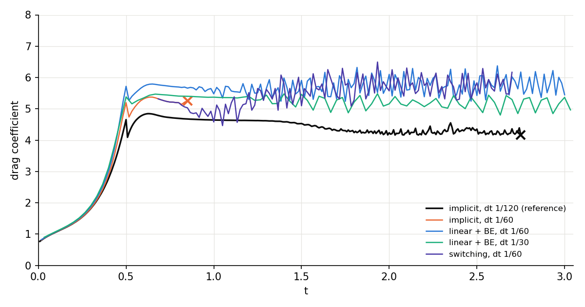
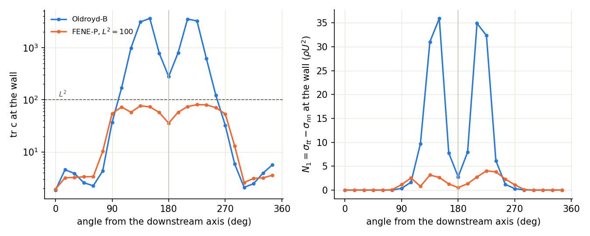

```{note}
Migrated from the wiki page [Viscoelastic-stretch-at-large-steps](https://github.com/underworldcode/underworld3/wiki/Viscoelastic-stretch-at-large-steps) on 2026-10-27 as this topic page's starting text (written 2026-10-16 to 2026-10-18). The dated entries at the foot are the record; this text is trimmed as its content moves into guides, subsystem pages and entries.
```


What happens to an upper-convected viscoelastic step when the timestep is large at a wall, what we measured, what we tried, and what we now recommend. Topic page for the confined-cylinder work of October 2026 ([Cylinder campaign 2026](../campaigns/cylinder-campaign-2026.md)); the models themselves are on [Viscoelastic Constitutive models](../topics/viscoelastic-constitutive-models.md), the solver background on [Solvers and multigrid](../topics/solvers-and-multigrid.md). Usage: `docs/developer/subsystems/stress-transport.md`, section "The momentum's share of the stretch at a large step".

Our criterion throughout: **a large step may cost accuracy, never stability or Newton convergence.**

## The problem

The deformation step stretches the stored conformation with the velocity gradient $\mathbf{L} = \nabla\mathbf{u}$ of the step being solved for, $\mathbf{F} = \mathbf{I} + \Delta t\,\mathbf{L}$:

$$
\mathbf{c} = a\,\mathbf{F}\mathbf{c}^*\mathbf{F}^T + \text{(relaxation target)}, \qquad
\boldsymbol{\sigma}^* + \Delta t\,S(\boldsymbol{\sigma}^*) = \mathbf{F}\boldsymbol{\sigma}^*\mathbf{F}^T + G\,\Delta t^2\,\mathbf{L}\mathbf{L}^T ,
$$

with $S(\boldsymbol{\sigma}) = \mathbf{L}\boldsymbol{\sigma} + \boldsymbol{\sigma}\mathbf{L}^T + \Delta t\,(\mathbf{L}\boldsymbol{\sigma}\mathbf{L}^T + G\,\mathbf{L}\mathbf{L}^T)$ the source the momentum flux carries. It is positive-definite for any step, which is why we use it. But because it is taken with the *new* $\mathbf{L}$, its tangent puts the stored stress $\boldsymbol{\sigma}^*$ into the velocity block of the momentum Jacobian, with weight $\Delta t\,|\boldsymbol{\sigma}^*|/\eta$, and the terms $\Delta t^2\,\mathbf{L}\boldsymbol{\sigma}^*\mathbf{L}^T$ make the momentum equation quadratic in the velocity.

The case: the confined cylinder (channel 2.2 × 0.41, radius 0.05), Re 100, Wi 0.5, β 0.5, Eulerian SUPG for velocity and stress, ETD-1, upper-convected deformation step, DEVSS, resolution 40 with wall cells one eighth of the far field (two refinements, geometric full multigrid on the velocity, GMRES × 4 + SOR smoothing). At $\Delta t = 1/60$ the cylinder-cell Courant number is 8. The implicit form stalls at $t = 0.85$ (step 52): Newton creeps, the inner velocity solves hit their 200-iteration cap, and the run hangs. At $\Delta t = 1/120$ it stalls later, at $t = 2.75$.

## What the Jacobian shows

We dumped the assembled Jacobian at chosen Newton iterates (driver flag `-uw_dump_newton`) and computed the spectrum of the velocity block offline (symmetric part $\tfrac12(\mathbf{A} + \mathbf{A}^T)$, by Lanczos):

| dump | lowest eigenvalues of the symmetric part | largest | negative diagonal entries | $\lVert\mathbf{A} - \mathbf{A}^T\rVert/\lVert\mathbf{A}\rVert$ |
|---|---|---|---|---|
| step 41, iterate 1 (easy) | −0.011, −0.007, −0.006 | 1.02 | 0 | 0.12 |
| step 45, iterate 1 | −0.011, −0.008, −0.006 | 1.05 | 0 | 0.12 |
| step 50, iterate 1 (the hard step) | −0.016, −0.011, −0.011 | 1.25 | 0 | 0.12 |
| step 50, iterate 5 | −0.044, −0.028, −0.011 | 1.10 | 3 | 0.12 |
| step 50, iterate 10 | −0.100, −0.048, −0.020 | 1.07 | 4 | 0.12 |

- The symmetric part is mildly indefinite even at easy steps, and the solver copes.
- In the hard step it becomes steadily more indefinite *over the Newton iterates*, and the diagonal goes negative.
- The most negative mode lies 95 to 100 % in the first cell layer at the wall ($r/R < 1.1$).
- The non-symmetry stays at 12 % throughout: it is not what changes.

The diagonal margin (min over mean of the velocity diagonal) was 0.33 on healthy steps, 0.32 on the last converged step before a failure, and 0.04 at the first iterate of the failing step. **The breakdown develops within one step**: a check between steps gives no warning.

## What we tried

| approach | what it does | result |
|---|---|---|
| implicit (default) | whole stretch with the new $\mathbf{L}$ | accurate; stalls at $t = 0.85$ ($\Delta t = 1/60$), $t = 2.75$ ($1/120$) |
| `"tangent"` | each $\mathbf{L}\mathbf{A}\mathbf{L}^T$ by its tangent about the last step's $\mathbf{L}^n$ | matches implicit to $10^{-3}$ while it runs; at $\Delta t = 1/60$ stalls with it (step 52); at $1/120$ (Crank-Nicolson) went unstable at $t = 1.75$, where implicit ran to $2.75$ |
| `"linear"` | drops the $O(\Delta t^2 L^2)$ terms from the momentum; the stored stress keeps them | **converges at every step**, Crank-Nicolson or backward Euler, $\Delta t = 1/60$ and $1/30$, to $t = 3$ |
| `preconditioner_flux = "model"` | velocity block of the preconditioning matrix without the stretch terms (SPD for Stokes without yield) | Newton unchanged; inner iterations 22 against 7 at an easy step: at the wall the stretch is most of the operator (the viscous block's largest eigenvalue is a twelfth of the Jacobian's) |
| `strategy = "bulletproof"` | GMRES × 8 + ASM smoothing on the velocity levels | cheaper inner solves on easy steps (4 to 6 iterations); stalls at the same step |
| lagged stretch (`"split"`) | stretch with the last step's $\mathbf{L}^n$ so the momentum tangent holds no $\boldsymbol{\sigma}^*$ | **blows up in one or two steps**, in all three forms tried — see below |
| per-step switching | implicit while it converges; a failed step restored and retaken with `"linear"` | **every step converges**; see below |

## The switching policy

The stretch form can change between steps (`constitutive_model.stretch_in_momentum = ...`): every form stores the same thing, the full deformation step with the converged velocity, so a switch carries no state and costs only a kernel rebuild (cached). Each solve records its form in `solve_report.config["tangent"]`.

The policy (campaign driver flag `-uw_switch 1`):

1. Run implicit. Save the state before each implicit step (`save_state`). Bound each attempt with `solver.guard(wall_per_step=150)` and a Newton cap (6).
2. If Newton fails or the deadline fires, restore (`load_state`) and retake the step with `"linear"`.
3. After 10 linear steps, try implicit again; each failed trial doubles the wait (to 80).

On the cylinder from the step-40 restart at $\Delta t = 1/60$: implicit for steps 41 to 48; step 49 failed and was retaken; trials at steps 60, 81 and 122 were each stopped by the deadline within minutes. Every step converged through $t = 2.70$ (the run was then stopped by the campaign's hang guard during a step slowed 20-fold by a machine at load 150; that step was converging). Without the deadline the first trial ground for an hour inside a single Newton iteration: an iteration cap cannot stop that.



*Drag on the cylinder. A cross marks where a run stopped because Newton stalled. The switching run starts from the implicit run's step-40 state.*

## What a large step costs

Over $t = 0.6$ to $0.84$, while every run was still going (mean drag coefficient):

| run | $C_D$ | |
|---|---|---|
| implicit, $\Delta t = 1/120$ (reference) | 4.76 | |
| implicit, $\Delta t = 1/60$ | 5.27 | the step: +11 % |
| `"linear"`, Crank-Nicolson, $1/60$ | 5.01 | the form: −5 % against implicit at the same step |
| `"linear"`, backward Euler, $1/60$ | 5.74 | the time scheme: +14.5 % against `"linear"` Crank-Nicolson at the same step |
| `"linear"`, backward Euler, $1/30$ | 5.42 | |

The step and the time scheme cost about equally (+11 % and +14.5 %); the `"linear"` form costs least (−5 %). The error is not monotone in $\Delta t$ (backward Euler at $1/30$ is closer than at $1/60$), and the drag still alternates in sign on about half the steps with backward Euler, so part of the ringing is not the time scheme. The two forms agree to first order in $\Delta t\,|\mathbf{L}|$: in the geodynamic regime, $\Delta t\,|\mathbf{L}| \ll 1$, they are interchangeable.

## What the wall layer is

Sampled on rays normal to the cylinder at 15° intervals (driver flag `-uw_wall_report`), wall frame ($\mathbf{n}$ outward, $\mathbf{t}$ along the wall), angle measured from the downstream axis so that 180° is the front stagnation point; stresses in units of $\rho U^2$, tension positive; $\lambda = 0.05$.

| angle | $\dot\gamma$ | $\lambda\dot\gamma$ | tr c | $N_1/\lvert\sigma_{tn}\rvert$ | pressure | total $\sigma_1$ | total $\sigma_2$ |
|---|---|---|---|---|---|---|---|
| 180° (front stagnation) | 3 | 0.1 | 270 | 1200 | 2.35 | 0.35 | −2.39 |
| 165° | 281 | 14 | 780 | 264 | 2.16 | 5.6 | −2.18 |
| 150° (upstream shoulder) | 309 | 15 | 3500 | 17 | 1.81 | 33.5 | −1.81 |
| 135° | 188 | 9 | 3300 | 66 | 0.93 | 32.2 | −0.94 |
| 90° (top) | 65 | 3 | 44 | 12 | −0.38 | 0.81 | 0.37 |
| 0°–60° (downstream) | < 25 | < 1.2 | < 6 | < 3 | ≈ −0.5 | ≈ 0.6 | ≈ 0.5 |

*Oldroyd-B at step 41 (t 0.68); step 48, just before the failing step, is the same to a few per cent (tr c 3620, $N_1$ 36).*

- **It starts in extension.** Along the upstream stagnation streamline $\lambda\dot\varepsilon$ reaches 2.1, four times the value (½) above which the Oldroyd-B extensional stress is unbounded. The front face stretches the material along the wall with no shear at all (tr c 270 at the stagnation point).
- **Shear carries and amplifies it.** On the upstream shoulders the local Weissenberg number is 15 and tr c 3500: the Hookean dumbbell is stretched forty times its rest length. What accumulates is the streamwise normal stress, not the shear stress: $N_1$ is 17 to 1200 times $\sigma_{tn}$, so $\tau_{II} \approx N_1/2$.
- **It is a tension.** In total stress the shoulders carry a principal tension of 32 along the wall, 15 to 30 times the local pressure, against a mild compression normal to it. (In incompressible flow the pressure level is a gauge set at the outflow: an ambient pressure above $32\rho U^2$ would make the layer compressive.)
- **It is unresolved.** The half-width of the tension layer is 0.21 wall cells.
- **It may be an elastic instability.** The Pakdel–McKinley parameter $M = \sqrt{(\lambda U/\mathcal{R})(N_1/\sigma_{tn})}$ reaches 24 to 29 within two wall cells (Oldroyd-B, steps 41 and 48; 30 for FENE-P), above the critical values reported for curved-streamline flows (of order 5 to 10). At the sampling point nearest the wall it is 3.6 to 6.7, which is the value we first reported, wrongly, as the peak; further out it is larger still, but there the shear stress in its denominator vanishes and it means nothing. The indefinite Jacobian mode sits where the tension is largest, a prestressed, curved, unresolved sheet. Whether an instability is developing cannot be settled in 2-D on a mesh that does not resolve the layer.

## Finite extensibility does not remove it

FENE-P with $L^2 = 100$ (branch `feature/forward-from-nodes`), the same mesh, step and implicit stretch, from $t = 0$:



*Conformation trace and first normal stress difference along the wall at step 48 ($t = 0.80$), nearest sampling distance. The dashed line is $L^2$.*

The cap does what it is for: tr c on the rays stays below 90, the wall tension is nine times smaller ($N_1$ 4 against 35) and the layer twice as wide (0.62 wall cells), and the drag is 3.45 against 5.2. But the largest nodal conformation reaches the cap, tr c 99.95 at the upstream shoulder at step 48, where the FENE-P spring factor $(L^2 - d)/(L^2 - \mathrm{tr}\,c)$ diverges (54 on the record), and step 49 hangs, as the Oldroyd-B run does. Bounding the spring moves the singular behaviour from unbounded stretch to a diverging spring stiffness at the same place and the same step. The extension rate is unchanged ($\lambda\dot\varepsilon = 2.2$): the flow imposes the deformation, and at this resolution no spring can absorb it without its stiffness entering the tangent.

## For our own problems

This regime is a polymer one, outside rock deformation: elastic strains of order ten, a layer narrower than a cell. Rock stores elastic strain of order $10^{-3}$ before it yields, so the same flow in a geodynamic model is limited by yielding long before anything like this. Two consequences for how we set up viscoelastic-plastic models:

- **The yield criterion must see the full stress invariant.** The stored stress here is almost entirely streamwise normal stress; a limit on resolved shear stress would not release it. `ViscoElasticPlasticFlowModel` yields on the invariant of the effective strain rate, which includes the carried stress and the objective terms, so it should (we have not run a yielding case on the cylinder).
- **Under lithostatic pressure the layer is compressive in total stress**, and the release is deviatoric (von Mises / Drucker–Prager); a tension cut-off matters only where the total stress can actually be tensile (near-surface, or with fluid pressure).
- **Watch the conformation.** `constitutive_model.conformation_min_eigenvalue()` also returns `max`, the largest conformation eigenvalue; for a linear spring, a value much above one says the model is being used at elastic strains of order one, and the results are outside the regime it was chosen for. It reads the history's own points and is not available for the Eulerian SUPG history, where the stored tensor has to be sampled directly (as the wall report does).

## What we claim, and what we do not

- We claim: at a wall with $\Delta t\,|\boldsymbol{\sigma}^*|/\eta \sim 1$ the implicit stretch makes the velocity block indefinite and Newton stalls, whatever the preconditioner; `"linear"` converges there at every step we tried, at Courant 8 and 16; switching keeps the implicit form wherever it converges and bounds the cost of finding out where it does not.
- We do not claim: that `"linear"` is accurate at these steps (it is not, and neither is the implicit form at $\Delta t = 1/60$); that the switching thresholds are tuned; that the policy is in the library (it is in the campaign driver).

## What did not work

- **Preconditioning.** The breakdown is in the Newton problem, not the linear solver. A positive-definite preconditioning matrix without the stretch is a poor approximation of an operator that is mostly stretch; a stronger smoother (GMRES + ASM) stalls at the same step. We also briefly believed the velocity block ran on GAMG with Chebyshev/Jacobi smoothing and that GMRES + SOR would fix it — it was already on geometric multigrid with GMRES + SOR; a run printing the resolved preconditioner settled it. Check what a run resolved to, not what the defaults table says.
- **The lagged stretch ("split").** Taking the stretch with $\mathbf{L}^n$ removes $\boldsymbol{\sigma}^*$ from the tangent exactly, but at the wall $\Delta t\,|\mathbf{L}|$ is 4 to 8: the lag error is several times the stress itself, entering the momentum as a fixed force. Three variants, all from the step-40 restart at $\Delta t = 1/60$:
  - stretching the whole conformation $\mathbf{c}^*$ with $\mathbf{L}^n$ also lags the elastic loading, leaving about 85 % of the viscous response explicit: drag −108 at step 42;
  - stretching only $\boldsymbol{\sigma}^*$ (loading implicit): drag $5\times10^5$ at step 42;
  - the same without the quadratic term: drag −111 at step 42.

  Sub-steps do not help: the error is in which $\mathbf{L}$ is used, not in the step length. The option lived in commit `75a374b9` on `feature/ve-stretch-split` and was removed in `11256696`.
- **A between-step warning.** The diagonal margin of the converged Jacobian did not move before the failure (0.32); a proactive switch on it never fired. The policy is reactive.

## The code

Branch `feature/ve-stretch-split` (not yet a PR):

- `ViscoElasticPlasticFlowModel(stretch_in_momentum="implicit" | "linear" | "tangent")`, settable between steps; the form each solve ran is in its solve report. Non-default forms need the deformation step (either integrator) and are refused elsewhere; `NavierStokesSLCN` / `NavierStokesSwarm` build their flux from the history and refuse them.
- `solver.preconditioner_flux = "jacobian" | "model"` on the saddle-point solvers, with `preconditioner_flux` on the constitutive models (the flux itself by default; without the objective-rate terms for the viscoelastic model). Refused with rotated free-slip, on the semi-Lagrangian Navier-Stokes solvers, and with a smooth Jacobian surrogate; the adjoint preconditions with the transposed Jacobian. The preconditioner block is symmetric positive-definite only for Stokes without a yield stress.
- Lands after #800 (FENE-P, the same constitutive code); the review record is `docs/reviews/2026-10/ve-stretch-split-adversarial-review.md`.
- Tests: `tests/test_1075_preconditioner_flux.py`, `tests/test_1076_stretch_in_momentum_switch.py`.

Campaign driver (`uw3-campaigns/ve_cylinder_demo/ve_cylinder.py`): `-uw_stretch`, `-uw_switch` (with `-uw_switch_margin`, `-uw_switch_retry`, `-uw_switch_wall`), `-uw_pc_flux`, `-uw_strategy`, `-uw_dump_newton step:its` (Jacobian, velocity rows and dof coordinates at chosen Newton iterates); the figure is `plot_stretch_forms.py`.

## Open

- Move the switching policy into the library as an opt-in fallback beside snap-back.
- Find the remaining drag ringing under backward Euler.
- Noticed on the way: the Stokes warm-start pre-solve sets the absolute tolerance from the residual at a zero vector, before the initial guess is copied in.

## History

- 2026-10-16 — created: the Jacobian spectrum, preconditioning and smoothers, the lagged-stretch dead end, `"linear"` at Courant 8 and 16, the switching policy and the accuracy accounting.
- 2026-10-17 — the wall layer measured (extension at the stagnation point, tension on the shoulders, unresolved, not an elastic instability); FENE-P reaches its cap at the same place and step; the consequences for yielding in our own models.
- 2026-10-18 — corrected after the adversarial review: the Pakdel–McKinley M inside the layer is 24 to 30 (an elastic instability is plausible, not ruled out), the time scheme costs 14.5 % not 9 %, `"tangent"` went unstable at $1/120$, the preconditioner block is SPD only for Stokes without yield, the conformation check does not cover the Eulerian history, the yielding argument is unrun; the options now refuse where they cannot act.

<!-- BEGIN ENTRIES (generated by scripts/build_index.py; do not edit) -->

## Entries

- 2026-10-18 · [Viscoelastic stretch at large steps: corrections from the adversarial review (Pakdel-McKinley inside the layer, time-scheme cost, tangent at 1/120, SPD scope, conformation-check scope, the refusals, merge order after #800)](../entries/2026-10-18-viscoelastic-stretch-at-large-steps-corrections-from-the.md) · measurement
- 2026-10-17 · [Viscoelastic stretch at large steps: the wall layer measured (extension at the stagnation point, tension on the shoulders, unresolved), FENE-P capped at the same place and step, the consequences for yielding](../entries/2026-10-17-viscoelastic-stretch-at-large-steps-the-wall-layer-measured.md) · measurement
- 2026-10-16 · [Viscoelastic stretch at large steps: the Jacobian spectrum at the wall, preconditioning and smoothers, the lagged-stretch dead end, "linear" at Courant 8 and 16, per-step switching, the accuracy accounting; linked from Home, the cylinder campaign, solvers and constitutive models](../entries/2026-10-16-viscoelastic-stretch-at-large-steps-the-jacobian-spectrum-at.md) · dead-end
- 2026-10-16 · [Dead end: The lagged stretch ("split")](../entries/2026-10-16-dead-end-the-lagged-stretch-split.md) · dead-end
- 2026-10-16 · [Dead end: Preconditioning](../entries/2026-10-16-dead-end-preconditioning.md) · dead-end
- 2026-10-16 · [Dead end: A between-step warning](../entries/2026-10-16-dead-end-a-between-step-warning.md) · dead-end

<!-- END ENTRIES -->
